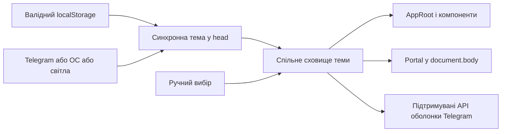

# Каркас Mini App

React 18.3, TypeScript, Vite 7, Telegram UI та TanStack Query. Каркас реалізує [T34](../docs/features/personal-trainer-mvp/tasks/T34-miniapp-skeleton.md) і перевірки [AC-58](../docs/features/personal-trainer-mvp/PRD.md). Затверджені кольори походять із [токенів Everforest](../docs/features/personal-trainer-mvp/design/theme-tokens.json); правила компонентів — із [дизайн-системи](../docs/features/personal-trainer-mvp/design-system.md).

## Локальний запуск

Потрібні Node.js 22.12+ і npm. Команди виконуються з цієї директорії.

```powershell
npm ci
npm run dev
```

Vite відкриває `http://127.0.0.1:5173`, а `/api` проксіює на `http://127.0.0.1:8888`. У режимі розробки `mockTelegramEnv` із підтримуваного `@tma.js/sdk` створює локальне середовище, якщо відсутні справжні `initData`. Mock не створює підписаної ідентичності та не пересилає виклики Telegram. У production-збірку він не потрапляє. Звичайний браузер також може відкрити оболонку без Telegram; доступ до захищеного API потребує справжніх підписаних даних.

```powershell
npm run generate:api
npm run build
```

Перша команда генерує типи всіх операцій із [контракту OpenAPI](../docs/features/personal-trainer-mvp/contracts/openapi.yaml). `openapi-fetch` використовує ці типи для клієнта, передає поточний `Authorization: tma <initData>` і підтримує `AbortSignal`. Відносний origin забезпечує спільне розміщення UI та API за [ADR-0002](../docs/features/personal-trainer-mvp/adr/0002-build-mini-app-as-react-spa-served-by-aspnet-core.md). Друга команда генерує CSS із джерела токенів, перевіряє типи та записує готову SPA у `../ConstantLearning/wwwroot`. Каталог збірки не комітиться. Оновлені Vite 7/Vitest 4 зберігають React 18 і підтримують Node.js 22.12+.

ASP.NET Core роздає SPA за `/`, повертає її також для вкладених маршрутів, а для невідомих `/api/...` зберігає 404. Справжній запуск бекенду потребує його конфігурації. Для локального smoke використовуйте ізольований host нижче.

## Тема та компоненти



Початковий пріоритет: збережений вибір → Telegram → ОС → світла. Та сама функція вибору вбудовується Vite у `head` і використовується сховищем React. Синхронний Telegram-скрипт завершується перед запуском модулів; навіть його повільне завантаження не дає React відобразити тему ОС раніше за доступну тему Telegram. Збережений фон встановлюється ще перед цим скриптом. Після ручного вибору `themeChanged` та зміна схеми ОС не перевизначають його. Недоступний `localStorage` залишає вибір у пам’яті. Поведінку визначає [ADR-0013](../docs/features/personal-trainer-mvp/adr/0013-use-everforest-with-manual-light-dark-themes.md).

Семантичні CSS-змінні задані на `documentElement`, а адаптер перекриває власні значення Telegram UI в `AppRoot`; тому native dialog через `createPortal` та компоненти kit усередині нього успадковують ту саму палітру. Шапка підтримує HEX із Telegram 6.9; версії 6.1–6.8 отримують `bg_color`, старші не викликають API кольорів. Зміна теми зберігає ввід і поточну картку та не викликає API.

Оболонка містить перемикач двох тем і розгортаний приклад спільних компонентів: картка, прогрес, поле, результат, кнопки, loading, disabled, error, empty та модальне вікно. Це демонстрація каркаса. Онбординг, навчальні екрани та серверні запити додаватимуться в окремих задачах, зазначених у [плані тестування](../docs/features/personal-trainer-mvp/test-plan.md).

## Локальні перевірки

```powershell
npm run lint
npm run typecheck
npm test
npx playwright install chromium
npm run test:visual
npm run test:visual:proof
```

Vitest перевіряє пріоритет теми, повторне відкриття, сховище, події Telegram, версії API оболонки, контраст без округлення, збереження відповіді/картки/portal і відсутність мережевої мутації при перемиканні. Playwright перевіряє застосування теми у `head` без React, перший рендер, portal, фокус, disabled, error та повторне відкриття. Еталони зберігаються в `tests/visual/theme.spec.ts-snapshots/`; їх слід переглядати та свідомо оновлювати командою `npm run test:visual:update`. Поточні еталони створені Chromium на Windows; інша ОС потребує окремо переглянутих еталонів.

`test:visual:proof` тимчасово змінює розмір заголовка в CSS, вимагає падіння саме на порівнянні знімків, зберігає червоний звіт і diff у `artifacts/visual-proof-red/`, відновлює CSS у `finally` та запускає зелений прогін. Перевірки запускаються локально; frontend/E2E CI до цього каркаса не входить.

## Ізольована перевірка справжнього бекенду

Потрібні .NET 10 та Docker. Host запускає ефемерний PostgreSQL 16 із випадковим паролем і портом та справжній `ConstantLearning.Program` через Kestrel. Він примусово задає середовище `Testing`, синтетичний токен і тестове підключення; видаляє лише hosted services Webhook та Quartz, які можуть виконувати зовнішні відправлення. Ініціалізація БД і міграції залишаються справжніми. Ця конфігурація існує лише в локальному інструменті.

```powershell
npm run build
dotnet run --project tools/backend-smoke/BackendSmoke.csproj
```

Host перевіряє `/`, вкладений SPA-маршрут, JS-ресурс і 404 невідомого API, потім друкує `MINIAPP_BASE_URL`. Поки він працює, в іншому терміналі:

```powershell
$env:MINIAPP_BASE_URL = "http://localhost:PORT"
npm run test:visual
Remove-Item Env:MINIAPP_BASE_URL
```

Натисніть Enter у терміналі host для завершення й видалення контейнера. Параметр `--once` завершує його відразу після HTTP smoke. Реальний клієнт Telegram і допоміжні технології доступності цими локальними тестами не перевіряються.
