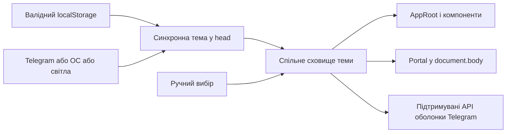

# Каркас Mini App

React 18.3, TypeScript, Vite 7, Telegram UI та TanStack Query. Каркас реалізує [T34](../docs/features/personal-trainer-mvp/tasks/T34-miniapp-skeleton.md) і перевірки [AC-58](../docs/features/personal-trainer-mvp/PRD.md); потік онбордингу — [T35](../docs/features/personal-trainer-mvp/tasks/T35-ui-onboarding.md). Затверджені кольори походять із [токенів Everforest](../docs/features/personal-trainer-mvp/design/theme-tokens.json); правила компонентів — із [дизайн-системи](../docs/features/personal-trainer-mvp/design-system.md).

## Локальний запуск

Потрібні Node.js 22.12+ і npm. Команди виконуються з цієї директорії.

```powershell
npm ci
npm run dev
```

Vite відкриває `http://127.0.0.1:5173`, а `/api` проксіює на `http://127.0.0.1:8888`. У режимі розробки `mockTelegramEnv` із підтримуваного `@tma.js/sdk` створює локальне середовище, якщо відсутні справжні `initData`. Mock не створює підписаної ідентичності та не пересилає виклики Telegram. У production-збірку він не потрапляє. Звичайний браузер також може відкрити оболонку без Telegram; доступ до захищеного API потребує справжніх підписаних даних.

```powershell
npm run generate:api
npm run build
```

Перша команда генерує типи всіх операцій із [контракту OpenAPI](../docs/features/personal-trainer-mvp/contracts/openapi.yaml). `openapi-fetch` використовує ці типи для клієнта, передає поточний `Authorization: tma <initData>` і підтримує `AbortSignal`. Відносний origin забезпечує спільне розміщення UI та API за [ADR-0002](../docs/features/personal-trainer-mvp/adr/0002-build-mini-app-as-react-spa-served-by-aspnet-core.md). Друга команда генерує CSS із джерела токенів, перевіряє типи та записує готову SPA у `../ConstantLearning/wwwroot`. Каталог збірки не комітиться. Оновлені Vite 7/Vitest 4 зберігають React 18 і підтримують Node.js 22.12+.

ASP.NET Core роздає SPA за `/`, повертає її також для вкладених маршрутів, а для невідомих `/api/...` зберігає 404. Справжній запуск бекенду потребує його конфігурації. Для локального smoke використовуйте ізольований host нижче.

## Тема та компоненти



Початковий пріоритет: збережений вибір → Telegram → ОС → світла. Та сама функція вибору вбудовується Vite у `head` і використовується сховищем React. Синхронний Telegram-скрипт завершується перед запуском модулів; навіть його повільне завантаження не дає React відобразити тему ОС раніше за доступну тему Telegram. Збережений фон встановлюється ще перед цим скриптом. Після ручного вибору `themeChanged` та зміна схеми ОС не перевизначають його. Недоступний `localStorage` залишає вибір у пам’яті. Поведінку визначає [ADR-0013](../docs/features/personal-trainer-mvp/adr/0013-use-everforest-with-manual-light-dark-themes.md).

Семантичні CSS-змінні задані на `documentElement`, а адаптер перекриває власні значення Telegram UI в `AppRoot`; тому native dialog через `createPortal` та компоненти kit усередині нього успадковують ту саму палітру. Шапка підтримує HEX із Telegram 6.9; версії 6.1–6.8 отримують `bg_color`, старші не викликають API кольорів. Зміна теми зберігає ввід і поточну картку та не викликає API.

Окремий маршрут `/dev/components` містить перемикач двох тем і розгортаний приклад спільних компонентів: картка, прогрес, поле, результат, кнопки, loading, disabled, error, empty та модальне вікно. Це локальна демонстрація каркаса, яка не читає профіль і не викликає API. Кореневий маршрут відкриває потік онбордингу нижче; навчальний екран заплановано в [T36](../docs/features/personal-trainer-mvp/tasks/T36-ui-today.md).

## Онбординг і контакт власника

Перед показом форми `GET /api/v1/learners/me` перевіряє профіль. Лише точна відповідь `404` із `learner.not_onboarded` відкриває онбординг. Наявний профіль або успішна відповідь `200`/`201` після завершення викликають `onNavigateToToday(learner)` і замінюють адресу на `/today`. Екран [T36](../docs/features/personal-trainer-mvp/tasks/T36-ui-today.md) показує актуальний навчальний прогрес і доступні дії. Помилка `401` просить знову відкрити Mini App через Telegram і не запускає автоматичних повторів.

Форма має ліміти 3/5/10, автоматичний пояс пристрою, ручний вибір із підтвердженням і необов’язкове нагадування. Нагадування потребує вибраного поясу, часу й хоча б одного дня; його можна пропустити. Невизначений пояс без нагадування передається як `null`, щоб сервер застосував Варшаву. Повторний POST приймає наявні налаштування із сервера; форма не намагається змінити їх. Під час збереження поля й завершення недоступні, повторне надсилання блокується синхронно. Тимчасова помилка залишає введені значення на екрані.

Повідомлення про Telegram-ідентифікатор, налаштування, навчальну історію, видалення протягом 7 календарних днів і резервні копії до 14 днів стоїть перед формою. Власник проєкту 2026-11-01 погодив публічний контакт [melnichenkoviatcheslav@gmail.com](mailto:melnichenkoviatcheslav@gmail.com); він використовується за відсутності перевизначення. Змінна `VITE_PRIVACY_CONTACT_URL` перевизначає його **під час збірки**; приймаються валідні `mailto:` або `https:` посилання. Порожнє чи невалідне перевизначення залишає завершення онбордингу недоступним. Для локальної конфігурації скопіюйте `.env.example` у `.env.local`; для зміни вже зібраної SPA потрібна нова збірка. Вимогу визначено в [PRD](../docs/features/personal-trainer-mvp/PRD.md).

Компонентні та візуальні перевірки використовують явно синтетичний контакт `privacy@example.test`. Playwright задає його лише дочірньому Vite-серверу через тестову конфігурацію; звичайні `npm run dev` та `npm run build` цього значення не отримують. Еталони онбордингу містяться в `tests/visual/onboarding.spec.ts-snapshots/`.

## Налаштування

Екран [T41](../docs/features/personal-trainer-mvp/tasks/T41-ui-settings.md) відкривається за `/settings` окремим лінивим чанком. На екрані «Сьогодні» є кнопка переходу до нього й назад. Спільна перевірка профілю зберігає прямий маршрут `/settings`, не запускає повторів після `401`, а після `404 learner.not_onboarded` пропонує явний перехід до початку.

Чинний денний ліміт і вже відкладена зміна показуються окремо. Початково обрано відкладений ліміт, якщо він є. `PATCH /api/v1/learners/me/settings` передає лише змінені серверні поля, тому зміна нагадування чи поясу не скасовує запланованого темпу. Новий ліміт діє з наступної навчальної доби; повторний вибір чинного ліміту скасовує відкладену зміну. Після збереження екран показує чинні й відкладені значення з відповіді сервера за [контрактом](../docs/features/personal-trainer-mvp/contracts/openapi.yaml).

Новий пояс потребує ручного підтвердження; нагадування — підтвердженого поясу, часу й хоча б одного дня. Вимкнення передає `reminder: null`. Під час запиту поля заблоковані, а синхронний захист не допускає подвійного PATCH. Помилки полів, мережі та тимчасова недоступність сервера зберігають ввід; повтор виконується лише за дією користувача.

Перемикачі «Світла» й «Темна» використовують спільний провайдер також усередині portal-діалогу. Вони не входять у серверну форму, не роблять її зміненою і не надсилають PATCH. Ручний вибір переважає `themeChanged`; зміни форми та кеш заняття залишаються на місці. Перевірки [AC-27, AC-44, AC-45 і AC-58](../docs/features/personal-trainer-mvp/PRD.md) містяться в `tests/settings.test.tsx`, а еталони обох тем, помилок, pending і portal — у `tests/visual/settings.spec.ts-snapshots/`.

## Сьогодні

Екран [T36](../docs/features/personal-trainer-mvp/tasks/T36-ui-today.md) замінює вступну заглушку на `/today`. Типізований `getToday` показує серверні кількості слів до повторення, пригаданих слів і завершених занять за поточну та шість попередніх календарних дат за [AC-28](../docs/features/personal-trainer-mvp/PRD.md). Клієнт не перераховує їх за годинником пристрою. Нуль повторень не означає відсутність нових слів чи вичерпання ліміту; остаточний склад заняття визначає сервер. Завершений курс продовжує повторення. Серверне `course_replenished_notice` показується один раз для отриманої відповіді, включно з поверненням до кешованого екрана.

Якщо валідний пояс пристрою відрізняється від профілю, екран пропонує підтвердити його або залишити збережений. Без натискання підтвердження PATCH не виконується. Після підтвердження використовується спільний `updateSettings` лише з `time_zone`; чинний і відкладений ліміти та нагадування не додаються до запиту. Після успіху оновлюється кеш профілю й перечитуються профіль і день. Невідомий IANA-пояс і помилки мають пояснення, тимчасова помилка дозволяє явний повтор. Правило визначено в [PRD §5](../docs/features/personal-trainer-mvp/PRD.md#5-acceptance-criteria).

`has_active_session` визначає підпис головної кнопки. З підключеним `onOpenSession(session: SessionResponse)` компонент викликає `POST /api/v1/sessions` для початку або `GET /api/v1/sessions/current` для продовження й передає справжню відповідь обробнику. Синхронний захист блокує повторні натискання. Повідомлення про вичерпання ліміту й завершення курсу беруться тільки із серверних notices за [AC-06](../docs/features/personal-trainer-mvp/PRD.md) та [AC-10](../docs/features/personal-trainer-mvp/PRD.md). `session.not_found` перечитує день, не створюючи нову сесію автоматично. `401` припиняє подальші дії та просить повторно відкрити Telegram; `learner.not_onboarded` дає перехід до початку. Прогрес і деталі запитів не записуються у сховище чи журнали браузера.

Підключення маршруту й карток заняття залишається [T37](../docs/features/personal-trainer-mvp/tasks/T37-ui-session-shell.md). `App` уже передає необов’язковий `onOpenSession` до екрана. До підключення обробника натискання показує коротке повідомлення про недоступність; запит сесії не виконується. Це дозволяє додати маршрут без зміни API прогресу чи створення покинутих занять.

`today_ready_ms` вимірюється через `performance.now()` від `performance.timeOrigin` документа: враховує завантаження SDK, React, профілю й даних дня. Подія надсилається після рендера готового екрана в `requestAnimationFrame`, включно зі станом без доступного заняття, один раз на відкриття документа. `StrictMode`, зміна теми, refetch і повернення з інших екранів не дублюють її. Тіло містить лише `metric` і ціле `value_ms`; ідентичність надходить звичайним захищеним заголовком API. Немає автоматичних повторів або логування payload. Значення поза `0..60000` пропускаються без обрізання відповідно до [контракту телеметрії](../docs/features/personal-trainer-mvp/contracts/openapi.yaml).

Перевірки містяться в `tests/today.test.tsx`; еталони прогресу, активного заняття, завершеного курсу, loading, error і підтвердження поясу обох тем — у `tests/visual/today.spec.ts-snapshots/`. Візуальні сценарії також перевіряють клавіатуру, ширину 320 px, одноразову подію та повернення з налаштувань. SVG SMIL індикатора зупиняється лише на час знімка, бо Playwright не вимикає її параметром CSS-анімацій.

## Словник

Екран [T39](../docs/features/personal-trainer-mvp/tasks/T39-ui-dictionary.md) відкривається кнопкою «Словник» на вступі «Сьогодні» або прямо за `/dictionary`. Спільна перевірка профілю зберігає цей маршрут; незавершений онбординг пропонує перехід до початку, а `401` просить знову відкрити тренер у Telegram. Екран і стилі завантажуються окремим лінивим чанком.

Кожна зміна непорожнього запиту одразу викликає типізований `searchDictionary` без debounce. Порожнє поле або лише пробіли не викликають API. Новий запит, очистка та вихід скасовують попередній `AbortSignal`; додаткова перевірка актуальності не дозволяє пізній відповіді чи помилці замінити поточний стан навіть за транспорту, який ігнорує скасування. Текст передається без локального перетворення, тому правила діакритики, однолітерного точного збігу та порядку визначає [серверний контракт](../docs/features/personal-trainer-mvp/contracts/openapi.yaml).

Результати зберігають серверний порядок, показують нормативну лему, частину мови, коротке значення, знайдену форму й особистий статус. Сторінки використовують `after`/`before`; зміна запиту скидає курсор. `getDictionaryEntry` завантажує картку з усіма перекладами, родом, вимовою та прикладом. Перегляд виконує лише GET і зберігає запит та сторінку при поверненні. Недоступний після зняття публікації запис показує пояснення й дію оновлення пошуку. Тимчасові помилки зберігають ввід, повтор виконується за дією користувача.

Порожній результат показує «Не знайшли слово». Дія повідомлення відкриває форму [T40](../docs/features/personal-trainer-mvp/tasks/T40-ui-content-report.md) з точним вихідним запитом. Необов’язковий `onReportMissing({ origin: 'missing_word', search_query: rawQuery })` сповіщає зовнішній код про відкриття; саму форму Mini App підключає завжди.

Компонентні перевірки [AC-30 і AC-31](../docs/features/personal-trainer-mvp/PRD.md) містяться в `tests/dictionary.test.tsx`; світлі й темні еталони початкового стану, результатів, картки, loading, error та порожнього результату — в `tests/visual/dictionary.spec.ts-snapshots/`. Візуальний сценарій також перевіряє клавіатуру, повернення фокуса, пряме повторне відкриття маршруту та відсутність горизонтального переповнення.

## Повідомлення про словник

Форма [T40](../docs/features/personal-trainer-mvp/tasks/T40-ui-content-report.md) завантажується окремим лінивим чанком лише після натискання «Повідомити про неточність» у картці або «Повідомити про відсутній запис» у порожньому результаті. Нативний portal-діалог залишає словник змонтованим: запит, сторінка результатів і картка зберігаються. Фокус переходить до заголовка, а після закриття повертається до кнопки відкриття. Діалог прокручується у вузькому WebView; кнопка закриття залишається доступною вгорі.

Для картки потрібно обрати поле: польське слово, переклад, транскрипцію або приклад. Запропоноване значення й коментар необов’язкові; для відсутнього слова поле та `entry_id` дорівнюють `null`, а `search_query` зберігає точний вихідний текст. Межі — 500, 1000 і 200 Unicode code points відповідно, як у серверній реалізації [T23](../docs/features/personal-trainer-mvp/tasks/T23-content-report-api.md). Лічильники та перевірки не обрізають emoji за довжиною UTF-16. Нульові символи відхиляються; значення й коментар передаються та відображаються як звичайний текст.

Типізований `createContentReport` виконує POST за [контрактом](../docs/features/personal-trainer-mvp/contracts/openapi.yaml). Тільки відповідь `202` із серверним ID та статусом прийняття відкриває «Дякуємо, передали на перевірку». Надсилання не змінює картку, прогрес і кеш заняття. Підтвердження змін і вибір між автоматичною звіркою та редакторською чергою належать серверу.

Синхронний захист допускає один запит одночасно; під час очікування поля, повторне надсилання, закриття й Escape заблоковані. Автоматичних повторів POST немає. Помилки `400`, `401`, `404`, `429`, мережі й сервера зберігають введення. `429` пояснює межу 20 повідомлень та можливість надсилати нові після 00:00 за часом learner. Після `401` чи `404` подальше надсилання блокується, а повернення до словника залишається доступним.

«Назад», закриття й повторне відкриття того самого повідомлення зберігають чернетку в пам’яті. Інший запис або інший пошуковий запит відкриває нову чернетку; вихід із маршруту чи перезавантаження її скидає. Після успіху повторне відкриття дозволяє знову надіслати ті самі значення: клієнт не вигадує ID чи ключ дедуплікації, а приймає серверний `202` для наявного report за [AC-51](../docs/features/personal-trainer-mvp/PRD.md#ac-51---domain-invariant).

Компонентні перевірки [AC-34, AC-36, AC-46 і AC-51](../docs/features/personal-trainer-mvp/PRD.md) містяться в `tests/content-report.test.tsx`; світлі й темні еталони форми, ліміту, очікування, прийняття та відсутнього слова — у `tests/visual/content-report.spec.ts-snapshots/`. Сценарії також перевіряють повернення фокуса, незмінність картки й чернетки, повторне серверне прийняття та ширину 320 px.

## Локальні перевірки

```powershell
npm run lint
npm run typecheck
npm test
npx playwright install chromium
npm run test:visual
npm run test:visual:proof
```

Vitest перевіряє пріоритет теми, повторне відкриття, сховище, події Telegram, версії API оболонки, контраст без округлення, збереження відповіді/картки/portal і відсутність мережевої мутації при перемиканні. Playwright перевіряє застосування теми у `head` без React, перший рендер, portal, фокус, disabled, error та повторне відкриття. Еталони зберігаються в `tests/visual/theme.spec.ts-snapshots/`; їх слід переглядати та свідомо оновлювати командою `npm run test:visual:update`. Поточні еталони створені Chromium на Windows; інша ОС потребує окремо переглянутих еталонів.

`test:visual:proof` тимчасово змінює розмір заголовка в CSS, вимагає падіння саме на порівнянні знімків, зберігає червоний звіт і diff у `artifacts/visual-proof-red/`, відновлює CSS у `finally` та запускає зелений прогін. Перевірки запускаються локально; frontend/E2E CI до цього каркаса не входить.

## Ізольована перевірка справжнього бекенду

Потрібні .NET 10 та Docker. Host запускає ефемерний PostgreSQL 16 із випадковим паролем і портом та справжній `ConstantLearning.Program` через Kestrel. Він примусово задає середовище `Testing`, синтетичний токен і тестове підключення; видаляє лише hosted services Webhook та Quartz, які можуть виконувати зовнішні відправлення. Ініціалізація БД і міграції залишаються справжніми. Ця конфігурація існує лише в локальному інструменті.

```powershell
npm run build
dotnet run --project tools/backend-smoke/BackendSmoke.csproj
```

Host перевіряє `/`, вкладений SPA-маршрут, JS-ресурс і 404 невідомого API, потім друкує `MINIAPP_BASE_URL`. Поки він працює, в іншому терміналі:

```powershell
$env:MINIAPP_BASE_URL = "http://localhost:PORT"
npx playwright test theme.spec.ts
Remove-Item Env:MINIAPP_BASE_URL
```

Ця перевірка застосовує еталони спільних компонентів через `/dev/components`; еталони онбордингу запускаються окремо на керованому Vite-сервері із синтетичним контактом командою `npm run test:visual`. Натисніть Enter у терміналі host для завершення й видалення контейнера. Параметр `--once` завершує його відразу після HTTP smoke. Реальний клієнт Telegram і допоміжні технології доступності цими локальними тестами не перевіряються.
