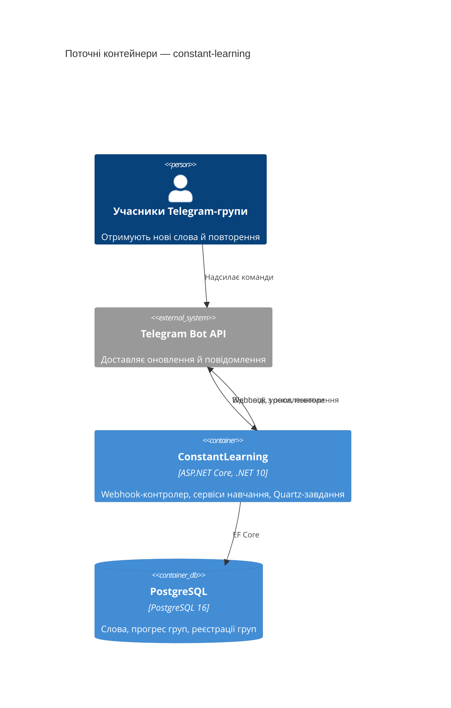

# Architecture map — constant-learning

> Поточна архітектура (те, що існує зараз), згенерована `map-architecture`. Її читають
> write-prd, architecture-design, generate-data-model та implement-tasks. Оновлюйте через
> `/sdlc:map-architecture`, коли репозиторій відійде від `reflects_commit`. Шляхи в посиланнях
> `file:line` відносні до `ConstantLearning/`, якщо не вказано інше.

## Stack

- Мова й рантайм: C# на .NET 10 (`net10.0`), nullable та implicit usings увімкнено — `ConstantLearning.csproj:3-8`.
- Фреймворки: ASP.NET Core (Web SDK) з контролерами; EF Core 10.0.2 + Npgsql 10.0.0; Telegram.Bot 22.8.1; Quartz 3.15.1 з hosted service — `ConstantLearning.csproj:12-21`.
- Тести: xUnit 2.9.3, Moq 4.20.72, FluentAssertions 7.2.0, EF Core InMemory 10.0.2 — `../ConstantLearning.Tests/ConstantLearning.Tests.csproj`.
- Команди збирання й тестів (з CI, `../.github/workflows/ci-cd.yml:31,34`):
  - `dotnet build ConstantLearning.slnx --configuration Release`
  - `dotnet test ConstantLearning.Tests/ConstantLearning.Tests.csproj --no-build --configuration Release`
- Лінтера чи окремого статичного аналізу в репозиторії немає.

## C4 — system as it is

## Module inventory

Застосунок — один процес без поділу на модулі за фічами; шари розкладені за технічними папками.

| Module | Path | Layers | Wired at | Responsibility |
|---|---|---|---|---|
| Webhook API | `Controllers/` | вхідний порт | `Program.cs:88` (`MapControllers`) | Приймає оновлення Telegram і віддає health — `Controllers/TelegramController.cs:8,14,29` |
| Бот-команди | `Services/TelegramBotService.cs` | застосунковий | `Program.cs:41` | Розбір тексту команди й виклик обробника — `Services/TelegramBotService.cs:46-94` |
| Сервіси навчання | `Services/` | застосунковий + доступ до даних | `Program.cs:43-49` | Реєстрація групи, вибір слів, прогрес, форматування, шаблони, локалізовані повідомлення |
| Заплановані завдання | `Jobs/` | застосунковий | `Program.cs:51-71` | Щохвилинна перевірка розкладу кожної групи й надсилання уроків — `Jobs/NewWordsJob.cs`, `Jobs/RepetitionJob.cs` |
| Ініціалізація | `HostedServices/` | інфраструктура | `Program.cs:73-74` | Міграції й імпорт CSV на старті; реєстрація та видалення webhook |
| Дані | `Data/`, `Migrations/` | інфраструктура | `Program.cs:31` | `AppDbContext`, сутності, EF-міграції |
| Конфігурація | `Configuration/` | крос-функціональний | `Program.cs:19-23` | Типізовані options: Telegram, Learning, WordsImport, Language |
| Ресурси | `Resources/` | контент | `Program.cs:25` | Тексти бота (`uk`, `en`), HTML-шаблони повідомлень, CSV-словник |

## Conventions (cited — the rules a new feature must match)

- **Реєстрація залежностей:** усе зареєстровано централізовано в `Program.cs`; інтерфейс і реалізація в одному файлі; сервіси зі станом БД — `Scoped`, без стану — `Singleton` — `Program.cs:40-49`, `Services/WordService.cs:7-16`.
- **Конструктори:** primary constructors для сервісів, контролерів і завдань — `Services/WordService.cs:16`.
- **Options:** `Configure<T>(GetSection(T.SectionName))`, споживачі отримують `IOptions<T>` — `Program.cs:19-23`, `Configuration/LearningOptions.cs`.
- **Обробка помилок:** кожен обробник команди має власний `try/catch`, логує структурований шаблон з `{ChatId}` і надсилає локалізоване повідомлення про помилку — `Services/TelegramBotService.cs:134`. Завдання ізолюють кожну групу окремим `try/catch` — `Jobs/NewWordsJob.cs`.
- **Scope у фонових потоках:** обробники й завдання створюють scope через `IServiceProvider.CreateScope()` — `Services/TelegramBotService.cs:115`.
- **Локалізація повідомлень:** ключі — імена `BotMessageKey`, тексти — у `Resources/BotMessages.json` за кодом мови (`uk` у рядку 2, `en` у рядку 37), мова береться з `Language:SourceLanguageCode` — `Services/BotMessagesService.cs:25`, `Enums/BotMessageKey.cs`.
- **IDs:** `int` identity для сутностей БД — `Migrations/20260130060918_Init.cs:20`; Telegram-група ідентифікується `long ChatId` — `Data/Entities/ChatRegistration.cs:6`. Ідентифікатора користувача немає.
- **Persistence:** EF Core через `AppDbContext`, конфігурація моделі у `OnModelCreating` — `Data/AppDbContext.cs:19-38`. Час зберігається в UTC — `Data/Entities/LearnedWord.cs`.
- **Migrations:** EF Core Migrations, назви `yyyyMMddHHmmss_Name.cs` + `.Designer.cs` + snapshot; застосовуються автоматично на старті — `Migrations/20260201161043_AddWordsCountToChat.cs`, `HostedServices/DatabaseInitializationService.cs:21`.
- **Tests:** xUnit `[Fact]`, Moq, FluentAssertions, AAA-коментарі українською, InMemory-БД з унікальною назвою на тест — `../ConstantLearning.Tests/Services/ChatRegistrationServiceTests.cs:20`. Тести є лише для сервісів; завдань, контролера, `WordService` і `WordImportService` тести не покривають.
- **Inter-module communication:** прямі виклики через DI-інтерфейси; подій і черг немає — `Jobs/NewWordsJob.cs:99-113`.
- **Розклад:** Quartz cron `0 * * * * ?` (щохвилини) для обох завдань; група отримує повідомлення, коли `DateTime.Now` збігається з її `HH:mm` — `Program.cs:60,68`, `Jobs/NewWordsJob.cs:39-41`.

## Datastores

| Store | Engine | Accessed via | Notes |
|---|---|---|---|
| Основна БД | PostgreSQL 16 (docker-compose), Npgsql | `AppDbContext` (EF Core) | `Words` (індекс на `FrequencyRank`), `LearnedWords` (унікальний `(ChatId, WordId)`, каскадне видалення з `Words`), `ChatRegistrations` (унікальний `ChatId`) — `Data/AppDbContext.cs:19,28,32,38` |
| CSV-словник | файли `*.csv` | `WordImportService` | Імпортується лише коли таблиця `Words` порожня; розбір через `Split(',')` без підтримки лапок — `Services/WordImportService.cs:33,95` |

## Frontend / UI foundation

<!-- N/A: frontend немає. Єдиний «інтерфейс» — Telegram-повідомлення з HTML-шаблонів у Resources/Templates/ (NewWords.html, RepetitionAnswers.html). Telegram Mini App із PRD personal-trainer-mvp буде першим фронтендом, тож дизайн-систему й стек UI обирає architecture-design. -->

## Where things live / closest precedents

- Нова бот-команда → гілка в `TelegramBotService.HandleUpdateAsync` + метод `Handle…Command` + ключі `BotMessageKey` і тексти в `BotMessages.json`; зразок — `/getalllearned` (`Services/TelegramBotService.cs:87,363`, `Services/WordService.cs:54`).
- Нове заплановане повідомлення → Quartz-завдання в `Jobs/` + реєстрація в `Program.cs`; зразок — `NewWordsJob` (`Jobs/NewWordsJob.cs:10`, `Program.cs:62-68`).
- Нове налаштування групи → колонка в `ChatRegistration` + EF-міграція + метод `Update…Async` у `ChatRegistrationService`; зразок — `/setwordscount` (`Services/TelegramBotService.cs:285`, `Services/ChatRegistrationService.cs:111`, `Migrations/20260201161043_AddWordsCountToChat.cs`).

## Constraints & known tech-debt

- **Модель прив'язана до групи.** Ключі всюди — `ChatId`: унікальні `ChatRegistrations.ChatId` і `LearnedWords(ChatId, WordId)`; обробник не читає автора повідомлення — `Data/AppDbContext.cs:28,38`. Персональному тренеру потрібен окремий ідентифікатор learner і нова модель прогресу.
- **Розклад у локальному часі контейнера.** Завдання порівнюють `DateTime.Now` з `HH:mm` групи; часового поясу не задано — `Jobs/NewWordsJob.cs:39-41`. Нагадування за поясом learner потребують іншого підходу.
- **Немає захисту від повторного надсилання.** Розклад — точний збіг хвилини без обліку вже надісланого; сховище Quartz — у пам'яті, тож кілька реплік надсилали б дублікати. Зараз `replicas: 1` — `../k8s/base/deployment.yaml:8`.
- **Повторення блокує завдання.** `RepetitionJob` чекає `AnswerDelaySeconds` всередині виконання — `Jobs/RepetitionJob.cs:109`.
- **Імпорт словника одноразовий.** Зміни CSV після першого імпорту ігноруються, розбір не підтримує коми в лапках — `Services/WordImportService.cs:33,95`. Редакторський словник із версіями ([PRD §1](features/personal-trainer-mvp/PRD.md#1-context)) потребує іншого механізму.
- **Webhook видаляється на кожній зупинці** — `HostedServices/WebhookConfigurationService.cs:54`; під час rolling deploy бот може лишитися без webhook.
- **Розбіжності k8s-маніфестів із кодом:** probes звертаються до `/health`, а маршрут — `api/telegram/health` (`../k8s/base/deployment.yaml:34,40`, `Controllers/TelegramController.cs:8,29`); overlay задає `CONNECTION_STRING`, а застосунок читає `ConnectionStrings:DefaultConnection` (`../k8s/overlays/staging/patch-env.yaml:13`, `Program.cs:27`).
- **CI лише збирає й публікує образ**, розгортання не виконує — `../.github/workflows/ci-cd.yml`.
- **Design-time фабрика має захардкоджений локальний рядок підключення** — `Data/AppDbContextFactory.cs:12`.

## Reconciliation with the authored architecture doc

Окремого авторського архітектурного документа немає. `README.md` описує ту саму схему (Telegram → webhook → сервіси → PostgreSQL, Quartz-завдання) і з картою узгоджений; `AGENTS.md` задає лише мовні правила документації. Ця карта — поточна архітектурна довідка.
