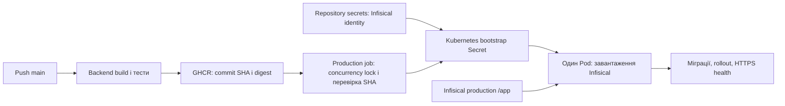

# Автоматичний production-деплой

Репозиторій `HeliosPersonal/constant-learning`, середовище GitHub `production`, namespace Helios `apps-production`. [Workflow](../.github/workflows/ci-cd.yml) після backend-тестів публікує GHCR-образ за commit SHA й розгортає його точний digest. Frontend і E2E перевіряються лише локально за [інструкцією Mini App](../ConstantLearning.MiniApp/README.md).

Конфігурація відповідає схемі WiseWizard: **Repository secrets → bootstrap credentials у Kubernetes → Infisical SDK у застосунку**. Прикладні секрети завантажуються під час старту; GitHub не передає рядок підключення або токен Telegram у Pod.



## GitHub: Repository secrets

У Settings → Secrets and variables → Actions → **Repository secrets** потрібні:

| Назва | Значення |
|---|---|
| `INFISICAL_CLIENT_ID` | Client ID machine identity з Universal Auth для проєкту constant-learning. |
| `INFISICAL_CLIENT_SECRET` | Client secret цієї identity. |
| `INFISICAL_PROJECT_ID` | Project ID constant-learning у Infisical. |
| `GHCR_PULL_USERNAME` | GitHub login облікового запису з доступом до package `ghcr.io/heliospersonal/constant-learning`. |
| `GHCR_PULL_TOKEN` | Довготривалий credential із `read:packages`; потрібна ротація. Короткотривалий `GITHUB_TOKEN`, який використовує WiseWizard для pull Secret, після завершення job не гарантує pull на новому вузлі або після очищення кешу. |
| `KUBECONFIG` | Необов’язковий base64 kubeconfig Helios. Якщо відсутній, використовується наявний `~/.kube/config` runner, як у WiseWizard. |

`GITHUB_TOKEN` для публікації образу GitHub надає автоматично. `ARM_*`, `PG_PASSWORD`, `DOCKERHUB_*`, прикладні `CONNECTIONSTRINGS__*`, `TELEGRAM__*` у Repository secrets цей workflow не читає. БД і роль потрібно підготувати окремо: Terraform із цього pipeline не запускається. `INFISICAL_*` залишаються в Repository secrets; перенесення до Environment secrets не потрібне.

## Infisical: прикладна конфігурація

Як у WiseWizard: site `https://eu.infisical.com`, environment slug **`production`**, path **`/app`** у проєкті constant-learning. Machine identity повинна мати read-доступ до цього середовища й шляху. Перевірити фактичний slug, назва для відображення може відрізнятися.

| Ключ у Infisical | Значення |
|---|---|
| `CONNECTIONSTRINGS__CONSTANT_LEARNING` | Рядок Npgsql для БД constant-learning: `Host=…;Port=5432;Database=…;Username=…;Password=…`. |
| `TELEGRAM__BOTTOKEN` | Токен production-бота. |
| `TELEGRAM__SECRETTOKEN` | Окремий випадковий webhook secret: 1–256 символів `A-Z`, `a-z`, `0-9`, `_`, `-`. |
| `TELEGRAM__WEBHOOKURL` | Точно `https://PUBLIC_HOST/api/telegram/webhook`, із фактичним hostname замість `PUBLIC_HOST`. |
| `TELEGRAM__MINIAPPURL` | Точно `https://PUBLIC_HOST/`, включно з кінцевим `/`. |

`TELEGRAM__OWNERCHATID` застосунок не використовує. Ключі перетворюються з `__` на `:`; регістр не має значення. Рядок підключення `ConnectionStrings:Constant_Learning` має пріоритет; `ConnectionStrings:DefaultConnection` зберігається для локальних запусків та наявних тестових host.

[Bootstrap конфігурації](../ConstantLearning/Configuration/InfisicalConfigurationExtensions.cs) виконується до реєстрації БД і Telegram. У Kubernetes встановлено `INFISICAL_REQUIRED=true`: відсутність credentials, обов’язкових віддалених ключів або невідповідність Telegram URL до `PUBLIC_HOST` зупиняє старт. Помилка SDK приховується без server response або credentials. Локально без credentials Infisical не викликається; частково задані credentials спричиняють помилку. Секрети читаються при старті, для їх оновлення потрібен новий запуск Pod.

## Runner, hostname і доступ Kubernetes

У групі `HeliosRunners` організації дозволити репозиторій constant-learning. [Workflow](../.github/workflows/ci-cd.yml) вибирає цю групу з labels `self-hosted`, `Linux`, `X64`, як у наявного `k3s-01`; окремий runner і label `constant-learning-deploy` більше не потрібні. Потрібні Python 3.10+, kubectl із Kustomize, підтримуваний Actions runner і мережевий доступ до GitHub, Helios API та зовнішнього HTTPS. Pod повинен мати доступ до EU Infisical і Telegram.

Створити GitHub environment `production`, дозволити лише protected branch `main`. Це відмітка середовища й обмеження deployment, секрети залишаються repository-level. Для автоматичного запуску без ручного підтвердження не додавати required reviewers середовища. [PR workflow](../.github/workflows/backend-tests.yml) працює на GitHub-hosted runner, не містить посилань на secrets і не звертається до кластера. Repository secrets технічно доступні workflow цього репозиторію: зміни workflows потребують review, а PR workflows не повинні передавати secrets у виконання.

У **Repository variables** налаштувати `PUBLIC_HOST` — погоджений вільний hostname без схеми, порту та шляху. Вибрати піддомен першого рівня `devoverflow.org`, який покриває наявний wildcard-сертифікат; значення constant-learning не вигадано. Для цього hostname налаштувати Cloudflare DNS/Tunnel та BotFather. Чинний remotely managed Tunnel використовує `https://ingress-nginx-controller.ingress.svc.cluster.local:443`, Origin Server Name `devoverflow.org`, перевірку сертифіката ввімкнено. Локальний HTTP ConfigMap не описує ефективного маршруту.

[Production Ingress](../k8s/overlays/production/ingress.yaml) використовує nginx і спільний TLS Secret `cloudflare-origin`, який Terraform Overflow копіює в `apps-production`. Pipeline лише перевіряє наявність цього Secret. Namespace повинен існувати. Kubeconfig потребує get namespace, Pod і TLS Secret; get/apply Deployment, Service, Ingress і прикладних bootstrap/pull Secret. Pipeline створює тільки `constant-learning-infisical` і `constant-learning-ghcr`; старі `constant-learning-db` / `constant-learning-telegram` не використовуються й автоматично не видаляються. Спільний `infisical-creds` WiseWizard не змінюється. [Staging overlay](../k8s/overlays/staging/kustomization.yaml) — окремий шаблон без автоматичного деплою, з Infisical slug `staging`.

## Увімкнення та перевірка

Останнім кроком установити **Repository variable** `AUTOMATIC_DEPLOYMENT_ENABLED=true`. До цього deploy job пропускається. Перший запуск — окремий погоджений крок після мерджу: наступний push у main або rerun успішного push workflow поточного SHA. `workflow_dispatch` не додано.

Concurrency `constant-learning-production` із `cancel-in-progress: false` серіалізує весь деплой. [Сценарій](../tools/deployment/deploy.py) перевіряє поточний SHA main перед підготовкою та перед першою зміною кластера; annotation `constant-learning.github.io/run-number` не дозволяє старому запуску перезаписати новіший реліз навіть після force push. Секретні файли створюються лише у приватному тимчасовому каталозі, прибираються після завершення й не потрапляють до артефактів або логів.

Одна репліка, `Recreate`, порт `8888`, Service `ClusterIP`. Оновлення має вікно недоступності; startup probe дає 450 секунд на старт. Після застосування digest очікується rollout до 8 хвилин, перевіряється образ Deployment та публічний HTTPS `/api/telegram/health`: HTTP 200 і JSON `status=healthy`. Job обмежений 15 хвилинами. Помилка завершує workflow невдало; діагностика містить тільки стан Deployment/Pod без env, Secret, application logs і довільних повідомлень API.

У Actions summary збережені попередній і новий образи. Після першого запуску оператор перевіряє Mini App, `/start`, webhook і навчальний сценарій за [операційною інструкцією](features/personal-trainer-mvp/pilot-runbook.md). Health підтверджує HTTP-процес, але не повний сценарій або backup.

## Rollback

Вимкнути `AUTOMATIC_DEPLOYMENT_ENABLED`, дочекатися завершення вже запущених/очікуваних jobs, узгодити ручні операції. Зміна variable не скасовує поставлені в чергу jobs; ручний kubectl не захищений Actions concurrency. Взяти попередній digest із summary та перевірити сумісність коду, схеми БД і конфігурації Infisical. Старі образи до інтеграції Infisical потребують старих прикладних Secret і envFrom; простого set image для переходу між цими схемами недостатньо.

Для сумісного образу з підтримкою Infisical:

```bash
: "${PREVIOUS_IMAGE:?}" "${PUBLIC_HOST:?}"
kubectl -n apps-production set image deployment/constant-learning "constant-learning=${PREVIOUS_IMAGE}"
kubectl -n apps-production rollout status deployment/constant-learning --timeout=8m
curl --fail --max-time 10 "https://${PUBLIC_HOST}/api/telegram/health"
```

Образ не відкочує EF-міграції, імпорт, секрети Infisical або webhook. Не знижувати annotation номера запуску; до повторного ввімкнення виправити main. Автоматичного rollback БД немає. Блокери [T43](features/personal-trainer-mvp/tasks/T43-retire-group-code.md) / [T44](features/personal-trainer-mvp/tasks/T44-migrate-drop-group-model.md) збережено: потрібні перевірена позакластерна копія та успішне відновлення в окрему БД за [інструкцією recovery](features/personal-trainer-mvp/pilot-runbook.md#резервні-копії).

## Локальні перевірки

```bash
python -m unittest discover -s tools/deployment -p test_deploy.py -v
dotnet test ConstantLearning.Tests/ConstantLearning.Tests.csproj --configuration Release --filter FullyQualifiedName~InfisicalConfigurationTests
kubectl kustomize k8s/overlays/production
python tools/docs/check_links.py
```

Тести конфігурації використовують фіктивний loader, без викликів Infisical. Deployment-тести рендерять справжній Kustomize з фіктивними credentials; реального деплою немає. Workflow перевіряється `actionlint`, маніфести — `kubeconform`.
