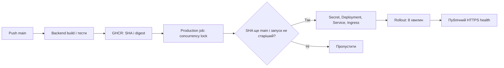

# Автоматичний production-деплой

Ціль — Helios, namespace `apps-production`, GitHub environment `production` (погоджено власником). [Workflow](../.github/workflows/ci-cd.yml) виконує backend-тести, публікує GHCR-образ із тегом повного commit SHA й передає digest у [сценарій деплою](../tools/deployment/deploy.py). Деплой використовує `image@sha256:…`; тег `latest` більше не публікується. Frontend typecheck, lint, unit і E2E запускаються лише локально за [інструкцією Mini App](../ConstantLearning.MiniApp/README.md).



## Перевірений стан і одноразова підготовка

Стан GitHub API на 2026-11-02: у `ViacheslavMelnichenko/constant-learning` немає доступних self-hosted runners, environments або variables. Є лише repository secrets `CONNECTIONSTRINGS__DEFAULTCONNECTION`, `TELEGRAM_BOT_TOKEN`, `TELEGRAM_WEBHOOK_URL`. Це перевірка назв, без читання значень. Кластер, чинну БД, DNS і зовнішній HTTPS під час підготовки PR не змінювали й не перевіряли.

У Helios є online org runner `k3s-01` у групі `HeliosRunners`, labels `self-hosted`, `Linux`, `X64`. Група належить `HeliosPersonal`; особистий репозиторій не отримує її runner автоматично. Label `helios`, зазначений в інфраструктурній документації, у фактичного runner відсутній. Наявність успішних запусків Overflow не підтверджує доступ для цього репозиторію.

До ввімкнення автоматичного деплою оператор має виконати:

1. Зареєструвати для цього репозиторію окремий runner/service на Helios із labels `self-hosted`, `Linux`, `X64`, `constant-learning-deploy`. Не перереєстровувати й не зупиняти чинний org runner. Перевірити через Settings → Actions → Runners, що runner online і доступний саме цьому репозиторію. Потрібні Python 3.10+, kubectl із Kustomize та мережевий доступ до Helios API, GitHub і публічного HTTPS застосунку. Оновити Actions runner до підтримуваної версії з runtime для `actions/checkout@v4`. Docker, Terraform і Helm deploy job не запускає.
2. Створити environment `production`; дозволити лише protected branch `main`, без PR refs і tags. Deploy-секрети зберігати тільки в цьому environment. Зберегти обов’язковий review для змін workflow й доступ до self-hosted runner лише довіреним maintainer. Якщо потрібне повністю автоматичне розгортання після CI, не вмикати ручне approval для кожного deployment.
3. Узгодити реальний публічний hostname й записати його в environment variable `PUBLIC_HOST` (без `https://`, порту та шляху). Погодженого hostname constant-learning немає; обрати вільний піддомен першого рівня `devoverflow.org`, який покриває наявний wildcard-сертифікат. За актуальною інструкцією Helios від 2026-10-28, remotely managed Cloudflare Tunnel використовує `https://ingress-nginx-controller.ingress.svc.cluster.local:443`, Origin Server Name `devoverflow.org`, перевірку сертифіката ввімкнено. Зберегти ці налаштування; локальний HTTP ConfigMap не відображає ефективного маршруту. Налаштувати DNS/публічний hostname Tunnel, HTTPS на Cloudflare й заборону зовнішнього HTTP. [Production Ingress](../k8s/overlays/production/ingress.yaml) використовує наявний TLS Secret `cloudflare-origin` у `apps-production`; його копіює Terraform Overflow з `infra-production`. До ввімкнення перевірити наявність і покриття сертифіката, не змінювати цей спільний Secret із pipeline constant-learning.
4. Підготувати прикладну БД/роль у спільному PostgreSQL Helios, перевірити правильність рядка підключення приватно. Namespace `apps-production` уже описаний Terraform Helios; workflow його не створює. Налаштувати резервування й перевірку відновлення за [операційною інструкцією](features/personal-trainer-mvp/pilot-runbook.md#резервні-копії). Не виконувати [T43](features/personal-trainer-mvp/tasks/T43-retire-group-code.md) або [T44](features/personal-trainer-mvp/tasks/T44-migrate-drop-group-model.md) без незалежної перевіреної копії та успішного restore в окрему БД.
5. Використати наявну схему Helios: Infisical як джерело → синхронізація/перенесення до environment secrets GitHub → прикладні Secret у Kubernetes. Сам застосунок Infisical SDK не використовує. Перевірити призначення й ротацію кожного секрету; наявність однойменного секрету в іншому репозиторії не дає доступу тут.

| Environment secret | Призначення |
|---|---|
| `KUBECONFIG` | Base64 kubeconfig Helios, як в інфраструктурному workflow. Доступ до `apps-production`: читання namespace, Deployment і Pod; перевірка наявності спільного TLS Secret `cloudflare-origin`; apply/get Deployment, Service, Ingress і трьох прикладних Secret. Не потрібен доступ до робочої БД через CLI. |
| `CONNECTIONSTRINGS__DEFAULTCONNECTION` | Перенести наявний прикладний рядок підключення з repository scope до environment; не використовувати значення-заповнювач. |
| `TELEGRAM_BOT_TOKEN` | Перенести токен production-бота до environment. |
| `TELEGRAM_SECRET_TOKEN` | Окремий webhook secret, 1–256 символів `A-Z`, `a-z`, `0-9`, `_`, `-`. |
| `GHCR_PULL_USERNAME` | Обліковий запис із доступом до приватного GHCR package. |
| `GHCR_PULL_TOKEN` | Довготривалий read-only credential для pull (`read:packages`); налаштувати ротацію. Короткотривалий `GITHUB_TOKEN` для pull Pod після завершення job не підходить. |

`Telegram__WebhookUrl` формується як `https://PUBLIC_HOST/api/telegram/webhook`, `Telegram__MiniAppUrl` — `https://PUBLIC_HOST/`. Старий `TELEGRAM_WEBHOOK_URL` workflow не читає: звірити старе значення з погодженим доменом перед його видаленням. У BotFather налаштувати домен і кнопку Mini App для того самого production-бота. Не використовувати один bot token одночасно для staging і production.

Після перенесення видалити копії прикладних секретів із repository scope, щоб PR jobs не могли отримати їх. [PR workflow](../.github/workflows/backend-tests.yml) виконується на GitHub-hosted runner без environment і deploy-секретів; deploy job існує лише у workflow для push `main`. Обмеження branch для environment обов’язкове, щоб зміни в PR не могли запросити production secrets.

## Увімкнення та поведінка

Після мерджу й окремої перевірки всіх налаштувань установити **repository variable** `AUTOMATIC_DEPLOYMENT_ENABLED=true`. Вона перевіряється перед вибором environment/runner, тому це саме repository variable. До цього build і публікація образу працюють, deploy job пропускається. Перший деплой — окремий погоджений крок: наступний push у `main` або ручний rerun успішного push workflow для поточного SHA main; `workflow_dispatch` не додано. У межах цього PR запуск не виконується.

Лише deploy job отримує production secrets. `KUBECONFIG` декодується в приватний тимчасовий каталог; Secret формуються як JSON без shell-підстановки. Каталог прибирається після успіху або помилки сценарію. Не зберігаємо Secret у workspace, артефактах, summary чи діагностиці; аварійне вимкнення runner потребує очищення його тимчасового каталогу оператором.

[Base](../k8s/base/kustomization.yaml) не застосовує шаблонні Secret з `REPLACED_BY_CI`; deploy створює лише `constant-learning-db`, `constant-learning-telegram`, `constant-learning-ghcr`. Імена ізольовані від секретів Overflow. Deployment посилається на ці Secret; Service — `ClusterIP:8888`; Ingress використовує `nginx`. [Staging overlay](../k8s/overlays/staging/kustomization.yaml) залишається окремим шаблоном без автоматичного деплою; його секрети потрібно підготувати окремо.

Concurrency `constant-learning-production` із `cancel-in-progress: false` серіалізує apply й rollout без переривання міграцій. Порядок очікування GitHub не вважається порядком комітів: сценарій перевіряє поточний SHA main на початку й безпосередньо перед змінами. Annotation `constant-learning.github.io/run-number` додатково забороняє старішому запуску перезаписати новіший навіть після force push. Застарілий запуск завершується пропуском. Якщо main змінився під час поточного rollout, він завершується, а наступний актуальний запуск розгортає новий образ.

Одна репліка й `Recreate` запобігають паралельному запуску планувальників; оновлення має вікно недоступності. Startup probe дає до 450 секунд на EF-міграції, імпорт та реєстрацію webhook, перш ніж почнуть діяти liveness/readiness. Rollout обмежений 8 хвилинами, job — 15. Після rollout перевіряються digest у Deployment і зовнішній HTTPS `GET /api/telegram/health` із JSON `status=healthy`, до 12 спроб із timeout 10 секунд. Health endpoint підтверджує HTTP-процес, а не повний навчальний сценарій або працездатність Telegram/БД.

## Перевірка результату та помилки

У Actions summary збережені SHA, попередній і новий образи. Перевірити успіх усіх jobs, відсутність пропуску через застарілий SHA та результат HTTPS-перевірки. Додатково оператор виконує:

```bash
kubectl -n apps-production get deployment constant-learning -o wide
kubectl -n apps-production get pods -l app=constant-learning
kubectl -n apps-production rollout status deployment/constant-learning --timeout=8m
curl --fail --max-time 10 "https://${PUBLIC_HOST}/api/telegram/health"
```

Після першого запуску вручну перевірити Mini App, `/start`, фактичний webhook і один навчальний сценарій за [операційною інструкцією](features/personal-trainer-mvp/pilot-runbook.md). Контейнерний health цього не замінює.

Помилки apply, rollout або health завершують workflow помилкою. Діагностика виводить лише кількість available/updated реплік і стандартні conditions Deployment, Pod name, phase, ready, restart count і стандартний reason (`ImagePullBackOff`, `CrashLoopBackOff` тощо). Env, Secret, довільні повідомлення API та application logs не публікуються, бо можуть містити credentials. За назвою невдалого етапу й станом Pod оператор перевіряє приватні журнали Helios. Автоматичного rollback немає: він може бути несумісний з уже застосованими міграціями.

## Повернення попереднього образу

1. Вимкнути repository variable `AUTOMATIC_DEPLOYMENT_ENABLED`, дочекатися завершення всіх уже запущених/очікуваних deploy jobs (зміна variable не зупиняє вже поставлені в чергу). Під час міграції не переривати Pod без розбору стану. Узгодити операцію з іншими операторами; ручний kubectl не захищений Actions concurrency.
2. Взяти попередній `image@sha256:…` із Actions summary. Перевірити сумісність попереднього коду з фактичною схемою та даними. Якщо попереднього образу немає, це перший деплой і повертати нічого.
3. Тільки для сумісної схеми виконати з довіреного host:

```bash
# PREVIOUS_IMAGE — перевірений повний ghcr.io/...@sha256:... із журналу релізу.
: "${PREVIOUS_IMAGE:?}"
kubectl -n apps-production set image deployment/constant-learning "constant-learning=${PREVIOUS_IMAGE}"
kubectl -n apps-production rollout status deployment/constant-learning --timeout=8m
curl --fail --max-time 10 "https://${PUBLIC_HOST}/api/telegram/health"
```

Зафіксувати ручне повернення в журналі релізу; збережений номер автоматичного запуску не знижувати. Перед повторним увімкненням автоматизації повернути/виправити код у `main`, інакше наступний push знову розгорне нову версію.

Образ не відкочує EF-міграції, імпорт словника, Secret або налаштування webhook. Застосунок виконує міграції при старті, тому старий код можна запускати лише після перевірки сумісності. Руйнівні зміни [T43](features/personal-trainer-mvp/tasks/T43-retire-group-code.md) / [T44](features/personal-trainer-mvp/tasks/T44-migrate-drop-group-model.md) залишаються заблокованими. Для несумісної схеми потрібне контрольоване відновлення перевіреної позакластерної копії в окрему БД за [порядком recovery](features/personal-trainer-mvp/pilot-runbook.md#резервні-копії); pipeline не виконує down-міграцій або restore.

## Локальна перевірка змін

```bash
python -m unittest discover -s tools/deployment -p test_deploy.py -v
kubectl kustomize k8s/overlays/staging
kubectl kustomize k8s/overlays/production
python tools/docs/check_links.py
```

Статичні overlays містять заповнювачі образу/hostname; тест сценарію виконує справжній Kustomize render із фіктивними параметрами та перевіряє їх усунення без звернення до кластера. Workflow перевіряється `actionlint`, відрендерені маніфести — `kubeconform`. Звірені офіційні правила [GitHub deployments](https://docs.github.com/en/actions/how-tos/deploy/configure-and-manage-deployments/control-deployments) та [kubectl rollout status](https://kubernetes.io/docs/reference/kubectl/generated/kubectl_rollout/kubectl_rollout_status/).
