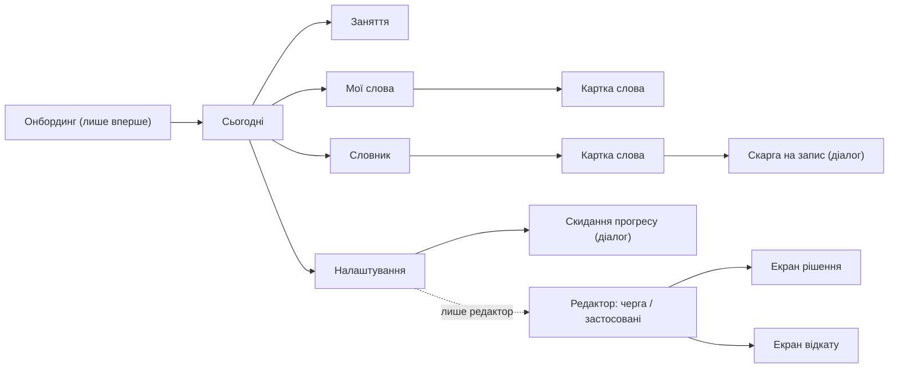
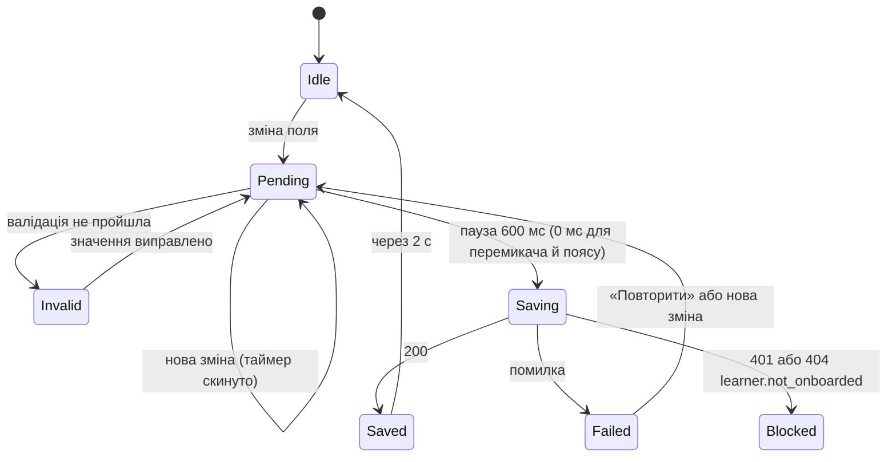
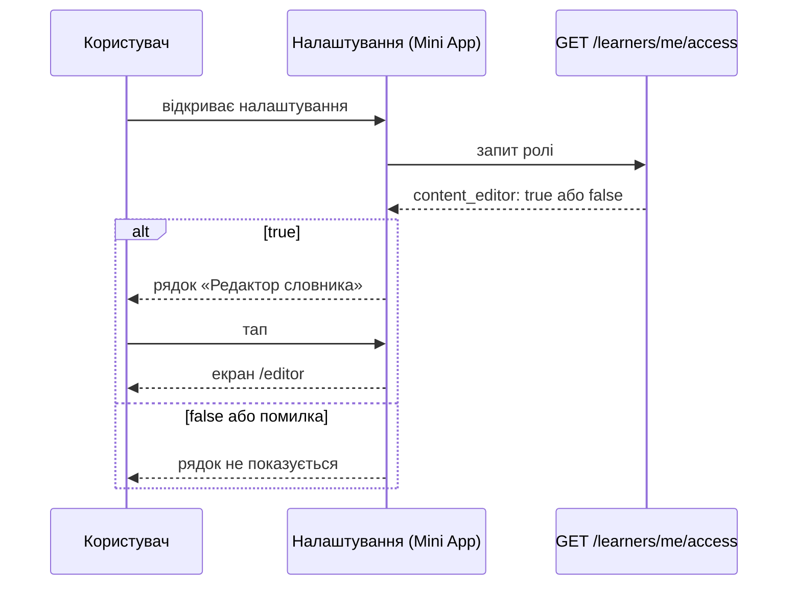

# Дизайн-специфікація — ios-ui-redesign

Опис того, **як є зараз** (реалізовано й покрито тестами). Вимоги й критерії — у [PRD](PRD.md), рішення — в [ADR-0001](adr/0001-autosave-settings-with-debounce.md)–[ADR-0004](adr/0004-use-the-native-telegram-back-button-with-an-in-page-fallback.md). Палітра й токени без змін: [дизайн-система Everforest](../personal-trainer-mvp/design-system.md).

## 1. Проблеми початкового варіанта

- Вертикальне місце витрачалося на шапку з логотипом, слоган, футер і стрілку «← На головну».
- Лівий край вирівнювання скрізь, навіть там, де єдина дія чи цифра (екран «Сьогодні», заняття).
- Кожна сутність — окрема велика картка з eyebrow-підписом, заголовком і підказкою.
- Налаштування — форма з кнопкою «Зберегти зміни» й діалогом «Про оформлення»; вибір теми й ліміту займав окремі великі картки.
- Редактор відкривав рішення й відкат модальними діалогами, а входу до нього в інтерфейсі не було.

## 2. Принципи

- **Мінімалізм.** Прибрати все, що не допомагає виконати дію: слогани, дублюючі підписи, підказки, що повторюють очевидне.
- **Групи рядків замість карток.** Підпис групи зверху, закруглений блок з рядками, тонкі розділювачі, шеврон там, де рядок веде далі.
- **Центр лише там, де один фокус.** «Сьогодні», екран заняття, заголовки екранів, стани «порожньо / не знайдено». Списки й форми вирівняні ліворуч, як у iOS.
- **Нативна навігація.** Повернення — кнопка «Назад» Telegram; посилання «←» лише як запасний варіант ([ADR-0004](adr/0004-use-the-native-telegram-back-button-with-an-in-page-fallback.md)).
- **Менше діалогів.** Складні дії (рішення редактора, підтвердження відкату) — окремі екрани ([ADR-0002](adr/0002-use-separate-screens-instead-of-dialogs-in-the-editor.md)); діалог лишається для коротких підтверджень (скидання прогресу, скарга на запис).

## 3. Примітиви

Спільні класи живуть у `ConstantLearning.MiniApp/src/styles.css`, специфічні для екрана — у CSS цього екрана.

| Примітив | Клас | Де використано |
|---|---|---|
| Заголовок екрана по центру | `ios-title` | усі екрани крім «Сьогодні» (там `h1` у картці) |
| Рядок статусу | `ios-status` | автозбереження в налаштуваннях, повідомлення редактора |
| Підпис групи | `ios-caption` | заголовки груп у налаштуваннях, списках, картках |
| Примітка під групою | `ios-footnote` (`--error` для помилок) | пояснення й помилки валідації |
| Група рядків | `ios-group` + `ios-row` | налаштування, навігація, списки, картки слів, екрани редактора |
| Рядок-вибір | `ios-row--select` | часовий пояс, причина відхилення (прихований `select` поверх рядка) |
| Сегментований перемикач | `ios-segmented` + `ios-segment` | тема, фільтр «Усі / Повторити / Пригадую», «Черга / Застосовані», «Схвалити / Відхилити» |
| Степер | `ios-stepper` (компонент `LimitStepper`) | денний ліміт нових слів в онбордингу й налаштуваннях |
| Головна кнопка | `ios-primary` | «Почати навчання» |
| Перемикач | `ios-switch` | нагадування |
| Нативна «Назад» | компонент `BackButton` | усі вкладені екрани |
| Позначка `ios-plain` | прибирає глобальні стилі кнопок Telegram UI | кнопки, що стилізуються самі |

Крапки статусу слова: зелена — «пригадую», сіра — «на повторення», порожнє коло — «ще не вчив»; у «Моїх словах» слабке слово позначено червоною крапкою.

## 4. Карта екранів

Кожна стрілка «назад» — нативна кнопка Telegram; запасне посилання «←» з'являється лише поза Telegram.

## 5. Екрани

### 5.1 Сьогодні

- Центрована картка: «Сьогодні», дата й часовий пояс.
- Велика цифра «слів до повторення» (72 px, акцентна), під нею розділювач і дві цифри поруч: «Пригадуєте» та «Занять за 7 днів».
- Рядок «Темп — N нових слів на день» і головна кнопка заняття.
- Під карткою — група «Мої слова / Словник / Налаштування» зі шевронами.

### 5.2 Заняття

- Тонка смужка прогресу й підпис «Опрацьовано N із M» над карткою.
- Слово чи підказка 40 px по центру; поле відповіді по центру, підпис «Ваша відповідь» лишається лише для скрінрідерів.
- Головна дія — акцентна кнопка; «Не знаю» й «Вже знаю» — текстові кнопки.
- Приклад — м'який блок без лівої смужки.

### 5.3 Налаштування

Групи зверху вниз: «Вигляд» (сегментований перемикач теми), «Навчання» (степер ліміту й примітка про наступну добу), «Нагадування» (перемикач, час, дні тижня колами), «Місцевий час» (рядок-вибір поясу), «Редактор» (лише для редакторів), окрема група зі скиданням прогресу. Кнопки «Зберегти» немає: див. [§6](#6-автозбереження-налаштувань).

### 5.4 Мої слова

- Зведення однією смугою з трьох цифр: «Побачено», «Пригадую», «Повторити».
- Кнопка «Тренувати слабкі · N», сегментований фільтр, вузьке поле пошуку й рядок сортування («Нещодавні» зі «Сортувати ⌄»).
- Груповий список: слово, крапка статусу, «переклад · транскрипція», справа «правильно / помилки» і смужка частки правильних; тап відкриває картку.
- Картка слова: слово по центру, транскрипція й статус; групи «Переклади», лічильники, «Розбивка помилок».

### 5.5 Словник

- Вузьке поле пошуку з кнопкою очищення «×»; підказка про діакритику — у порожньому стані «З чого почнемо?».
- Груповий список: слово, крапка статусу, «частина мови · значення»; рядок «Збіг: …» лише коли знайдена форма відрізняється від слова.
- Картка слова: слово по центру, частина мови з родом, статус; групи «Переклади», «Вимова», «Приклад» і рядок «Повідомити про неточність». Поле пошуку на картці приховано, запит зберігається.
- Порожній результат: «Не знайшли слово» з кнопкою «Повідомити про відсутній запис».

### 5.6 Редактор словника

- Перемикач «Черга / Застосовані»; черга — груповий список із цитатою пропозиції, автором і датою; застосовані — «було → стало», хто підтвердив і дія «Відкотити» (або «Лише поточна»).
- Екран рішення й екран відкату відкриваються поверх списку; список лишається в DOM прихованим, тож чернетка, прокрутка й фокус зберігаються.
- Результат дії — рядок статусу під заголовком.
- Без ролі: «Потрібен доступ редактора» без даних і дій.

### 5.7 Онбординг

- Центрована шапка «Ваш темп. Ваші слова.» з одним рядком під нею.
- Групи «Навчання» (степер, той самий `LimitStepper`, що в налаштуваннях), «Місцевий час» (рядок-вибір; без визначеного поясу значення «Не визначено»), «Нагадування» (перемикач; за ввімкнення — час і дні тижня).
- Блок «Ваші дані — під вашим контролем» з повним текстом про обробку й строки видалення та рядком-посиланням «Запит на видалення» стоїть безпосередньо над кнопкою. Без налаштованого контакту кнопка заблокована з поясненням.
- На відміну від налаштувань, збереження явне («Почати навчання»): це створення профілю, а не зміна параметра. Пояс, вибраний вручну, вважається підтвердженим; кнопок «Підтвердити часовий пояс» і «Пропустити нагадування» немає.

## 6. Автозбереження налаштувань

Правила: запит не йде, поки є помилки валідації; поки запит триває, наступна зміна чекає його завершення; однаковий запит двічі поспіль не надсилається; невдалу зміну автоматично не повторює лише «Повторити». Деталі й альтернативи — [ADR-0001](adr/0001-autosave-settings-with-debounce.md).

## 7. Вхід до редактора

Сервер у будь-якому випадку перевіряє роль на редакторських запитах; приховання рядка — лише зручність ([ADR-0003](adr/0003-expose-editor-role-through-a-dedicated-access-endpoint.md)). Як видати роль у production — [PRD §6.1](PRD.md#61-security--privacy) та секрет `Identity__ContentEditorTelegramUserIds__N` в Infisical (`production`, `/app`).

## 8. Що не входить

Перевірка нативної кнопки «Назад» і поля часу на справжніх клієнтах Telegram не виконана ([PRD §8](PRD.md#8-open-questions)).
