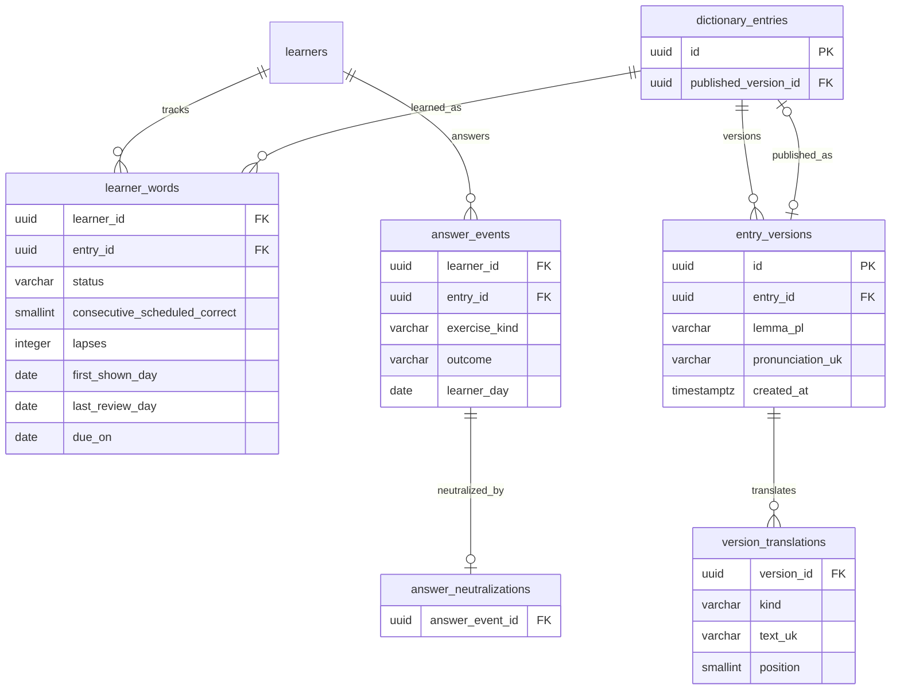

# Data model — learned-words-stats

> **Inputs:** [PRD](./PRD.md) · [contract](contracts/openapi.yaml) · [idea-brief](./idea-brief.md) (Approach C) · батьківська [data-model personal-trainer-mvp](../personal-trainer-mvp/data-model.md) · суміжні [unlimited-learning](../unlimited-learning/data-model.md) і [reset-progress PRD](../reset-progress/PRD.md).
> Це **read-only дельта** до батьківської моделі: **жодної нової таблиці, колонки чи міграції**. Фіча лише читає наявні таблиці й рахує лічильники наживо на кожен запит.

## Немає змін схеми

| Що | Стан |
|---|---|
| Нові таблиці | немає |
| Нові колонки | немає |
| Нові індекси | немає |
| Міграції (`.up.sql` / `.down.sql`) | немає |
| Нові значення в наявних полях | немає |
| Кеш / матеріалізована таблиця статистики | **свідомо немає** — усе читається наживо (див. «Чому без кешу») |

Увесь екран «Мої слова» будується з уже наявних таблиць батьківської моделі: `learner_words`, `answer_events`, `answer_neutralizations`, `dictionary_entries`, `entry_versions`, `version_translations`. Нижче — лише **форми читання** над ними й точні запити лічильників.

## ER diagram (лише читані сутності)

Показано наявні сутності, які читає фіча; схема не змінюється ([повна модель](../personal-trainer-mvp/data-model.md#er-diagram)).



## Read shapes (форми читання)

Жодна сутність не змінюється; тут описано, **як кожне поле контракту [`LearnedWordStat`](contracts/openapi.yaml)** відображається на наявні колонки.

### `learner_words` — джерело статусу, серії, забутого й дат

| Поле контракту | Джерело | Правило |
|---|---|---|
| `status` | `learner_words.status` | єдине джерело істини вкладок і зведення (той самий, що recalled words на «Сьогодні»); у статистику входять лише `review` і `recalled`, `not_started` виключено |
| `streak` (серія) | `learner_words.consecutive_scheduled_correct` | напряму |
| `forgotten_count` (забуте) | `learner_words.lapses` | напряму |
| `first_shown_day` | `learner_words.first_shown_day` | nullable |
| `last_review_day` | `learner_words.last_review_day` | nullable |
| `due_on` | `learner_words.due_on` | nullable |

**Склад списку й вкладок:** лише рядки `learner_words` цього learner зі `status ∈ {review, recalled}`. Вкладка `all` = обидва статуси (лише побачені слова, [PRD AC-01](./PRD.md#ac-01---domain-invariant-усі-показує-лише-побачені-слова)); `recalled` = `status = recalled`; `review` = `status = review`. Непоказані леми курсу (`not_started` або без рядка `learner_word`) ніколи не читаються, тож порядок курсу не розкривається.

### `answer_events` (+ `answer_neutralizations`) — лічильники показ / правильно / неправильно

Лічильники рахуються наживо з журналу відповідей по `(learner_id, entry_id)`; успішно оскаржені промахи вилучаються анти-join'ом по `answer_neutralizations`. Неоцінювані картки (`new_word_card`, `new_word_check`, `extra_new_word_check`) і нейтральні відповіді (`synonym`, `already_known`) не входять ні в показ, ні в правильно/неправильно ([PRD AC-02](./PRD.md#ac-02---domain-invariant-визначення-лічильників), [AC-03](./PRD.md#ac-03---domain-invariant-скасоване-оскарження-не-рахується-помилкою)).

Псевдо-SQL (для одного `(learner_id, entry_id)`; у коді — одна агрегація на learner):

```sql
-- оцінювані картки: лише ці exercise_kind формують показ
-- graded_kinds = ('review', 'control_repetition', 'extra_practice')

-- показ (shown_count): усі зараховані спроби на оцінюваних картках,
-- крім нейтральних відповідей synonym / already_known
SELECT count(*) FILTER (
  WHERE ae.exercise_kind IN ('review','control_repetition','extra_practice')
    AND ae.outcome IN ('correct','mistake_typo','mistake_diacritic','dont_know')
) AS shown_count,

-- правильно (correct_count)
     count(*) FILTER (
  WHERE ae.exercise_kind IN ('review','control_repetition','extra_practice')
    AND ae.outcome = 'correct'
) AS correct_count,

-- неправильно (incorrect_count): промахи МІНУС успішно оскаржені (анти-join)
     count(*) FILTER (
  WHERE ae.exercise_kind IN ('review','control_repetition','extra_practice')
    AND ae.outcome IN ('mistake_typo','mistake_diacritic','dont_know')
    AND an.answer_event_id IS NULL          -- анти-join: немає нейтралізації
) AS incorrect_count
FROM answer_events ae
LEFT JOIN answer_neutralizations an ON an.answer_event_id = ae.id
WHERE ae.learner_id = :learner_id
  AND ae.entry_id   = :entry_id;
```

`mistake_breakdown` (лише для картки, [`LearnedWordCard`](contracts/openapi.yaml)) — та сама анти-join-вибірка, розкладена за типом:

- `typo` = `count(outcome = 'mistake_typo' AND an.answer_event_id IS NULL)` (не-нейтралізовані друкарські);
- `diacritic` = `count(outcome = 'mistake_diacritic')`;
- `dont_know` = `count(outcome = 'dont_know')`.

> **Примітка про `shown_count`.** Контракт і PRD узгоджено так: показ = зараховані спроби на оцінюваних картках **без** нейтральних `synonym` / `already_known`. Формулювання idea-brief «будь-який outcome» звужено цим пізнішим реченням, щоб показ не роздувався нейтральними відповідями й лишався сумісним з означенням «правильно/неправильно» (єдине розходження у вхідних даних, яке довелось узгодити).

### `is_weak` — похідний прапорець (у пам'яті, не колонка)

```
is_weak = (status <> 'recalled') AND (lapses > 0 OR incorrect_count > 0)
```

Слово зі `status = recalled` ніколи не слабке. `weak_count` у [`LearnedWordsSummary`](contracts/openapi.yaml) = кількість слів з `is_weak = true` ([PRD AC-08](./PRD.md#ac-08---domain-invariant-слабке-слово)).

### Відображувані поля — з опублікованої `entry_version`

| Поле контракту | Джерело | Правило |
|---|---|---|
| `lemma_pl` | `entry_versions.lemma_pl` | з опублікованої версії |
| `transcription_uk` | `entry_versions.pronunciation_uk` | `null`, якщо запис втратив публікацію |
| `translation_uk` | `version_translations.text_uk` | канонічний переклад: `kind = 'canonical'`, перший за `position` |
| `translations_uk[]` (картка) | `version_translations` | усі переклади версії, впорядковані за `position` |

Версія для показу: перевага `dictionary_entries.published_version_id`; за його відсутності (запис знято з публікації) — остання `entry_versions` цього `entry_id` за `created_at` спадно; у цьому разі `transcription_uk = null`, а лічильники слова лишаються ([PRD AC-12](./PRD.md#ac-12---cross-context-поля-з-опублікованої-версії)).

## Сортування й пагінація

Сортування застосовується до вже зібраного набору рядків статистики ([PRD AC-09](./PRD.md#ac-09---happy-path-сортування)):

| `sort` | Ключі (у порядку) |
|---|---|
| `recent` (типове) | `coalesce(last_review_day, first_shown_day)` спадно, далі `entry_id` |
| `alpha` | `lemma_pl` зростанням, далі `entry_id` |
| `weakest` | `lapses` спадно, `incorrect_count` спадно, `coalesce(last_review_day, first_shown_day)` спадно, `entry_id` |

Пагінація — непрозорий курсор за `entry_id` (`after` / `before`, взаємовиключні; `limit` 1–50, типове 20); `entry_id` як останній ключ кожного сортування забезпечує стабільний порядок між сторінками. Пошук `q` звужує за `lemma_pl` або перекладом за згорнутою (без діакритики) формою ([PRD AC-10](./PRD.md#ac-10---happy-path-пошук)).

## Indexes

Нових індексів немає. Наявні індекси батьківської моделі покривають усі читання фічі:

| Index | On | Query it serves | Рішення |
|---|---|---|---|
| `ix_learner_words_learner_status` | `learner_words(learner_id, status)` | Склад вкладок і зведення (`seen/recalled/review`) | наявний, достатній |
| `ix_learner_words_learner_due` | `learner_words(learner_id, due_on)` | `due_on` у рядку статистики | наявний |
| `ux_learner_words_learner_entry` | `learner_words(learner_id, entry_id)` | Рядок слова для картки | наявний |
| `ix_answer_events_learner_entry` | `answer_events(learner_id, entry_id, answered_at)` | Агрегація показ/правильно/неправильно по слову | наявний; той самий, що перебудовує стан слова |
| `ix_answer_events_learner_day_outcome` | `answer_events(learner_id, learner_day, outcome)` | Агрегація за outcome у межах learner | наявний |
| `ux_answer_neutralizations_answer_event` | `answer_neutralizations(answer_event_id)` | Анти-join успішно оскаржених промахів | наявний |
| `ix_dictionary_entries_published_version_id` | `dictionary_entries(published_version_id)` | Опублікована версія для відображуваних полів | наявний |
| `ix_entry_versions_entry_id` | `entry_versions(entry_id, created_at)` | Запасна версія за `created_at`, коли публікації немає | наявний |
| `ux_version_translations_version_position` | `version_translations(version_id, position)` | Канонічний переклад і список перекладів | наявний |

Окремий індекс під статистику свідомо не створюється: немає запиту, не покритого наявними індексами (правило «індекс лише під конкретний запит»).

## Чому без кешу (агрегація в пам'яті)

- **Масштаб пілоту** — десятки learner, сотні побачених слів на learner ([idea-brief §3](./idea-brief.md#3-users)). Агрегація журналу в пам'яті на один запит на learner за наявними індексами дешева й укладається в цілі латентності [PRD §6](./PRD.md#6-non-functional-requirements); матеріалізована таблиця чи тригер оновлення не виправдані.
- **Один набір істини** — лічильники завжди збігаються зі станом слова й екраном «Сьогодні», бо читаються з тих самих рядків, а не з окремого кешу, який міг би розійтися.
- **Крос-фіча з reset-progress (інваріант).** Статистика читається рівно з тих таблиць, які очищає скидання прогресу — `learner_words`, `answer_events`, `answer_neutralizations` (а також `learning_sessions` / `session_items`, що породжують події), див. [reset-progress PRD §1](../reset-progress/PRD.md#1-context) і [AC-01](../reset-progress/PRD.md#ac-01---happy-path). Оскільки окремого кешу статистики немає, скидання автоматично обнуляє всю статистику ([PRD AC-07](./PRD.md#ac-07---cross-context-скидання-обнуляє-статистику)) — витоку старих підсумків після скидання бути не може.

## Migrations

Немає. Фіча read-only; жодного `.up.sql` / `.down.sql`.

## Seeds

Немає. Лічильники й види карток — константи застосунку; статистика нічого не сіє.

## Test fixtures

Нові таблиці не вводяться, тож і нових фікстур-таблиць немає. Інтеграційні тести використовують наявні фабрики батьківської моделі (`LearnerFixtures`, `ContentFixtures.NewPublishedEntry`, `LearningFixtures`) плюс побудовник журналу `answer_events` з нейтралізаціями для перевірки лічильників (AC-02, AC-03). Тестові learner — лише `user-<uuid>@example.test`, `Test User`, Telegram id з діапазону `900000000+`.
