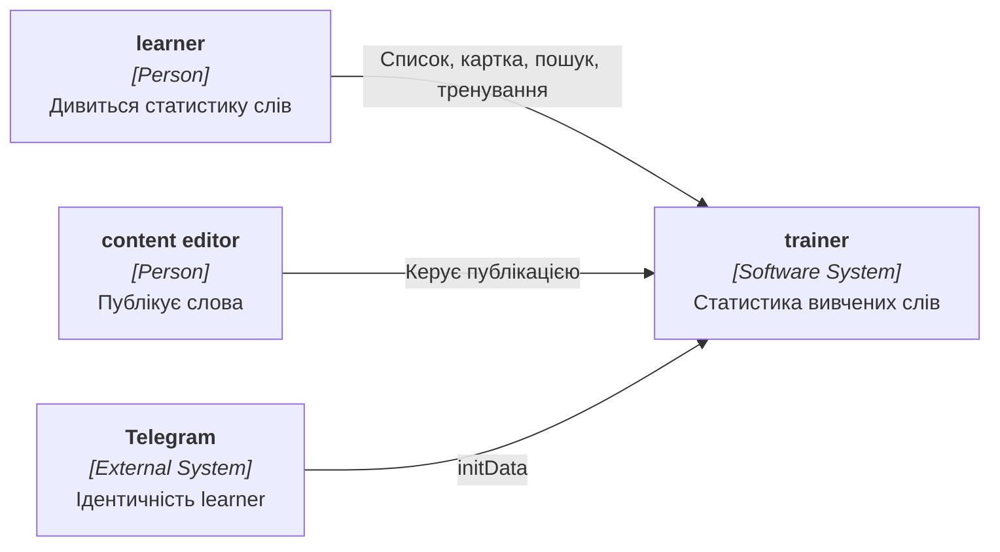
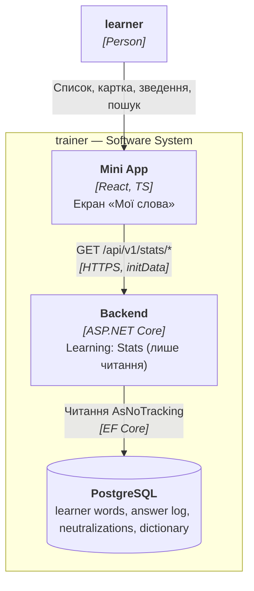
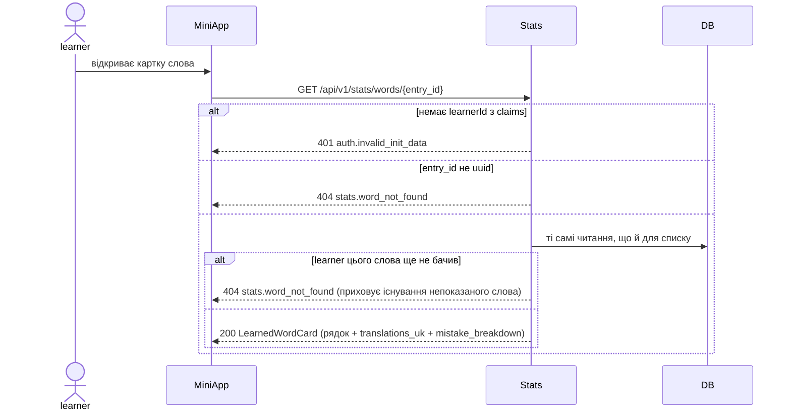

# Software Architecture Document — learned-words-stats

> **Inputs:** [idea-brief](./idea-brief.md) · [контракт openapi](./contracts/openapi.yaml) · [CONTEXT](../../../CONTEXT.md) · [architecture-map](../../architecture-map.md) · батьківський [SAD personal-trainer-mvp](../personal-trainer-mvp/sad.md) · [data-model personal-trainer-mvp](../personal-trainer-mvp/data-model.md).
> Це дельта до батьківського SAD: контейнери, технології й наскрізні концепції успадковані, тут описано лише те, що додає ця фіча. Окремого PRD для фічі ще немає; джерело вимог — idea-brief (Approach C) і авторитетний контракт, за якими реалізовано backend-модуль `ConstantLearning/Features/Learning/Stats`. US/AC-посилання відповідають позначкам у контракті (`US-01`, `US-02`, `AC-01`, `AC-04`, `AC-06`).

## 1. Introduction and goals

**Intent.** Дати learner екран «Мої слова» — список лише для читання з особистою статистикою кожного вивченого слова (показ / правильно / неправильно / серія / забуте), фільтром за статусом, пошуком, сортуванням і карткою слова з розбивкою помилок, щоб бачити прогрес, знаходити слабкі слова й шукати раніше вивчене ([idea-brief §2](./idea-brief.md#2-problem), [idea-brief §13](./idea-brief.md#13-recommendation)).

**Top-3 quality goals (повні сценарії в §10):**
1. Чесні лічильники: статистика збігається з тим, як тренер оцінював learner — скасовані оскарження, синоніми й разова перевірка нового слова не роздувають помилки ([idea-brief §10](./idea-brief.md#10-risks)).
2. Узгодженість зі «Сьогодні»: статус, вкладки й зведення беруться з того самого джерела, що й план дня, тож цифри не суперечать одна одній.
3. Коректність під скиданням прогресу: після [reset-progress](../reset-progress/PRD.md) статистика стає порожньою автоматично, без окремого очищення й без витоку з кешу.

**Stakeholders.**

| Role | Interest | Sign-off owner? |
|---|---|---|
| learner | Бачити прогрес, знаходити слабкі й раніше вивчені слова | No |
| content editor | Зміна чи зняття слова з публікації не ламає список і картку | No |
| Tech Lead | Затвердження SAD | Yes |

## 2. Constraints

**Technical.**
- Успадковано від [SAD personal-trainer-mvp §2](../personal-trainer-mvp/sad.md#2-constraints): ASP.NET Core на .NET 10, EF Core, PostgreSQL, Mini App на React і TypeScript.
- Журнал відповідей — джерело істини, стан слова відтворюється його повторним прогоном ([ADR-0009](../personal-trainer-mvp/adr/0009-schedule-reviews-with-memorize-behind-a-port-over-an-answer-log.md)); фіча лише читає й не пише нічого в journal, слова чи session.
- Нових таблиць і міграцій немає: усі лічильники читаються наживо з наявних таблиць (`learner_words`, `answer_events`, `answer_neutralizations`, `dictionary_entries` / `entry_versions` / `version_translations`), які очищає reset-progress ([ADR-0003](adr/0003-read-stats-live-with-in-memory-aggregation-no-materialized-table.md)).
- Значення «показ» у журналі окремо не зберігається; його обчислює фіча як кількість зарахованих спроб за зарахованими видами вправ ([idea-brief §10](./idea-brief.md#10-risks)).

**Organisational.**
- Оцінка 3 людино-тижні ([idea-brief §11](./idea-brief.md#11-rice--claude-proposed)); роботу веде одна людина.

**Conventions.**
- Правила міграцій і контракту API: `.claude/rules/migrations.md`, `.claude/rules/openapi.md`.
- Модульний моноліт із feature-модулями ([ADR-0003 personal-trainer-mvp](../personal-trainer-mvp/adr/0003-organise-code-into-feature-modules-inside-the-monolith.md)); доступ до чужих модулів лише через наявні порти.

**Regulatory / external.** Нових зовнішніх обмежень немає; персональні дані ті самі, що в базовому PRD ([PRD personal-trainer-mvp §6.1](../personal-trainer-mvp/PRD.md#61-security--privacy)).

## 3. Context and scope

learner переглядає свою статистику через Mini App; Telegram лише підтверджує ідентичність. Нових зовнішніх систем немає.

**External systems (in / out):**

| Actor or system | Type | Interaction |
|---|---|---|
| learner | Person | Відкриває «Мої слова», шукає й сортує, відкриває картку, запускає тренування слабких слів |
| content editor | Person | Керує публікацією словника, від якої залежить відображення слова |
| Telegram | System (external) | Передає перевірену ідентичність через initData ([ADR-0005](../personal-trainer-mvp/adr/0005-authenticate-every-api-request-with-telegram-init-data.md)) |

**Context (L1):**



## 4. Solution strategy

**Target surface(s):** `[backend-service, web-frontend]` — успадковано; читання додається в наявний backend, а екран «Мої слова» — новий маршрут Mini App. Нового контейнера й нового джерела даних немає: фіча лише читає наявні таблиці.

**Top strategic choices:**
1. **Лічильники рахуються лише за зарахованими повтореннями** (`exercise_kind ∈ {review, control_repetition, extra_practice}`); помилки — за винятком успішно оскаржених (`answer_neutralizations`); синоніми й разова перевірка нового слова (`new_word_check`) до помилок не входять. Це прямо відповідає на найкритичніший ризик idea-brief — розбіжність статистики з оцінкою тренера ([ADR-0001](adr/0001-count-only-graded-reviews-minus-successfully-disputed-misses.md)).
2. **Статус, вкладки й зведення — з `learner_words.status`, не переобчислюються з подій.** Те саме джерело, що й екран «Сьогодні», тож «5 правильних, 0 неправильних» і статус «На повторення» не суперечать одне одному ([ADR-0002](adr/0002-source-word-status-tabs-and-summary-from-learner-words.md)).
3. **Читання наживо з агрегацією в пам'яті, без кешованої чи матеріалізованої таблиці статистики.** На масштабі пілоту (десятки learner, сотні побачених слів) один прохід на запит достатньо швидкий, а скидання прогресу автоматично обнуляє статистику, бо чистяться ті самі таблиці ([ADR-0003](adr/0003-read-stats-live-with-in-memory-aggregation-no-materialized-table.md)).
4. **Слабкі слова тренуються наявним `POST /api/v1/sessions/extra-practice`** із [unlimited-learning](../unlimited-learning/sad.md) — окремого навчального ендпоінта фіча не додає, тож правила додаткового тренування (одна практика на слово за добу) не дублюються ([ADR-0004](adr/0004-train-weak-words-by-reusing-extra-practice.md)).

Дрібні рішення, ухвалені в режимі easy (assumptions ledger, підтверджено власником 2026-11-03):
- Відображення слова (лема, транскрипція, переклади) береться з опублікованої `EntryVersion`, а за її відсутності — з останньої за `created_at`; транскрипція null, якщо слово втратило публікацію. Канонічний переклад — перший серед перекладів.
- Список показує лише слова, що мають `learner_word` зі статусом `review` або `recalled` (побачені); вкладка «Усі» ніколи не розкриває порядок непоказаних слів курсу ([idea-brief §10](./idea-brief.md#10-risks)).
- `is_weak` — похідне: `status != recalled` і (`forgotten_count > 0` або `incorrect_count > 0`); сортування `weakest` ставить спершу слова з найбільшими `lapses`, потім помилками.
- Пагінація — курсором за `entry_id` поверх відсортованого набору в пам'яті; `after` XOR `before`, `limit` 1..50 (дефолт 20), як у `DictionarySearchRequest`.
- Нових міграцій немає; фіча не створює й не змінює жодного рядка.

## 5. Building block view

Зміни вкладаються в наявні модулі ([SAD personal-trainer-mvp §5](../personal-trainer-mvp/sad.md#5-building-block-view)):

```
ConstantLearning/Features/Learning/
├── Stats/                           нове: екран «Мої слова» (лише читання)
│   ├── StatsController.cs                 [ApiController][Authorize] Route api/v1/stats — 3 ендпоінти GET
│   ├── LearnedWordsStatsService.cs        читання наживо + агрегація в пам'яті на запит
│   ├── StatsResponses.cs                  DTO відповідей і конверт помилки {code, message}
│   └── LearnedWordsStatsRequest.cs        розбір і валідація query (дзеркалить DictionarySearchRequest)
└── LearningModule.cs                реєстрація LearnedWordsStatsService (scoped)
ConstantLearning.MiniApp/src/features/stats/   новий екран «Мої слова»: список, вкладки, пошук/сортування, картка, вхід у тренування слабких слів
```

Наявні модулі використовуються без змін через порти: Identity (`User.GetLearnerId()` з claims — [ADR-0005](../personal-trainer-mvp/adr/0005-authenticate-every-api-request-with-telegram-init-data.md)); Content (`SearchTextNormalizer.Fold` і тип `WordTranslation` із `Content.Search`; словник `dictionary_entries` / `entry_versions` / `version_translations` для відображення — [ADR-0010](../personal-trainer-mvp/adr/0010-version-dictionary-entries-in-postgres-with-a-published-pointer.md)); Platform (`TrainerMetrics.RecordStatsQuery` для серверної метрики). `LearnedWordsStatsService` звертається до `AppDbContext` лише через `AsNoTracking`-запити. Крос-модульний доступ лише через інтерфейси ([ADR-0003 personal-trainer-mvp](../personal-trainer-mvp/adr/0003-organise-code-into-feature-modules-inside-the-monolith.md)).

**Containers (L2):**



## 6. Runtime view

Нижче — потоки трьох ендпоінтів контракту й ключові гілки, що разом із таблицею покриття в кінці розділу охоплюють історії й AC контракту та edge cases [idea-brief §9](./idea-brief.md#9-trade-offs-and-edge-cases). Потоки написано мовою модулів (Stats, Content, DB), як у батьківському SAD.

### Список вивчених слів

```mermaid
sequenceDiagram
    actor learner
    participant MiniApp
    participant Stats
    participant DB
    learner->>MiniApp: відкриває «Мої слова» (вкладка, пошук, сортування)
    MiniApp->>Stats: GET /api/v1/stats/words?tab&sort&q&after|before&limit
    alt немає learnerId з claims
        Stats-->>MiniApp: 401 auth.invalid_init_data
    else невалідні параметри (зайвий ключ, невідома вкладка/сорт, курсор не-uuid, limit поза 1..50)
        Stats-->>MiniApp: 400 stats.invalid_request
    else
        Stats->>DB: learner існує?
        alt learner не онбордився
            Stats-->>MiniApp: 404 learner.not_onboarded
        else
            Stats->>DB: learner_words зі status review|recalled
            Stats->>DB: відображення з опублікованої EntryVersion (fallback остання), переклади
            Stats->>DB: answer_events за зарахованими видами, анти-join answer_neutralizations
            Stats->>Stats: фільтр tab і q (folded), сортування, вікно курсором за entry_id
            Stats-->>MiniApp: 200 LearnedWordsPage (items, has_next, has_prev, next_cursor)
        end
    end
    Note over Stats,DB: порожній список = вивчених слів ще немає; «Усі» не розкриває непоказані слова курсу
```

### Картка вивченого слова



### Зведення шапки «Мої слова»

```mermaid
sequenceDiagram
    actor learner
    participant MiniApp
    participant Stats
    participant DB
    learner->>MiniApp: відкриває екран «Мої слова»
    MiniApp->>Stats: GET /api/v1/stats/summary
    alt немає learnerId з claims
        Stats-->>MiniApp: 401 auth.invalid_init_data
    else learner не онбордився
        Stats-->>MiniApp: 404 learner.not_onboarded
    else
        Stats->>DB: learner_words зі status review|recalled
        Stats->>Stats: seen = усі побачені; recalled / review з learner_words.status; weak = кількість is_weak
        Stats-->>MiniApp: 200 LearnedWordsSummary (seen_count, recalled_count, review_count, weak_count)
    end
    Note over Stats,DB: лічильники вкладок — те саме джерело, що й «Сьогодні» (learner_words.status)
```

### Підрахунок лічильників слова

```mermaid
sequenceDiagram
    participant Stats
    participant DB
    Stats->>DB: answer_events learner за exercise_kind review|control_repetition|extra_practice
    Stats->>DB: answer_event_id із answer_neutralizations для цих подій
    loop кожна зарахована спроба
        Note over Stats: show_count += 1 (будь-який результат)
        alt outcome = correct
            Note over Stats: correct_count += 1
        else outcome = mistake_typo|mistake_diacritic|dont_know і не оскаржено успішно
            Note over Stats: incorrect_count += 1, відповідний тип розбивки += 1
        else synonym та інші нейтральні
            Note over Stats: лише у show_count
        end
    end
    Note over Stats: streak = learner_words.consecutive_scheduled_correct; forgotten = learner_words.lapses
```

### Відображення слова, що втратило публікацію

```mermaid
sequenceDiagram
    participant Stats
    participant DB
    Stats->>DB: dictionary_entries.published_version_id для побачених слів
    Stats->>DB: усі entry_versions цих слів
    alt є опублікована версія
        Note over Stats: лема, транскрипція й переклади з опублікованої версії
    else публікації немає
        Note over Stats: лема й переклади з останньої версії за created_at; транскрипція = null
    end
    alt для слова немає жодної версії
        Note over Stats: рядок захисно пропускається (не потрапляє у список, картку й зведення)
    end
```

### Coverage: US/AC → flows

| ID | Realized by (§6 heading) | How | Note |
|---|---|---|---|
| US-01 | Список вивчених слів; Зведення шапки «Мої слова» | flow | список + шапка статистики |
| US-02 | Картка вивченого слова | flow | картка з розбивкою помилок |
| AC-01 | Список вивчених слів | branch | «Усі» показує лише побачені слова, не розкриває порядок курсу |
| AC-04 | Зведення шапки «Мої слова» | branch | лічильники вкладок з learner_words.status, як на «Сьогодні» |
| AC-06 | Картка вивченого слова | branch | 404 stats.word_not_found приховує існування непоказаного слова |
| EC-counting | Підрахунок лічильників слова | flow | скасовані оскарження, синоніми й перевірка нового слова не роздувають помилки ([idea-brief §9](./idea-brief.md#9-trade-offs-and-edge-cases)) |
| EC-zero-answers | Підрахунок лічильників слова | branch | «Вже знаю» без відповідей → слово в «На повторення» з нулем лічильників |
| EC-unpublished | Відображення слова, що втратило публікацію | flow | транскрипція null, лема з останньої версії; без розходження зі «Сьогодні» |
| EC-reset | — | N/A | статистика стає порожньою автоматично після reset-progress — ті самі таблиці ([ADR-0003](adr/0003-read-stats-live-with-in-memory-aggregation-no-materialized-table.md)) |
| EC-auth | — | N/A | авторизація за claims діє наскрізно на кожен запит, окремого потоку немає ([ADR-0005](../personal-trainer-mvp/adr/0005-authenticate-every-api-request-with-telegram-init-data.md)) |

Coverage: 2/2 user stories · 3/3 ACs контракту · 4 edge cases — 2 non-runtime N/A.

**Flags:**
- US/AC ідентифікатори взято з позначок контракту (PRD фічі ще не авторський); edge cases (EC-*) — з [idea-brief §9](./idea-brief.md#9-trade-offs-and-edge-cases).
- Усі потоки написано мовою модулів (Stats, Content, DB); вхід у тренування слабких слів — це наявний `POST /api/v1/sessions/extra-practice`, описаний у [SAD unlimited-learning](../unlimited-learning/sad.md), тому окремого потоку тут немає ([ADR-0004](adr/0004-train-weak-words-by-reusing-extra-practice.md)).

## 7. Deployment view

<!-- N/A: розгортання не змінюється — ті самі контейнери та конфігурація, що в SAD personal-trainer-mvp; нових міграцій, джерел даних чи фонових задач немає, фіча лише читає наявні таблиці. -->

## 8. Crosscutting concepts

Успадковано від [SAD personal-trainer-mvp §8](../personal-trainer-mvp/sad.md#8-crosscutting-concepts). Специфічне для фічі:

| Concept | Convention | Where defined |
|---|---|---|
| Authorization | `learner_id` лише з claims; список, картка й зведення стосуються лише власника, чужі дані не розкриваються; картка ховає існування непоказаного слова через 404 | [ADR-0005](../personal-trainer-mvp/adr/0005-authenticate-every-api-request-with-telegram-init-data.md) |
| Read-only | Фіча не пише нічого: усі запити `AsNoTracking`, жодного рядка не створюється й не змінюється | [ADR-0003](adr/0003-read-stats-live-with-in-memory-aggregation-no-materialized-table.md) |
| Counting semantics | Показ / правильно / неправильно / розбивка — лише за зарахованими видами вправ (review, control_repetition, extra_practice), помилки за винятком успішно оскаржених; синоніми й перевірка нового слова не входять | [ADR-0001](adr/0001-count-only-graded-reviews-minus-successfully-disputed-misses.md) |
| Status consistency | Статус, вкладки й зведення — з `learner_words.status`; серія — `consecutive_scheduled_correct`, забуте — `lapses`; те саме джерело, що й «Сьогодні» | [ADR-0002](adr/0002-source-word-status-tabs-and-summary-from-learner-words.md) |
| Display | Лема, транскрипція й переклади з опублікованої `EntryVersion` (fallback остання за created_at); транскрипція null без публікації; канонічний переклад перший | [ADR-0010](../personal-trainer-mvp/adr/0010-version-dictionary-entries-in-postgres-with-a-published-pointer.md) |
| Search / pagination | Пошук за folded лемою й перекладом (діакритика ігнорується); пагінація курсором за `entry_id`, `after` XOR `before`, `limit` 1..50; білий список query-ключів, як у `DictionarySearchRequest` | [ADR-0012](../personal-trainer-mvp/adr/0012-search-via-a-precomputed-table-of-folded-word-forms.md) |
| Telemetry | Серверна метрика часу запиту статистики (`RecordStatsQuery`); клієнтська телеметрія без Telegram-ідентифікатора | [PRD personal-trainer-mvp §7](../personal-trainer-mvp/PRD.md#7-metrics--kpis) |

## 9. Architecture decisions

| # | Title | Status | Section |
|---|---|---|---|
| 0001 | Рахувати лише зараховані повторення, помилки за винятком успішно оскаржених | Accepted | §4 |
| 0002 | Брати статус, вкладки й зведення з learner_words.status | Accepted | §4 |
| 0003 | Читати статистику наживо з агрегацією в пам'яті, без матеріалізованої таблиці | Accepted | §4 |
| 0004 | Тренувати слабкі слова наявним extra-practice, без нового ендпоінта | Accepted | §4 |

ADR-файли лежать у `docs/features/learned-words-stats/adr/`. Рішення батьківської фічі діють без змін: [ADR-0003](../personal-trainer-mvp/adr/0003-organise-code-into-feature-modules-inside-the-monolith.md), [ADR-0005](../personal-trainer-mvp/adr/0005-authenticate-every-api-request-with-telegram-init-data.md), [ADR-0006](../personal-trainer-mvp/adr/0006-model-learner-time-with-nodatime-and-iana-zones.md), [ADR-0009](../personal-trainer-mvp/adr/0009-schedule-reviews-with-memorize-behind-a-port-over-an-answer-log.md), [ADR-0010](../personal-trainer-mvp/adr/0010-version-dictionary-entries-in-postgres-with-a-published-pointer.md), [ADR-0012](../personal-trainer-mvp/adr/0012-search-via-a-precomputed-table-of-folded-word-forms.md). Тренування слабких слів спирається на [ADR-0001 unlimited-learning](../unlimited-learning/adr/0001-run-extras-as-typed-sessions-over-the-existing-session-pipeline.md).

## 10. Quality requirements

| ID | Scenario | Target | How verified |
|---|---|---|---|
| QG-1 | Learner оскаржив помилку кнопкою «Моя відповідь теж правильна» | слово не показує цю помилку в incorrect_count і розбивці | інтеграційний тест анти-join answer_neutralizations ([idea-brief §10](./idea-brief.md#10-risks)) |
| QG-2 | Слово з «5 правильних, 0 неправильних» і статусом «На повторення» | статус і вкладка збігаються зі «Сьогодні» | інтеграційний тест узгодженості з learner_words.status ([ADR-0002](adr/0002-source-word-status-tabs-and-summary-from-learner-words.md)) |
| QG-3 | Learner відкриває «Мої слова» на повному курсі (сотні побачених слів) | p95 ≤ 500 ms | серверна метрика RecordStatsQuery ([idea-brief §8](./idea-brief.md#8-multi-perspective-feedback)) |
| QG-4 | Learner скинув прогрес і відкрив «Мої слова» | список і зведення порожні, без витоку з кешу | інтеграційний тест статистики після reset-progress ([idea-brief §10](./idea-brief.md#10-risks)) |
| QG-5 | Слово зняли з публікації під час перегляду | список і картка показують лему з останньої версії, транскрипція null; без розходження зі «Сьогодні» | інтеграційний тест відображення непублікованого слова ([idea-brief §9](./idea-brief.md#9-trade-offs-and-edge-cases)) |
| QG-6 | Сторінкова навігація курсором при сортуванні за лічильниками | 0 дублів і 0 пропусків рядків, стабільний порядок | інтеграційний тест пагінації й сортування ([idea-brief §10](./idea-brief.md#10-risks)) |

## 11. Risks and technical debt

| Risk | Severity | Mitigation | Owner |
|---|---|---|---|
| Лічильники розходяться з оцінкою тренера, якщо рахувати сирий журнал (оскарження, синоніми, перевірка нового слова) | Medium | Визначення «показ / правильно / неправильно» зафіксоване в [ADR-0001](adr/0001-count-only-graded-reviews-minus-successfully-disputed-misses.md); тест QG-1 | Backend |
| Статус і лічильники суперечать одне одному | Medium | Статус і серія/забуте — лише з learner_words ([ADR-0002](adr/0002-source-word-status-tabs-and-summary-from-learner-words.md)); тест QG-2 | Backend |
| Агрегація в пам'яті перестане масштабуватися з ростом слів і learner | Low | Межа перегляду — у [ADR-0003](adr/0003-read-stats-live-with-in-memory-aggregation-no-materialized-table.md) (десятки learner, сотні слів); метрика QG-3 | Backend |
| Витік статистики після скидання прогресу через окремий кеш | Low | Кешу немає, читаються ті самі таблиці, що чистить reset-progress; тест QG-4 | Backend |
| Розходження зі «Сьогодні» для слів, знятих з публікації | Low | Відображення з опублікованої версії з fallback; захисний пропуск слів без версії; тест QG-5 | Backend |
| Пагінація за лічильниками, що змінюються, губить рядки | Low | Курсор за стабільним entry_id поверх детермінованого сортування; тест QG-6 | Backend |

**Accepted debt:**
- Метрика успіху фічі свідомо «поки без»; сигнал (вхід у тренування зі «Слабких слів») додається після перших двох тижнів пілоту ([idea-brief §15](./idea-brief.md#15-open-questions)).
- Графіки динаміки, віхи й прогноз завершення курсу (Approach B) не входять у фічу ([idea-brief §5](./idea-brief.md#5-out-of-scope)).

## 12. Glossary

Терміни — у [CONTEXT](../../../CONTEXT.md); нове для цієї фічі:

| Term | Meaning |
|---|---|
| shown (показ) | Кількість зарахованих спроб за словом (review / control_repetition / extra_practice), незалежно від результату |
| weak word (слабке слово) | Побачене слово зі статусом не «Вже пригадую» і з хоча б одним забуванням або зарахованою помилкою (`is_weak`) |
| mistake breakdown (розбивка помилок) | Поділ зарахованих помилок на друкарську, діакритичну й «не знаю» (успішно оскаржені не входять) |
