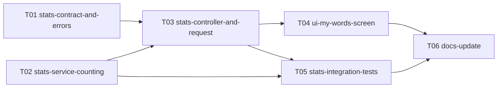

# Epic — learned-words-stats

> **PRD:** [PRD.md](../PRD.md) · **Design:** [sad.md](../sad.md) · **API:** [openapi.yaml](../contracts/openapi.yaml) · **Data:** [data-model.md](../data-model.md) · **ADRs:** [adr/](../adr/)

## Goal

Дати learner екран «Мої слова» зі статистикою вивчених слів — вкладки за статусом, пошук, лічильники показ/правильно/неправильно та розбивка помилок — і дію «Потренувати вивчені» для слабких слів, читаючи все наживо з наявних таблиць без нового сховища ([idea-brief](../idea-brief.md), [PRD §2](../PRD.md#2-goals)).

## Scope

- **In:** модуль `Learning/Stats` у `ConstantLearning/` (сервіс підрахунку, контролер, запит/валідація), три ендпоінти `/api/v1/stats/*` у контракті батьківської фічі, екран «Мої слова» в Mini App, інтеграційні тести, документація.
- **Out:** усе з [PRD §3](../PRD.md#3-non-goals) — нова таблиця чи кеш статистики, власний ендпоінт тренування слабких слів (використовується наявний `POST /api/v1/sessions/extra-practice`), зміна семантики статусу слова, досягнення й гейміфікація.

## Task map

Той самий DAG, що й у [tasks.json](./tasks.json). Стрілка веде від залежності до задачі, яку вона розблоковує. T01 і T02 стартують паралельно; T03 потребує обох.

## Coverage

Усі 13 AC з [PRD §5](../PRD.md#5-acceptance-criteria) покриті щонайменше однією задачею; тест-план — у [test-plan.md](../test-plan.md).
