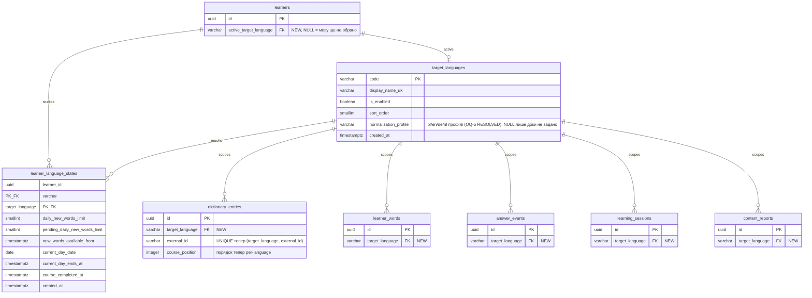

# Data model — multi-target-languages (delta)

<!-- Generated by generate-data-model (--mode brownfield). Міграції СТЕЙДЖЕНІ під
docs/features/multi-target-languages/migrations/ (НЕ у живому ConstantLearning/Migrations/);
implement-tasks переносить кожну пару у EF Core міграцію (migrationBuilder.Sql) з новою позначкою часу. -->

> **Brownfield-дельта.** Фіча не створює новий домен, а додає вимір `target_language`
> до наявних таблиць прогресу й контенту та дві нові таблиці (`target_languages`,
> `learner_language_states`). Нижче описані **лише зміни**; незмінені таблиці
> (`entry_versions`, `search_forms`, `morph_forms`, `session_items`, `learning_sessions`
> крім нової колонки, `notification_dispatches`, `reminder_schedules`, …) лишаються як у
> [personal-trainer-mvp/data-model.md](../personal-trainer-mvp/data-model.md).
>
> **Поточна база (brownfield-скан):** остання застосована EF-міграція `20261103185149`;
> нові стейджені файли мають позначку `20261104hhmmss`. Жодна таблиця прогресу чи контенту
> сьогодні не має мовного виміру; мово-свідомі лише `search_forms.lang` / `morph_forms.lang`
> (VARCHAR(2)).
>
> **Правила курсу** ([.claude/rules/migrations.md](../../../.claude/rules/migrations.md)):
> UUID v7 з застосунку; лише `created_at`; жорстке видалення; `VARCHAR(N)`; без `CHECK`,
> `TRIGGER`, бізнес-`DEFAULT`; зеро-даунтайм для наявних таблиць (нова NOT NULL → 3 кроки;
> новий індекс на наявній таблиці → `CREATE INDEX CONCURRENTLY`, один statement на файл).
>
> **ADR, що задають форму:**
> [0001](adr/0001-use-single-learner-with-target-language-column.md) (один learner +
> `active_target_language` + `target_language` на таблицях прогресу),
> [0002](adr/0002-scope-day-state-per-target-language.md) (повний per-language стан доби →
> `learner_language_states`),
> [0003](adr/0003-place-target-language-on-dictionary-entry.md) (`target_language` на
> `dictionary_entries`, порядок курсу й `external_id` — per-language),
> [0004](adr/0004-model-supported-languages-as-config-table.md) (`target_languages` конфіг-таблиця).

## ER diagram (зміни)

## New entities

### Агрегат Content — `target_languages` (конфіг-таблиця, ADR-0004)

| Column | Type | Constraints | Notes |
|---|---|---|---|
| `code` | VARCHAR(2) | PK | ISO-639-1 код (`pl`/`en`/`de`/`nl`) — природний ключ-дискримінатор; збігається з `search_forms.lang`/`morph_forms.lang` |
| `display_name_uk` | VARCHAR(64) | NOT NULL | укр. назва мови для списку вибору (US-01) |
| `is_enabled` | BOOLEAN | NOT NULL | адмін-перемикач: чи може learner почати мову; значення задає seed/застосунок, без DB-DEFAULT |
| `sort_order` | SMALLINT | NOT NULL | порядок у списку мов UI |
| `normalization_profile` | VARCHAR(32) | NULL | посилання на per-language каркас нормалізації/форм; **OQ-5 RESOLVED** — `pl`/`en`/`de`/`nl` кодуються одразу (T07), AC-08 застосовна до всіх; NULL лише для ще-не-заведеної мови |
| `created_at` | TIMESTAMPTZ | NOT NULL DEFAULT now() | |

**Aggregate root:** root (lookup). **PK-деві­ація:** природний ключ `code` замість UUID v7 — дискримінатор посилається всюди як `VARCHAR(2)`; UUID-сурогат змусив би денормалізувати `code` окремо. Прецедент природного ключа — `reminder_schedules(learner_id)` PK у reference. **Seed:** lookup-міграція `ON CONFLICT DO NOTHING` (нижче). **Увімкнення мови** (ADR-0004): `is_enabled=true` **і** наявний approved-контент (AC-02, перевіряє застосунок) **і** підтверджений `normalization_profile` для повної AC-08.

### Агрегат Identity — `learner_language_states` (per-language стан доби, ADR-0002)

| Column | Type | Constraints | Notes |
|---|---|---|---|
| `learner_id` | UUID | PK, FK → `learners(id)` ON DELETE CASCADE | |
| `target_language` | VARCHAR(2) | PK, FK → `target_languages(code)` | рядок = «learner вивчає цю мову» |
| `daily_new_words_limit` | SMALLINT | NOT NULL | ліміт нових слів **цієї мови** (AC-05); різні значення на мову — **OQ-1а RESOLVED** (незалежний per-language ліміт) |
| `pending_daily_new_words_limit` | SMALLINT | NULL | новий ліміт до наступної доби цієї мови |
| `pending_limit_effective_from` | TIMESTAMPTZ | NULL | |
| `new_words_available_from` | TIMESTAMPTZ | NULL | кінець доби видачі останньої порції цієї мови (AC-07) |
| `current_day_date` | DATE | NULL | знімок поточної доби цієї мови |
| `current_day_starts_at` | TIMESTAMPTZ | NULL | включна UTC-межа доби |
| `current_day_ends_at` | TIMESTAMPTZ | NULL | виключна UTC-межа (з подовженням після зміни поясу) |
| `current_day_original_ends_at` | TIMESTAMPTZ | NULL | початкова незмінна межа доби |
| `current_day_time_zone_at_start` | VARCHAR(64) | NULL | пояс початку доби цієї мови |
| `course_completed_at` | TIMESTAMPTZ | NULL | завершення base course цієї мови (AC-06) |
| `created_at` | TIMESTAMPTZ | NOT NULL DEFAULT now() | момент старту мови learner-ом |

**Aggregate root:** `learners`. **PK:** складений (`learner_id`, `target_language`). **Constraints:** п'ять `current_day_*` порожні або заповнені разом; застосунок перевіряє `starts_at < original_ends_at <= ends_at` (без DB-CHECK). Блокування день-стану береться на рядок **(learner_id, target_language)**, не на learner (ADR-0002; зміна конвенції `ILearnerDayStateService`). **Backfill:** на кожного наявного learner — рядок `'pl'`, скопійований із поточних полів `learners` (нижче).

## Altered entities (ALTER)

### `learners` — додати вказівник активної мови (ADR-0001)

| Column | Type | Constraints | Notes |
|---|---|---|---|
| `active_target_language` | VARCHAR(2) | **NEW**, NULL, FK → `target_languages(code)` | активна мова; NULL = learner ще не обрав мову; наявні learner → `'pl'` (backfill) |

Лишається **nullable**: свіжий learner не має активної мови до вибору (US-01). Наявні колонки `current_day_*`, `daily_new_words_limit`, `pending_*`, `new_words_available_from`, `course_completed_at` на `learners` **НЕ видаляються в цій фічі** — це фаза contract 3-кроку (окремий PR після того, як застосунок перейде на `learner_language_states`). У цій фічі — expand + backfill + dual-write у коді. Див. «Міграційний план → борг».

### `dictionary_entries` — мовний вимір контенту (ADR-0003)

| Column | Type | Constraints | Notes |
|---|---|---|---|
| `target_language` | VARCHAR(2) | **NEW**, NOT NULL (після backfill `'pl'`), FK → `target_languages(code)` | мова запису; base course = зріз `WHERE target_language = ?` |

- `ux_dictionary_entries_external_id` (глобальний UNIQUE) → **`ux_dictionary_entries_lang_external_id` UNIQUE (`target_language`, `external_id`)**: одне слово = один запис **у межах мови** (ідемпотентний імпорт per-language).
- `ix_dictionary_entries_course_position` → **`ix_dictionary_entries_lang_course_position` (`target_language`, `course_position`) WHERE `published_version_id IS NOT NULL`**: добір нових лем у власному порядку мови (AC-06).

`entry_versions` **не змінюється**: `lemma_pl`/`example_pl` семантично стають «лема/приклад активної мови», `pronunciation_uk`/`example_uk` лишаються source-мовними. Перейменування польсько-іменованих колонок — **борг** ([SAD §11](sad.md#11-ризики-і-технічний-борг)). Формат транскрипції — **OQ-8 RESOLVED**: єдина наближена (не-IPA) транскрипція для всіх мов, `pronunciation_uk` зберігає той самий формат для pl/en/de/nl — **без per-language колонки транскрипції**. Мова версії досяжна через `entry_id → dictionary_entries.target_language`.

### `learner_words`, `answer_events`, `learning_sessions`, `content_reports` — дискримінатор прогресу/черги

Кожна таблиця дістає **`target_language` VARCHAR(2) NOT NULL** (після backfill `'pl'`), FK → `target_languages(code)`. Денормалізація (а не join до `dictionary_entries`) — свідома: ключ ізоляції §8 — `(learner_id, target_language)`, і гарячі лічильники (добовий ліміт, слова до повторення, черга редактора) фільтрують за мовою без join (quality goal №3). **Інваріант:** `target_language` рядка = `target_language` його `entry` (де є `entry_id`); не DB-CHECK, а app-інваріант + тест ізоляції (ризик №1, [SAD §8](sad.md#8-crosscutting-concepts)).

| Table | Нова колонка | Чому денормалізовано |
|---|---|---|
| `learner_words` | `target_language` | лічильник recalled/due за мовою; ізоляція AC-05/AC-10 |
| `answer_events` | `target_language` | ліміт «Вже знаю» на добу **per-language** (AC-05); відповідь зараховується лише своїй мові (AC-04) |
| `learning_sessions` | `target_language` | session належить одній мові (AC-04); НЕ досяжно інакше (session не посилається на `entry`) |
| `content_reports` | `target_language` | розмежування черги редактора за мовою (AC-09, AC-11) |

`session_items` **не отримує** колонки — мова досяжна через `session_id → learning_sessions.target_language`; за мовою окремо не запитується.

## Indexes (нові / змінені)

| Index | Columns | Query it serves |
|---|---|---|
| `ux_dictionary_entries_lang_external_id` | `dictionary_entries(target_language, external_id)` | Ідемпотентний per-language імпорт (замість глобального `ux_dictionary_entries_external_id`) |
| `ix_dictionary_entries_lang_course_position` | `dictionary_entries(target_language, course_position) WHERE published_version_id IS NOT NULL` | Добір нових лем у порядку base course мови (AC-06, flow 2) |
| `ix_learners_active_target_language` | `learners(active_target_language)` | FK-індекс; фільтр активної мови |
| `ix_learner_language_states_target_language` | `learner_language_states(target_language)` | FK-індекс |
| `ix_learner_words_learner_lang_due` | `learner_words(learner_id, target_language, due_on)` | Слова до повторення активної мови (flow 1, «Сьогодні»); мово-свідома версія поряд із наявним `ix_learner_words_learner_due` (старий чиститься в contract-фазі) |
| `ix_learner_words_learner_lang_status` | `learner_words(learner_id, target_language, status)` | Лічильник recalled активної мови (AC-05/AC-07) |
| `ix_answer_events_learner_lang_day_outcome` | `answer_events(learner_id, target_language, learner_day, outcome)` | Ліміт «Вже знаю» на добу **per-language** (AC-05); мово-свідома версія поряд із наявним `ix_answer_events_learner_day_outcome` (старий чиститься в contract-фазі) |
| `ix_answer_events_target_language` | `answer_events(target_language)` | FK-індекс |
| `ix_learning_sessions_learner_lang_active` | `learning_sessions(learner_id, target_language) WHERE status='active'` | Активна session активної мови; продовження доби своєї мови (AC-04, flow 1) |
| `ix_learning_sessions_target_language` | `learning_sessions(target_language)` | FK-індекс |
| `ix_content_reports_lang_status_created` | `content_reports(target_language, status, created_at)` | Черга редактора з розмежуванням за мовою (AC-11, flow 7); доповнює `ix_content_reports_status_created` |
| `ix_content_reports_target_language` | `content_reports(target_language)` | FK-індекс |
| `ix_learner_words_target_language` | `learner_words(target_language)` | FK-індекс |

Наявні мово-свідомі індекси `ix_search_forms_form_folded`, `ix_morph_forms_lang_lemma` **без змін** — `search_forms`/`morph_forms` уже мають `lang`; узагальнення коду (зняття хардкоду `"pl"` у `SearchFormsProjection`/`PolishMorphologyImporter`) — app-side, без DDL.

## Міграційний план (стейджені файли `migrations/`)

Порядок (кожен `.up.sql` має парний `.down.sql`, що повністю реверсує). Кожен
`CREATE INDEX CONCURRENTLY` на наявній таблиці — **окремий файл з одним statement**
(tx-wrapper EF/golang-migrate не допускає CONCURRENTLY всередині транзакції):

1. `20261104090000_create_target_languages` — нова таблиця (не існує → без CONCURRENTLY).
2. `20261104090100_seed_target_languages` — lookup-seed `pl/en/de/nl`, `ON CONFLICT (code) DO NOTHING`.
3. `20261104090200_create_learner_language_states` — нова таблиця + FK-індекс на `target_language` (нова таблиця → звичайний індекс).
4. `20261104090300_backfill_learner_language_states_pl` — `INSERT` рядка `'pl'` на кожного learner зі знімка `learners`.
5. `20261104090400_alter_learners_add_active_target_language` — ADD COLUMN nullable + inline FK + backfill `'pl'` наявним.
6. `20261104090500_index_learners_active_target_language` — `CREATE INDEX CONCURRENTLY ix_learners_active_target_language`.
7. `20261104090600_alter_dictionary_entries_add_target_language` — ADD COLUMN nullable + inline FK + backfill `'pl'`.
8. `20261104090700_dictionary_entries_target_language_not_null` — `SET NOT NULL` (крок 3 з 3).
9. `20261104090800_create_dictionary_entries_lang_external_id_unique` — `CREATE UNIQUE INDEX CONCURRENTLY` (target_language, external_id).
10. `20261104090900_drop_dictionary_entries_external_id_unique` — DROP глоб. `ux_dictionary_entries_external_id`.
11. `20261104091000_create_dictionary_entries_lang_course_position_index` — `CREATE INDEX CONCURRENTLY` (target_language, course_position) partial.
12. `20261104091100_drop_dictionary_entries_course_position_index` — DROP старий `ix_dictionary_entries_course_position`.
13. `20261104091200_alter_learner_words_add_target_language` — ADD nullable + inline FK + backfill з `dictionary_entries.target_language` через `entry_id`.
14. `20261104091300_learner_words_target_language_not_null` — `SET NOT NULL`.
15. `20261104091400_index_learner_words_target_language` — `CREATE INDEX CONCURRENTLY` FK-індекс.
16. `20261104091500_index_learner_words_learner_lang_due` — `CREATE INDEX CONCURRENTLY` (learner_id, target_language, due_on).
17. `20261104091600_index_learner_words_learner_lang_status` — `CREATE INDEX CONCURRENTLY` (learner_id, target_language, status).
18. `20261104091700_alter_answer_events_add_target_language` — ADD nullable + inline FK + backfill через `entry_id`.
19. `20261104091800_answer_events_target_language_not_null` — `SET NOT NULL`.
20. `20261104091900_index_answer_events_target_language` — `CREATE INDEX CONCURRENTLY` FK-індекс.
21. `20261104092000_index_answer_events_learner_lang_day_outcome` — `CREATE INDEX CONCURRENTLY` (learner_id, target_language, learner_day, outcome).
22. `20261104092100_alter_learning_sessions_add_target_language` — ADD nullable + inline FK + backfill `'pl'`.
23. `20261104092200_learning_sessions_target_language_not_null` — `SET NOT NULL`.
24. `20261104092300_index_learning_sessions_target_language` — `CREATE INDEX CONCURRENTLY` FK-індекс.
25. `20261104092400_index_learning_sessions_learner_lang_active` — `CREATE INDEX CONCURRENTLY` (learner_id, target_language) partial `WHERE status='active'`.
26. `20261104092500_alter_content_reports_add_target_language` — ADD nullable + inline FK + backfill `'pl'`.
27. `20261104092600_content_reports_target_language_not_null` — `SET NOT NULL`.
28. `20261104092700_index_content_reports_target_language` — `CREATE INDEX CONCURRENTLY` FK-індекс.
29. `20261104092800_index_content_reports_lang_status_created` — `CREATE INDEX CONCURRENTLY` (target_language, status, created_at).

**3-крок (expand → backfill → contract) застосовано так:**
- Нові NOT NULL дискримінатори: **add nullable + inline FK + backfill** в одному файлі (backfill — константний/`entry_id`-похідний UPDATE на pre-pilot даних, без батчингу) + окремий файл `SET NOT NULL` (після деплою коду, що пише колонку). Колапс add+backfill виправданий: мала pre-pilot база, детермінований backfill.
- **Індекси на наявних таблицях** — `CREATE INDEX CONCURRENTLY`, рівно один statement на файл. Промоушен у EF: кожен такий файл іде в окремий `migrationBuilder.Sql(..., suppressTransaction: true)` (нотатка implement-tasks).
- **Своп індексу** (unique `external_id`, partial `course_position`) розбито на пару файлів: спершу `CREATE … CONCURRENTLY` нового, потім `DROP` старого — щоб не лишати вікна без індексу.

**Борг (contract-фаза, окремий PR):** (а) видалення `learners.current_day_*`, `daily_new_words_limit`, `pending_daily_new_words_limit`, `pending_limit_effective_from`, `new_words_available_from`, `course_completed_at` після переходу застосунку на `learner_language_states`; (б) чистка старих не-мово-свідомих індексів `ix_learner_words_learner_due`, `ix_learner_words_learner_status`, `ix_answer_events_learner_day_outcome`, що стали надлишковими після мово-свідомих версій. Не входить у цю фічу (dual-write проміжок).

## Seeds

- **Lookup `target_languages`** (міграція 2): `pl` (`is_enabled=true`, `normalization_profile='pl'`, `sort_order=1`), `en`/`de`/`nl` (`is_enabled=false`, `normalization_profile='en'`/`'de'`/`'nl'`, `sort_order=2/3/4`) — `ON CONFLICT (code) DO NOTHING`. Профілі заводяться одразу (OQ-5 RESOLVED — правила кодуються в T07 після spike OQ-7); `en/de/nl` вмикаються адміном, коли є approved-контент (AC-02). Назви: `Польська`/`Англійська`/`Німецька`/`Нідерландська`.
- **Backfill** (міграції 4, 5, 7, 13, 18, 22, 26): наявні дані → `'pl'` (єдина поточна мова). Не bootstrap/lookup — data-міграція.
- **Bootstrap:** немає.
- **PII guard:** сидів із персональними даними немає.

## Test fixtures

`implement-tasks` створює у `ConstantLearning.Tests/Fixtures/` (стиль репозиторію, без фікстур у міграціях):

- `TargetLanguageFixtures.NewEnabledLanguage(code, normalizationProfile)` — увімкнена мова з профілем.
- `LearnerFixtures.NewLearnerStudying(code, dailyLimit)` — learner із рядком `learner_language_states` і `active_target_language=code`.
- `ContentFixtures.NewPublishedEntry(targetLanguage, lemma, …)` — опублікований запис заданої мови з `course_position`.
- `ContentFixtures.NewContentReport(learner, entry, targetLanguage, origin)` — report, прив'язаний до мови запису.

PII guard: `Test User`, Telegram id `900000000+`, без реальних контактів.

## Відкриті питання — закрито (2026-11-04)

- **OQ-5 RESOLVED** — `target_languages.normalization_profile` для `en`/`de`/`nl` заводиться одразу (`'en'`/`'de'`/`'nl'`); повні правила de/nl (рід, артиклі, капіталізація, складені слова) кодуються в [T07](tasks/T07-generalize-forms-normalization.md). AC-08 застосовна до всіх чотирьох мов. (OQ-7: джерела відбирає spike-крок T07.)
- **OQ-8 RESOLVED** — єдина наближена (не-IPA) транскрипція для всіх мов; `pronunciation_uk` зберігає формат для pl/en/de/nl, **per-language колонки транскрипції не додаємо** — схема не змінюється.
- **OQ-1а RESOLVED** — незалежний per-language `daily_new_words_limit` (колонка вже в `learner_language_states`).

### Лишається борг (не в цій фічі)

- Перейменування `lemma_pl`/`example_pl` → мово-нейтральні імена — борг [SAD §11](sad.md#11-ризики-і-технічний-борг), 3-крок, окремий PR.
