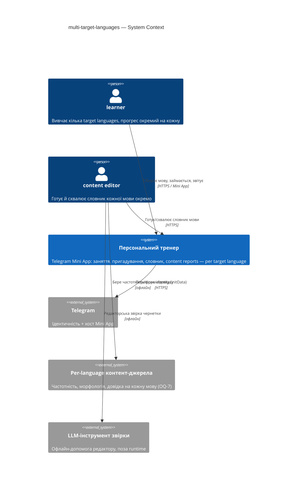
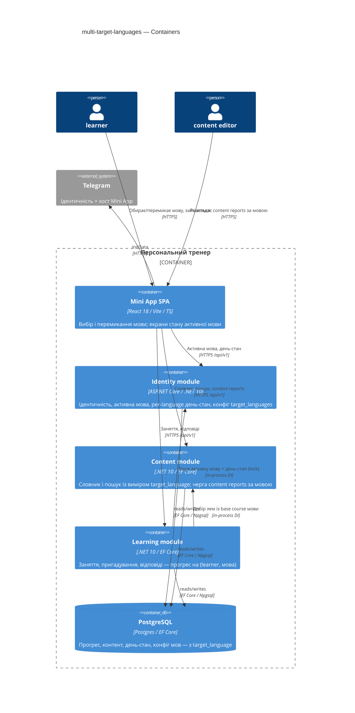
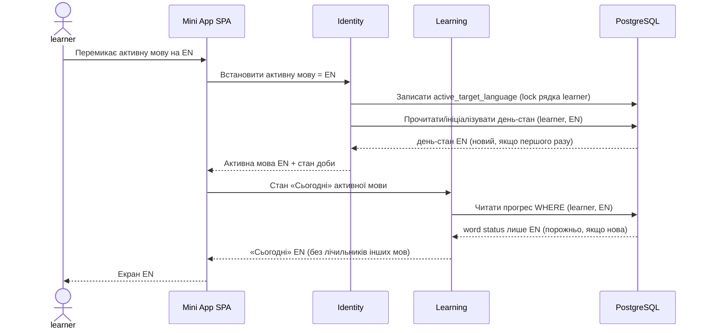
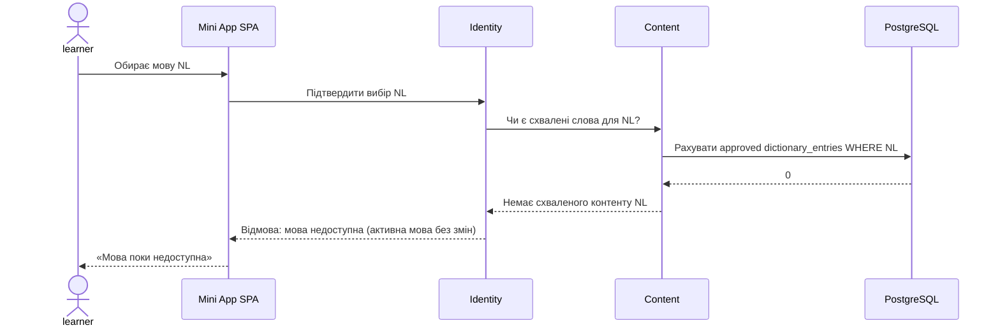

# Software Architecture Document — multi-target-languages (EN/DE/NL alongside Polish)

<!-- Stages 04-05 → see sdlc/plugin/skills/architecture-design/SKILL.md -->
<!-- 12 Arc42 sections. Empty sections — <!-- N/A: <one-line reason> -->. -->
<!-- C4 Context (L1) lives inline in §3. C4 Container (L2) lives inline in §5. -->
<!-- Заповнений приклад: див examples/course-lesson-mvp/sad.md у sdlc/ toolkit. -->

## 1. Introduction and goals

<!-- 🎯 Навіщо: стабільна памʼять про «що + три головні якості + хто зацікавлений».     -->
<!--           Через рік ніхто не згадає на словах, ЯКІ ТРИ ЯКОСТІ для системи критичні. -->
<!-- 📋 Що писати: 1 абзац intent + 3 рядки топ-3 якості + таблиця stakeholders.        -->
<!-- 📌 Приклад: «QG-1: швидкість редагування блоку p95 ≤500 мс»                         -->

**Intent.** Узагальнити персональний тренер з однієї мови (польська) до кількох target languages — польська, англійська, німецька, нідерландська — за перевикористовним каркасом на кожну мову: власний контент, вимова, приклади, форми й прийняті відповіді; окремий облік прогресу на кожну мову; спільна source language — українська. Нові мови додаються тим самим шляхом, що й три перші, без перебудови тренера (Approach C «Many Languages, One Trainer», [PRD §1-§2](./PRD.md)).

**Top-3 quality goals (1-liners; full scenarios in §10):**

1. **Ізоляція прогресу між мовами** — жодна відповідь, картка чи лічильник однієї мови не впливає на облік іншої (PRD §6 «Ізоляція прогресу» = 0 відповідей, зарахованих не до своєї мови; AC-04, AC-05, AC-10).
2. **Розширюваність на нову мову** — додати target language = додати контент + конфігурацію мови, без зміни коду тренера (ядро Approach C).
3. **Швидкодія** — p95 відкриття/перемикання «Сьогодні» ≤ 1500 мс, оцінка відповіді ≤ 500 мс, пошук у словнику ≤ 300 мс (PRD §6).

**Stakeholders.**

| Role | Interest | Sign-off owner? |
|---|---|---|
| learner | обирає й веде кілька target languages з окремим прогресом | No |
| content editor | готує й схвалює словник кожної мови окремо | No |
| Tech Lead | затвердження SAD, форма моделі даних (OQ-3 → ADR-0001), конкурентність (OQ-4 → оптимістична `xmin`) | Yes |
| Security Lead | ізоляція прогресу між learner і між мовами; роль редактора єдина для всіх мов (OQ-9 закрито) | Yes |

## 2. Constraints

<!-- 🎯 Навіщо: §4 (стратегія) працює тільки коли §2 зафіксувала, ЩО ВЖЕ ЗАФІКСОВАНО:    -->
<!--           стек, версії, дедлайн, регуляторні вимоги. Це вхід, не вихід.             -->
<!-- 📋 Що писати: чотири блоки — Технічні / Організаційні / Конвенції / Регуляторні.     -->
<!-- 📌 Приклад: «Postgres 18» (не «Postgres»); «дедлайн Q3 — жорсткий» (не «бажано»).    -->

**Technical.**
- Backend: C# на **.NET 10** (`net10.0`), nullable + implicit usings.
- Persistence: **EF Core 10.0.14** + Npgsql.EntityFrameworkCore.PostgreSQL 10.0.3 (+NodaTime), NodaTime 3.3.7, **PostgreSQL**. Оптимістична конкурентність через `xmin` (`uint Version`).
- Інтеграції: Telegram.Bot 22.10.3.3, Quartz 4.7.0 (фонові завдання), Microsoft.AspNetCore.OpenApi 10.0.14.
- Frontend: React 18.3.1 SPA, Vite 7, TypeScript 5.9, TanStack Query 5, `@telegram-apps/telegram-ui` + `@tma.js/sdk`; типи API генеруються з OpenApi-контракту.
- Архітектура: **feature-module monoліт** (модулі `Identity`, `Learning`, `Content`, `Notifications`, `Bot` — personal-trainer-mvp ADR-0003), прямі in-process DI-виклики, **без шини подій / черг / HTTP між модулями**. Scheduling за портом (`Memorize`, personal-trainer-mvp ADR-0009). Нотифікації через таблицю `notification_dispatches`, яку опитує воркер (personal-trainer-mvp ADR-0007). Фронт роздається бекендом із `wwwroot` (personal-trainer-mvp ADR-0002). *(Номери ADR тут — reference-фічі; власні ADR цієї фічі див. §9.)*

**Organisational.**
- Час релізу: **одразу після польського пілоту** ([idea-brief §4](./idea-brief.md)), поки інтерес свіжий.
- Пілотна база: **5–10 учнів** — впливає на статистичну вагу KPI (PRD §7, застереження про вибірку), не на архітектуру.
- `feature_size`: **M** (класифіковано `sdlc:classify-size`: 5–15 PR, 1–2 спринти, новий API + потабличні міграції, breaking лише внутрішні).

**Conventions.**
- Міграції: [`.claude/rules/migrations.md`](../../../.claude/rules/migrations.md) — UUID v7 app-side, `created_at` only, без CHECK/TRIGGER/бізнес-DEFAULT, hard delete, `VARCHAR(N)`; зеро-даунтайм на наявних таблицях (add nullable → backfill → SET NOT NULL; `CREATE INDEX CONCURRENTLY` одним стейтментом); кожен FK має індекс.
- Контракт API: [`.claude/rules/openapi.md`](../../../.claude/rules/openapi.md) — OpenAPI 3.1, конверт помилки `{code, message, details?}` з `code = module.error_name`, курсорна пагінація, `/api/v1/...`, `BearerAuth` глобально.
- Загальні: [`AGENTS.md`](../../../AGENTS.md) — доки/коментарі українською, імена файлів англійською, без AI co-author трейлерів, відносні markdown-лінки валідуються `tools/docs/check_links.py`.
- Наявні ADR для перевикористання/узгодження — `docs/features/personal-trainer-mvp/adr/` (зокрема ADR-0010 вказівник версії, ADR-0012 згорнуті search-forms, ADR-0009 порт планувальника).

**Regulatory / external.**
- Data classification: **confidential** — навчальна історія конкретних людей. Нових категорій PII фіча не додає; з'являється лише ознака мови при записах прогресу й content report (PRD §6.1).
- AuthN: перевірена Telegram-ідентичність. Нових authz-меж між мовами фіча не вводить (роль content editor єдина для всіх мов; per-language обмеження не вводиться — OQ-9 закрито 2026-11-04).
- Окремого security review ще не проводилося (PRD §6.1) — verdict має дати Security Lead; до того ризик прийнятий (§11).

## 3. Context and scope

<!-- 🎯 Навіщо: малює КОРДОН СИСТЕМИ — хто з нею говорить ззовні, де закінчується зона довіри. -->
<!--           Без §3 §5 і §8 (авторизація) розпливаються — неясно, що «всередині», а що «зовні». -->
<!-- 📋 Що писати: 2-3 речення бізнес-контексту + таблиця зовнішніх систем + Mermaid C4Context. -->
<!-- 📌 Приклад: «зовнішні — нема (свідома відмова від third-party у v1)» — це теж рішення.   -->
<!-- Кордон довіри (trust boundary) — лінія, за якою ти не довіряєш даним без перевірки.       -->

Тренер — Telegram Mini App, що навчає learner словам кількома target languages (пояснення українською), ведучи окремий прогрес на кожну мову. content editor готує й схвалює словник кожної мови офлайн тим самим редакторським методом. Кордон довіри проходить по Telegram-ідентичності: дані learner (у будь-якій мові) видно лише власнику; редакторський контент до релізу проходить схвалення. Свідома відмова від third-party навчального контенту — кожна мова готується власним словником.

**External systems (in / out):**

| Actor or system | Type | Interaction |
|---|---|---|
| learner | Person | Обирає/перемикає мову, займається, надсилає content report |
| content editor | Person | Готує й схвалює словник кожної мови окремо |
| Telegram | System (external) | Ідентичність (initData) + хост Mini App |
| Per-language контент-джерела | System (external) | Частотний корпус, морфологічний лексикон, довідкове джерело звірки на кожну мову — наявність/ліцензія ще не підтверджені (OQ-7) |
| LLM-інструмент редакторської звірки | System (external) | Офлайн-допомога редактору при підготовці словника; **поза runtime тренера** |

**C4 Context (L1):**



## 4. Solution strategy

<!-- 🎯 Навіщо: 3-4 СТРАТЕГІЧНІ СТОВПИ, з яких потім ростуть усі ADR. Без §4 кожен ADR    -->
<!--           виглядає випадковим — нема зонтика. ⭐ Найгустіша секція — тут ADR-gate    -->
<!--           спрацьовує майже завжди (рішення незворотні + мульти-модульні).            -->
<!-- 📋 Що писати: список з 3-4 виборів. На кожен — заголовок + 2-3 речення rationale.    -->
<!-- 📌 Приклад: «Зберігати урок як таблицю блоків» — стовп, з якого виросло ADR-0001.    -->

**Strategic choices (the seeds for ADRs):**

1. **Мовний вимір на наявних таблицях, а не окрема сутність learner-на-мову** — один `learner` зберігає ідентичність і налаштування; `target_language` стає дискримінатором на таблицях прогресу (`learner_words`, `learning_sessions`, `session_items`, `answer_events`) і контенту. Наявні польські рядки бекфіляться `'pl'` за зеро-даунтайм патерном. Обґрунтування: мінімальна перебудова, єдина Telegram-ідентичність, ізоляція досягається ключем `(learner_id, target_language)`, а не дублюванням learner. Розв'язує OQ-3. → **ADR-0001**.

2. **Власна доба learner на кожну мову** — кожна активна target language learner-а має власний стан доби (`CurrentDay*`, `NewWordsAvailableFrom`, `DailyNewWordsLimit`), а не спільне вікно доби з per-language лічильником. Обґрунтування: видача нових слів (AC-05) і початковий стан (AC-07) стають повністю незалежними на мову ціною ширшої перебудови day-state у `Identity`. Розв'язує OQ-1 (важчий варіант, ніж PRD default — міграційний ризик у §11). → **ADR-0002**.

3. **`target_language` на рівні `dictionary_entries` + порядок курсу на мову** — один запис словника належить конкретній мові; `CoursePosition` стає per-language впорядкуванням, `external_id` унікальний у межах мови. Обґрунтування: AC-06 вимагає власний base course зі своїм порядком на кожну мову; тримати мову на версії суперечило б глобальному `external_id`/`CoursePosition`. → **ADR-0003**.

4. **Набір підтримуваних мов та їхні правила — дані/конфіг, не код** — таблиця `target_languages` + per-language конфіг (чи застосовні local-equivalents — OQ-6, формат транскрипції — OQ-8, правила нормалізації відповіді/словоформ — OQ-5). Наявний мово-свідомий субстрат пошуку (`search_forms.Lang`/`morph_forms.Lang`) перевикористовується; хардкод `"pl"` у `SearchFormsProjection`/морфологічному імпортері узагальнюється до конфігурованого на мову. Нова мова = рядок конфігу + контент, без зміни коду тренера (стовп розширюваності). → **ADR-0004**.

**Активна мова й конкурентність.** Активна мова — серверний стан на `learner`, перемикання ідемпотентне (AC-12). Розв'язання конкурентних змін із різних вкладок (OQ-4) **схиляється** до перевикористання наявної оптимістичної конкурентності `xmin` із ключем `(learner_id, target_language)` (§8), але лишається **відкритим пунктом** до глибшого аналізу — §11.

Each tactical decision in later sections is traceable to one of these strategic seeds. Tactical decisions that *contradict* a strategic choice are red flags — surfaced in §11 Risks.

## 5. Building block view

<!-- 🎯 Навіщо: ВНУТРІШНЯ ДЕКОМПОЗИЦІЯ — модулі, контейнери, БД. Статична топологія:   -->
<!--           хто з ким може говорити. Без §5 §6 (сценарії) не має словника учасників. -->
<!-- 📋 Що писати: 1 абзац про стиль (шари/гексагональна/clean/на подіях) +            -->
<!--           дерево папок + Mermaid C4Container.                                       -->
<!-- 📌 Приклад: «web-app, content-api, media-worker, postgres, s3, cdn».                -->

Стиль лишається наявним — **feature-module monoліт** з прямими in-process DI-викликами (ADR-0003 reference-фічі), без шини подій. Фіча не додає нових модулів: вона протягує вимір `target_language` крізь три наявні модулі. Нові/змінені будівельні блоки зосереджені в `Identity` (ідентичність і стан learner), `Content` (словник і пошук) та `Learning` (заняття й відповіді); `Notifications` і `Bot` лишаються без структурних змін. Конфіг підтримуваних мов (`target_languages`) селиться в `Identity`, бо активна мова й день-стан — атрибути learner.

**Internal decomposition (змінені зрізи наявних модулів):**

```
ConstantLearning/Features/
├── Identity/            # ← активна мова + per-language день-стан + конфіг мов
│   ├── Data/            #   Learner (active_target_language); per-(learner,lang) day-state рядок
│   │                    #   (CurrentDay*, NewWordsAvailableFrom, DailyNewWordsLimit, CourseCompletedAt) — ADR-0002
│   ├── Data/            #   нова target_languages (код, enabled, прапорці правил) — ADR-0004
│   ├── Settings/        #   вибір/перемикання + додавання активної мови (OQ-2 закрито — усе в налаштуваннях)
│   └── ILearnerDayStateService   # блокування рядка (learner_id, target_language) — ADR-0002
├── Content/             # ← мовний вимір словника й пошуку
│   ├── Data/            #   dictionary_entries.target_language + per-language CoursePosition/external_id — ADR-0003
│   │                    #   entry_versions/version_accepted_answers лишаються, семантика «активної мови»
│   └── Search/Forms/    #   SearchFormsProjection/морф-імпортер — конфігуровані на мову (знято хардкод "pl") — ADR-0004
└── Learning/            # ← прогрес із мовним виміром
    └── Data/            #   learner_words / learning_sessions / session_items / answer_events
                         #   + target_language у ключі ізоляції (learner_id, target_language) — ADR-0001

ConstantLearning.MiniApp/src/features/
├── onboarding/ today/ session/ dictionary/ settings/   # вибір і перемикання активної мови; стан — лише активної мови
└── editor/                                              # черга content reports, відокремлена за мовою (AC-11)
```

**C4 Container (L2):**



## 6. Runtime view

<!-- 🎯 Навіщо: ПОТІК У RUNTIME для 1-2 критичних сценаріїв. Хто з ким коли і у якому     -->
<!--           порядку говорить. Без §6 §5 — лише купа коробок без життя.                  -->
<!-- 📋 Що писати: Mermaid sequenceDiagram. Учасники — імена з §5 (не вигадуй нові!).      -->
<!--           Повідомлення семантичні («складає чорновик»), БЕЗ HTTP-методів/шляхів —     -->
<!--           ендпоінт-рівневі sequence-діаграми зʼявляться у stage 06 (define-api).      -->
<!-- 📌 Приклад: «methodist → web-app: складає чорновик → web-app → content-api: зберегти». -->

Учасники — з §5: `spa`, `identity`, `content`, `learning`, `db`. Повідомлення семантичні; ендпоінт-рівневі діаграми з'являться у stage 06.

**Critical flow 1: Перемикання активної мови й відкриття «Сьогодні» (AC-03, AC-07)**



**Critical flow 2: Видача нових слів у межах per-language доби (AC-05, AC-06)**

```mermaid
sequenceDiagram
    actor learner
    participant spa as Mini App SPA
    participant learning as Learning
    participant identity as Identity
    participant content as Content
    participant db as PostgreSQL
    learner->>spa: Почати заняття активної мови (EN)
    spa->>learning: Старт session EN
    learning->>identity: День-стан (learner, EN) під lock рядка
    identity->>db: Lock (learner, EN); ліміт і видані нові EN
    db-->>identity: Залишок daily new words limit EN
    identity-->>learning: Квота нових слів EN (незалежна від PL)
    learning->>content: Леми base course EN у власному порядку
    content->>db: Читати dictionary_entries WHERE EN ORDER BY CoursePosition
    db-->>content: Наступні леми EN
    content-->>learning: Нові слова EN
    learning->>db: Створити session_items/answer_events з target_language=EN
    learning-->>spa: Заняття EN
```

**Critical flow 3 (failure): Вибір мови без схваленого контенту (AC-02)**



**Critical flow 4 (concurrency): Ідемпотентний повторний вибір / паралельні вкладки (AC-12, OQ-4)**

```mermaid
sequenceDiagram
    actor learner
    participant spa as Mini App SPA (2 вкладки)
    participant identity as Identity
    participant db as PostgreSQL
    learner->>spa: Повторно обирає EN (друга вкладка / застаріле посилання)
    spa->>identity: Почати вести EN
    identity->>db: Lock (learner, EN); читати xmin
    alt EN уже ведеться
        identity-->>spa: Ідемпотентно: наявні word status EN без змін
    else конкурентний запис із іншої вкладки
        db-->>identity: Конфлікт xmin (оптимістична конкурентність)
        identity-->>spa: Повтор на свіжому стані; жодного подвійного обліку
    end
    spa-->>learner: Стан EN без дублювання історії
```

**Critical flow 5: Вправа з вимовою, формами й нормалізацією відповіді активної мови (US-05, AC-08)**

```mermaid
sequenceDiagram
    actor learner
    participant spa as Mini App SPA
    participant learning as Learning
    participant content as Content
    participant db as PostgreSQL
    Note over learner, spa: Передумова: активна мова EN; каркас нормалізації/форм EN підтверджено (OQ-5)
    learner->>spa: Відкриває картку/вправу слова активної мови
    spa->>learning: Картка вправи активної мови
    learning->>content: Вимова, приклади, форми для entry активної мови
    content->>db: Читати entry_versions + search_forms WHERE target_language=EN
    db-->>content: Лема/вимова/приклад/форми EN
    content-->>learning: Підказки EN (не польські)
    learning-->>spa: Картка EN
    spa-->>learner: Вимова, приклад і форми EN
    learner->>spa: Надсилає відповідь
    spa->>learning: Оцінити відповідь (активна мова)
    learning->>content: Нормалізувати за правилами EN; пошук за формами EN
    content->>db: Пошук morph_forms/search_forms WHERE Lang=EN
    db-->>content: Збіг за формою EN
    content-->>learning: Нормалізований результат EN
    Note over learning, content: p95 оцінки відповіді ≤ 500 ms; пошуку за формами ≤ 300 ms (§10)
    learning->>db: answer_events з target_language=EN
    learning-->>spa: Результат відповіді EN
    spa-->>learner: Зараховано лише в облік EN
    alt каркас нормалізації/форм мови не підтверджено (OQ-5)
        content-->>learning: Правила форм мови відсутні
        learning-->>spa: Базова звірка без повного AC-08 (мово-специфічні форми недоступні)
    end
```

**Critical flow 6: Content report до слова активної мови (US-06, AC-09)**

```mermaid
sequenceDiagram
    actor learner
    participant spa as Mini App SPA
    participant content as Content
    participant db as PostgreSQL
    Note over learner, spa: Передумова: learner вивчає кілька мов; активна мова EN
    learner->>spa: Надсилає content report до слова активної мови
    spa->>content: Створити повідомлення для entry активної мови
    content->>db: Читати target_language entry (прив'язка до мови EN)
    db-->>content: entry_id належить EN
    alt у межах добового ліміту повідомлень learner (reference AC-46)
        content->>db: Записати content report з target_language=EN у чергу EN
        db-->>content: Повідомлення в черзі EN
        content-->>spa: Прийнято; контент інших мов без змін
        spa-->>learner: Повідомлення додано до черги EN
    else добовий ліміт повідомлень learner вичерпано
        content-->>spa: Відмова: ліміт повідомлень на добу вичерпано
        spa-->>learner: «Спробуйте пізніше»
    end
```

**Critical flow 7: Редактор розглядає чергу з розмежуванням за мовою (US-07, AC-11)**

```mermaid
sequenceDiagram
    actor editor as Content editor
    participant spa as Mini App SPA
    participant content as Content
    participant db as PostgreSQL
    Note over editor, spa: Передумова: у черзі є повідомлення різними мовами (EN/DE/NL/PL)
    editor->>spa: Відкриває чергу content reports
    spa->>content: Отримати чергу з розмежуванням за мовою
    content->>db: Читати content reports GROUP BY target_language
    db-->>content: Повідомлення, згруповані за мовою
    content-->>spa: Черга, відокремлена за мовою
    spa-->>editor: Повідомлення кожної мови окремо
    editor->>spa: Схвалює/відкочує зміну повідомлення мови DE
    spa->>content: Застосувати рішення до повідомлення DE
    content->>db: Оновити dictionary_entries WHERE target_language=DE (лише словник DE)
    db-->>content: Змінено лише словник DE
    content-->>spa: Застосовано до словника DE; інші мови без змін
    spa-->>editor: Рішення застосовано лише до DE
    alt повідомлення стосується іншої мови
        content->>db: Зміна маршрутизується на словник мови повідомлення, не активної
        db-->>content: Коректна мовна маршрутизація
    end
```

## 7. Deployment view

<!-- 🎯 Навіщо: ТОПОЛОГІЯ, яку DevOps має знати без читання Helm-чартів — скільки реплік,  -->
<!--           де живе фоновий обробник, ПРИ ЯКИХ ЧИСЛАХ масштабуємось.                     -->
<!-- 📋 Що писати: 2-3 речення про топологію + метрики + алерти + конкретні числа-пороги.   -->
<!-- 📌 Приклад: «500 IC → партиціонування за кварталом» (не «при зростанні подумаємо»).    -->
<!-- 🎯 Можна N/A для XS/S функцій, що переюзають існуюче розгортання без змін.            -->

Фіча **перевикористовує наявну одиницю розгортання** без структурних змін: один процес ASP.NET Core (.NET 10), що роздає Mini App SPA зі `wwwroot` (ADR-0002 reference) і тримає Quartz-воркер та воркер `notification_dispatches` in-process; єдиний PostgreSQL. Нових контейнерів, черг чи сервісів не додається — вводиться лише вимір `target_language` у наявні таблиці. Масштаб визначається пілотом (5–10 учнів), тож поточні ресурси з запасом покривають кілька мов на learner.

**Monitoring:**
- Метрика ізоляції (QG-1): щоденна звірка журналу відповідей — 0 `answer_events`, зарахованих не до своєї `target_language` (PRD §6).
- Клієнтська телеметрія латентності «Сьогодні»/перемикання (PRD §6) з розрізом за мовою.
- Наявні трасування/логи зберігаються; доповнюються полем `target_language` у записах прогресу.

**Scaling thresholds:**
- Множник даних — число активних мов на learner (1–4). При 5–10 учнів × ≤4 мови × base course — одиниці тисяч рядків прогресу; комфортно в одній таблиці.
- Партиціонування/шардинг за межами фічі (конвенція міграцій: multi-DB/партиції — окремий ADR за потреби); перегляд лише при виході за пілотний масштаб.

## 8. Crosscutting concepts

<!-- 🎯 Навіщо: НАСКРІЗНІ ПАТЕРНИ, які перетинають кілька модулів: логування, помилки,    -->
<!--           авторизація, ID strategy, outbox, кеш. ⭐ Друга найгустіша секція.          -->
<!--           Якщо патерн всередині одного модуля — він НЕ сюди. Якщо це конвенція        -->
<!--           проєкту в цілому — у CLAUDE.md.                                              -->
<!-- 📋 Що писати: таблиця концепт / конвенція / де визначено. Один рядок на концепт.      -->
<!-- 📌 Приклад: «UUID v7 (час+випадковий, сортується) у app-layer» — як default з CLAUDE.md. -->

| Concept | Convention | Where defined |
|---|---|---|
| Ізоляція за мовою (наскрізний інваріант) | Кожен запит/запис прогресу фільтрує за складеним ключем `(learner_id, target_language)`; пропуск = витік між мовами. Перевіряється інтеграційним тестом ізоляції + щоденною звіркою (QG-1) | тут; ADR-0001 |
| Активна мова | Серверний стан `active_target_language` на `learner`; запити резолвляться на активну мову learner, не на клієнтський параметр без перевірки | тут; §4 |
| Продовження session тієї ж доби (AC-04) | session лишається доступною для продовження в межах вікна доби **своєї мови**; за повного per-language day-state «та сама доба learner» для продовження = вікно доби мови цієї session (жодна картка не переноситься між мовами) | тут; ADR-0002 |
| Конкурентність (OQ-4 — закрито 2026-11-04) | Оптимістична конкурентність через наявний `xmin`, ключ `(learner_id, target_language)`; конфлікт версії → `409 language.concurrent_update`, клієнт повторює (без server-side retry й песимістичних блокувань); повторний вибір мови ідемпотентний (AC-12) | тут; §11; T12 |
| Маршрутизація content report за мовою | Повідомлення й схвалення/відкат прив'язані до `target_language` запису; черга редактора відокремлює за мовою (AC-09, AC-11) | тут; ADR-0003 |
| Error handling | Конверт `{code, message, details?}`, `code = module.error_name`; нові коди напр. `language.not_available` (AC-02). Один код = одне визначення в реєстрі помилок | `.claude/rules/openapi.md` |
| ID strategy | UUID v7, app-side; `created_at` only | `.claude/rules/migrations.md` |
| Міграції / backfill | Зеро-даунтайм: наявні рядки бекфіляться `target_language='pl'` (add nullable → backfill → SET NOT NULL); складені унікальні/FK-індекси з `target_language` | `.claude/rules/migrations.md`; ADR-0001/0003 |
| Конфіг мов | Набір підтримуваних мов і їхні правила — дані (`target_languages`), не enum; бізнес-прапорці в коді, не в DB-DEFAULT | ADR-0004 |
| Authentication | Перевірена Telegram-ідентичність (initData); нових authz-меж між мовами нема (OQ-9) | §2; PRD §6.1 |

## 9. Architecture decisions

<!-- 🎯 Навіщо: ЗВОРОТНИЙ ІНДЕКС на папку adr/. `ls adr/` дає файли, §9 дає семантику —    -->
<!--           чому вони існують, до якого зрізу SAD привʼязані, у якому статусі.           -->
<!-- 📋 Що писати: таблиця з 4 колонками. Один рядок на ADR. Mixed status — це OK.         -->
<!-- 📌 Приклад: «0001 | Зберігати урок як таблицю блоків | Accepted | §4».                -->

| # | Title | Status | Section |
|---|---|---|---|
| 0001 | Тримати один learner із дискримінатором target_language на таблицях прогресу | Accepted | §4, §5 |
| 0002 | Вести власний стан доби learner на кожну target language | Accepted | §4, §5 |
| 0003 | Розмістити target_language на dictionary_entries з порядком курсу на мову | Accepted | §4, §5 |
| 0004 | Моделювати набір підтримуваних мов як конфіг-таблицю, а не enum у коді | Accepted | §4, §8 |

ADR files live under `docs/features/multi-target-languages/adr/NNNN-<title>.md`.

## 10. Quality requirements

<!-- 🎯 Навіщо: ДЕРЕВО ЯКОСТЕЙ (Quality Tree) — беремо мету з §1 і розкладаємо на          -->
<!--           конкретні листя: тести, метрики, конфіги, drill-и. ⭐ Без §10 §1 — це       -->
<!--           маніфест. З §10 кожна декларація мапиться на щось, ЩО МОЖНА ДОВЕСТИ.        -->
<!-- 📋 Що писати: на кожну якість з §1 — When / Then / How verify. Числа з PRD §6 NFR     -->
<!--           ДОСЛІВНО (не округлюй p95 ≤250мс до ≤300мс — це F6-помилка критика).        -->
<!-- 📌 Приклад: «p95 ≤500 мс на UPDATE блоку, перевіримо k6 load test 100 req/s».        -->

Each top-3 goal from §1 expanded into a full scenario:

**QG-1. Ізоляція прогресу між мовами**
- **When:** learner веде ≥2 мови й перемикає активну мову посеред доби, вичерпавши daily new words limit в одній із них.
- **Then:** 0 `answer_events`, зарахованих не до своєї `target_language`; word status, графік повторень, облік «Вже знаю» і лічильник нових слів кожної мови незалежні; жодна картка не переноситься між мовами (PRD §6 «Ізоляція прогресу» = 0; AC-04, AC-05, AC-10).
- **How verify:** інтеграційний тест перемикання мови з перехресними відповідями + щоденна звірка журналу `answer_events` за `target_language`.

**QG-2. Розширюваність на нову мову**
- **When:** додають нову target language у тестовому середовищі.
- **Then:** мова вмикається рядком `target_languages` + схваленим контентом, і екрани «Сьогодні»/заняття/пошук працюють **без зміни коду тренера**; у `SearchFormsProjection`/морфологічному імпортері не лишається хардкоду `"pl"`.
- **How verify:** додати мову конфігом+сидом у test env, прогнати заняття й пошук без правок коду; код-рев'ю на відсутність `"pl"`-гілок (ADR-0004).

**QG-3. Швидкодія**
- **When:** learner відкриває/перемикає «Сьогодні» активної мови, відповідає на вправу, шукає у словнику.
- **Then:** p95 відкриття «Сьогодні» ≤ 1 500 ms; p95 перемикання активної мови ≤ 1 500 ms; p95 оцінки відповіді ≤ 500 ms; p95 пошуку в словнику ≤ 300 ms на запит; Availability 99.5% (PRD §6 — числа дослівно).
- **How verify:** клієнтська телеметрія (відкриття/перемикання), серверні метрики (оцінка відповіді, пошук), місячне SLO-вікно для availability.

## 11. Risks and technical debt

<!-- 🎯 Навіщо: ⭐ збирає ВСЕ, що може зламатись — і не лише технічне. Без §11 ризики   -->
<!--           обговорюються на стендапах і губляться; борг лишається у голові того,    -->
<!--           хто його прийняв.                                                          -->
<!-- 📋 Що писати: таблиця ризик/борг — серйозність — мітигація — власник. Технічний    -->
<!--           борг окремою секцією.                                                      -->
<!-- 📌 Приклад: «EM не пушить — member не оновлює дані | High | …». Перший ризик —      -->
<!--           часто продуктовий, не технічний. Це нормально.                            -->

<!-- Severity column literals: Low / Medium / High for regular risks; "Open question" for rows
     created by Step-7 `Save as Open Question` resolutions (see references/socratic-loop.md). -->

| Risk / debt | Severity | Mitigation | Owner |
|---|---|---|---|
| Пропуск фільтра `target_language` у запиті прогресу → витік між мовами | High | Наскрізний інваріант §8 + інтеграційний тест ізоляції + щоденна звірка `answer_events` за мовою (QG-1); security review цього виміру (PRD §6.1) | Tech Lead / Security Lead |
| Важча перебудова day-state у `Identity` (повна per-language доба, ADR-0002, важче за PRD default) | Medium | Зеро-даунтайм 3-крок із бекфілом `'pl'` день-стану; поетапні PR; блокування рядка `(learner_id, target_language)` | Tech Lead |
| Міграція глобальних `external_id`/`CoursePosition` на складені з `target_language` (ADR-0003) на наявних даних | Medium | Зеро-даунтайм перебудова індексів, бекфіл `'pl'` перед SET NOT NULL/UNIQUE | Tech Lead |
| OQ-5: звірка відповіді й словоформи для DE/NL (рід, капіталізація, складені слова) | Closed (2026-11-04) | **Повні мово-специфічні правила de/nl кодуються одразу** (рід `der/die/das`, артиклі `de/het`, капіталізація іменників, складені слова); `normalization_profile` `'de'`/`'nl'` заведено; реалізація — T07 (розбити на T07a/T07b якщо PR >500 LOC). AC-08 застосовна до всіх чотирьох мов | Viacheslav Melnichenko |
| OQ-7: наявність/ліцензійність per-language джерел (частотність, морфологія, довідка звірки) для EN/DE/NL | Open question | **Spike-крок на початку T07** відбирає вільно-ліцензовані джерела (Wiktionary / Unimorph / CC-корпуси) і фіксує профілі; без джерела мова лишається `is_enabled=false` (AC-02) | Viacheslav Melnichenko |
| OQ-8: перенос української наближеної транскрипції на EN/DE/NL орфографію/фонетику | Closed (2026-11-04) | **Єдиний формат наближеної (не-IPA) транскрипції для всіх мов** як звична навчальна практика; `pronunciation_uk` зберігає той самий формат для pl/en/de/nl, **без per-language колонки й без IPA** — схема не змінюється | Viacheslav Melnichenko |
| OQ-9: чи обмежувати редактора мовами, які він здатен верифікувати | Closed (2026-11-04) | **Роль content editor лишається єдиною для всіх мов** — `listEditorQueueByLanguage` без per-language authz й без 403-гілки; ревізія, коли редакторів і мов побільшає (T14) | Viacheslav Melnichenko |
| OQ-4: розв'язання конкурентних змін активної мови з різних вкладок (паралельні session різних мов) | Closed (2026-11-04) | **Оптимістична конкурентність через `xmin`** `(learner_id, target_language)`; конфлікт → `409 language.concurrent_update`, клієнт повторює (без server-side retry); повторний вибір ідемпотентний (AC-12, T12) | Viacheslav Melnichenko |

**Accepted debt (acceptable in v1, plan to fix later):**
- Польсько-іменовані колонки `entry_versions.LemmaPl`/`ExamplePl` стають семантично «лема/приклад активної мови» — не перейменовуються в цій фічі (перейменування колонки = окремий 3-крок dual-write per конвенції міграцій).
- `docs/architecture-map.md` застарілий (описує знятий груповий модель) — не в обсязі цієї фічі; довіряти коду, не мапі.
- OQ-2 (UI-розміщення вибору/перемикання мови) і OQ-6 (чи мають сенс local-equivalents для EN/DE/NL) — продуктові, не гейтять архітектуру; **закрито 2026-11-04** (OQ-2 → перемикання+додавання в налаштуваннях, T15; OQ-6 → local-equivalents опційні на кожну мову). Деталі у [PRD §8](../PRD.md#8-open-questions).

## 12. Glossary

<!-- 🎯 Навіщо: ⭐ СЛОВНИК ДОМЕНУ, який припиняє суперечки через рік («checkpoint —      -->
<!--           weekly чи biweekly? Quarter — календарний чи фіскальний?»).                -->
<!-- 📋 Що писати: таблиця термін / значення. Бізнес-терміни + технічні вперемішку.       -->
<!--           Один термін може мати дві мови у заголовку: «Goal (Обʼєктив)».              -->
<!-- 📌 Приклад: «Lesson | урок усередині курсу, що складається з блоків (text, video)». -->

| Term | Meaning |
|---|---|
| target language | Мова, яку learner вивчає (польська / англійська / німецька / нідерландська). До фічі — лише польська (CONTEXT) |
| source language | Мова пояснень — українська; фіча її не змінює (CONTEXT) |
| active language (активна мова) | target language, у якій learner наразі займається; екрани показують стан саме її. Серверний стан `active_target_language` на learner |
| окремий облік на мову | word status, повторення, daily new words limit, облік «Вже знаю», base course — незалежні на кожну target language; ключ ізоляції `(learner_id, target_language)` (PRD §5; ADR-0001) |
| base course | Впорядкований набір схвалених лем мови, з якого добираються нові слова; per-language `CoursePosition` (ADR-0003) |
| day-state (стан доби learner) | Вікно доби learner (`CurrentDay*`), `NewWordsAvailableFrom`, `DailyNewWordsLimit`, `CourseCompletedAt` — у цій фічі власне на кожну мову (ADR-0002) |
| daily new words limit | Денний ліміт нових слів (1–10); облік видачі окремий на мову (CONTEXT; AC-05) |
| transcription | Українсько-літерна наближена підказка вимови (не IPA); **єдиний формат для всіх мов** (OQ-8 закрито 2026-11-04) (CONTEXT) |
| local equivalent | Усталений місцевий відповідник слова; **опційний на кожну мову** (OQ-6 закрито 2026-11-04) (CONTEXT) |
| content report | Повідомлення learner про неточність у слові; маршрутизується до словника активної мови (AC-09, AC-11) |
| content editor | Роль, що готує й схвалює словник; **єдина для всіх мов** без per-language обмеження (OQ-9 закрито 2026-11-04) (CONTEXT) |
| `target_languages` | Конфіг-таблиця підтримуваних мов та їхніх правил (увімкненість, прапорці транскрипції/нормалізації/local-equivalents) (ADR-0004) |
| validation status | Стан контенту: draft / needs_review / approved; мова доступна, лише коли має схвалений контент (AC-02) (CONTEXT) |
