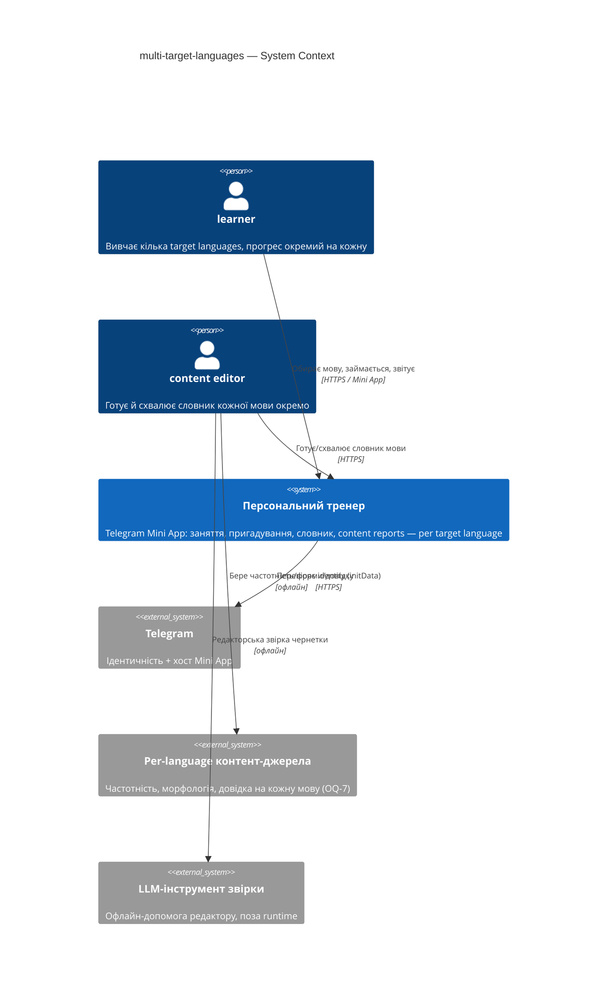
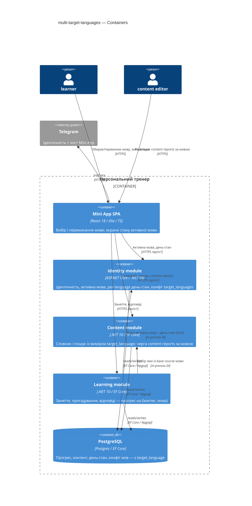
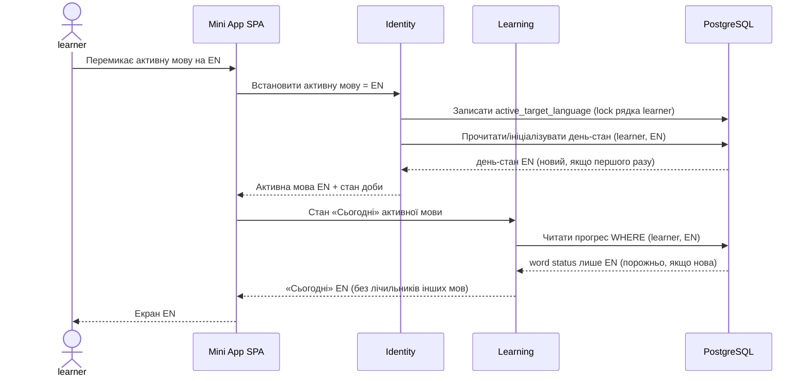
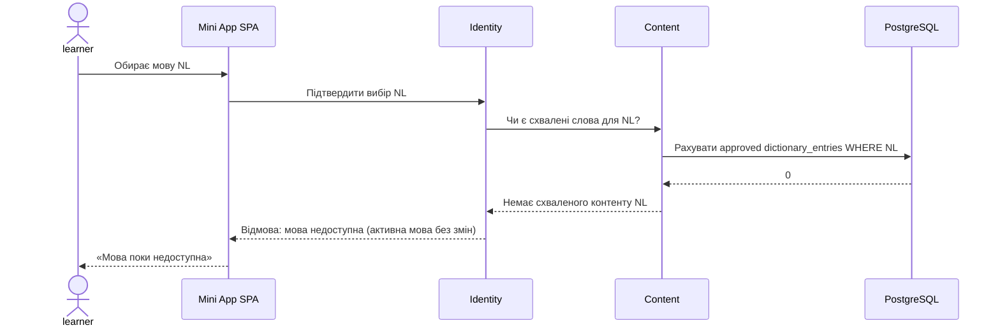

# Software Architecture Document — multi-target-languages (EN/DE/NL alongside Polish)

<!-- Stages 04-05 → see sdlc/plugin/skills/architecture-design/SKILL.md -->
<!-- 12 Arc42 sections. Empty sections — <!-- N/A: <one-line reason> -->. -->
<!-- C4 Context (L1) lives inline in §3. C4 Container (L2) lives inline in §5. -->
<!-- Заповнений приклад: див examples/course-lesson-mvp/sad.md у sdlc/ toolkit. -->

## 1. Introduction and goals

<!-- 🎯 Навіщо: стабільна памʼять про «що + три головні якості + хто зацікавлений».     -->
<!--           Через рік ніхто не згадає на словах, ЯКІ ТРИ ЯКОСТІ для системи критичні. -->
<!-- 📋 Що писати: 1 абзац intent + 3 рядки топ-3 якості + таблиця stakeholders.        -->
<!-- 📌 Приклад: «QG-1: швидкість редагування блоку p95 ≤500 мс»                         -->

**Intent.** Узагальнити персональний тренер з однієї мови (польська) до кількох target languages — польська, англійська, німецька, нідерландська — за перевикористовним каркасом на кожну мову: власний контент, вимова, приклади, форми й прийняті відповіді; окремий облік прогресу на кожну мову; спільна source language — українська. Нові мови додаються тим самим шляхом, що й три перші, без перебудови тренера (Approach C «Many Languages, One Trainer», [PRD §1-§2](./PRD.md)).

**Top-3 quality goals (1-liners; full scenarios in §10):**

1. **Ізоляція прогресу між мовами** — жодна відповідь, картка чи лічильник однієї мови не впливає на облік іншої (PRD §6 «Ізоляція прогресу» = 0 відповідей, зарахованих не до своєї мови; AC-04, AC-05, AC-10).
2. **Розширюваність на нову мову** — додати target language = додати контент + конфігурацію мови, без зміни коду тренера (ядро Approach C).
3. **Швидкодія** — p95 відкриття/перемикання «Сьогодні» ≤ 1500 мс, оцінка відповіді ≤ 500 мс, пошук у словнику ≤ 300 мс (PRD §6).

**Stakeholders.**

| Role | Interest | Sign-off owner? |
|---|---|---|
| learner | обирає й веде кілька target languages з окремим прогресом | No |
| content editor | готує й схвалює словник кожної мови окремо | No |
| Tech Lead | затвердження SAD, форма моделі даних (OQ-3), конкурентність (OQ-4) | Yes |
| Security Lead | ізоляція прогресу між learner і між мовами, обмеження редактора за мовою (OQ-9) | Yes |

## 2. Constraints

<!-- 🎯 Навіщо: §4 (стратегія) працює тільки коли §2 зафіксувала, ЩО ВЖЕ ЗАФІКСОВАНО:    -->
<!--           стек, версії, дедлайн, регуляторні вимоги. Це вхід, не вихід.             -->
<!-- 📋 Що писати: чотири блоки — Технічні / Організаційні / Конвенції / Регуляторні.     -->
<!-- 📌 Приклад: «Postgres 18» (не «Postgres»); «дедлайн Q3 — жорсткий» (не «бажано»).    -->

**Technical.**
- Backend: C# на **.NET 10** (`net10.0`), nullable + implicit usings.
- Persistence: **EF Core 10.0.14** + Npgsql.EntityFrameworkCore.PostgreSQL 10.0.3 (+NodaTime), NodaTime 3.3.7, **PostgreSQL**. Оптимістична конкурентність через `xmin` (`uint Version`).
- Інтеграції: Telegram.Bot 22.10.3.3, Quartz 4.7.0 (фонові завдання), Microsoft.AspNetCore.OpenApi 10.0.14.
- Frontend: React 18.3.1 SPA, Vite 7, TypeScript 5.9, TanStack Query 5, `@telegram-apps/telegram-ui` + `@tma.js/sdk`; типи API генеруються з OpenApi-контракту.
- Архітектура: **feature-module monoліт** (модулі `Identity`, `Learning`, `Content`, `Notifications`, `Bot` — ADR-0003), прямі in-process DI-виклики, **без шини подій / черг / HTTP між модулями**. Scheduling за портом (`Memorize`, ADR-0009). Нотифікації через таблицю `notification_dispatches`, яку опитує воркер (ADR-0007). Фронт роздається бекендом із `wwwroot` (ADR-0002).

**Organisational.**
- Час релізу: **одразу після польського пілоту** ([idea-brief §4](./idea-brief.md)), поки інтерес свіжий.
- Пілотна база: **5–10 учнів** — впливає на статистичну вагу KPI (PRD §7, застереження про вибірку), не на архітектуру.
- `feature_size` формально ще не класифіковано (`sdlc:classify-size` не запускали) — риси класу M прийнято як робочий дефолт; фіксація — відкритий пункт (§11).

**Conventions.**
- Міграції: [`.claude/rules/migrations.md`](../../../.claude/rules/migrations.md) — UUID v7 app-side, `created_at` only, без CHECK/TRIGGER/бізнес-DEFAULT, hard delete, `VARCHAR(N)`; зеро-даунтайм на наявних таблицях (add nullable → backfill → SET NOT NULL; `CREATE INDEX CONCURRENTLY` одним стейтментом); кожен FK має індекс.
- Контракт API: [`.claude/rules/openapi.md`](../../../.claude/rules/openapi.md) — OpenAPI 3.1, конверт помилки `{code, message, details?}` з `code = module.error_name`, курсорна пагінація, `/api/v1/...`, `BearerAuth` глобально.
- Загальні: [`AGENTS.md`](../../../AGENTS.md) — доки/коментарі українською, імена файлів англійською, без AI co-author трейлерів, відносні markdown-лінки валідуються `tools/docs/check_links.py`.
- Наявні ADR для перевикористання/узгодження — `docs/features/personal-trainer-mvp/adr/` (зокрема ADR-0010 вказівник версії, ADR-0012 згорнуті search-forms, ADR-0009 порт планувальника).

**Regulatory / external.**
- Data classification: **confidential** — навчальна історія конкретних людей. Нових категорій PII фіча не додає; з'являється лише ознака мови при записах прогресу й content report (PRD §6.1).
- AuthN: перевірена Telegram-ідентичність. Нових authz-меж між мовами фіча не вводить (роль content editor поки єдина для всіх мов; обмеження за мовою — OQ-9).
- Окремого security review ще не проводилося (PRD §6.1) — verdict має дати Security Lead; до того ризик прийнятий (§11).

## 3. Context and scope

<!-- 🎯 Навіщо: малює КОРДОН СИСТЕМИ — хто з нею говорить ззовні, де закінчується зона довіри. -->
<!--           Без §3 §5 і §8 (авторизація) розпливаються — неясно, що «всередині», а що «зовні». -->
<!-- 📋 Що писати: 2-3 речення бізнес-контексту + таблиця зовнішніх систем + Mermaid C4Context. -->
<!-- 📌 Приклад: «зовнішні — нема (свідома відмова від third-party у v1)» — це теж рішення.   -->
<!-- Кордон довіри (trust boundary) — лінія, за якою ти не довіряєш даним без перевірки.       -->

Тренер — Telegram Mini App, що навчає learner словам кількома target languages (пояснення українською), ведучи окремий прогрес на кожну мову. content editor готує й схвалює словник кожної мови офлайн тим самим редакторським методом. Кордон довіри проходить по Telegram-ідентичності: дані learner (у будь-якій мові) видно лише власнику; редакторський контент до релізу проходить схвалення. Свідома відмова від third-party навчального контенту — кожна мова готується власним словником.

**External systems (in / out):**

| Actor or system | Type | Interaction |
|---|---|---|
| learner | Person | Обирає/перемикає мову, займається, надсилає content report |
| content editor | Person | Готує й схвалює словник кожної мови окремо |
| Telegram | System (external) | Ідентичність (initData) + хост Mini App |
| Per-language контент-джерела | System (external) | Частотний корпус, морфологічний лексикон, довідкове джерело звірки на кожну мову — наявність/ліцензія ще не підтверджені (OQ-7) |
| LLM-інструмент редакторської звірки | System (external) | Офлайн-допомога редактору при підготовці словника; **поза runtime тренера** |

**C4 Context (L1):**



## 4. Solution strategy

<!-- 🎯 Навіщо: 3-4 СТРАТЕГІЧНІ СТОВПИ, з яких потім ростуть усі ADR. Без §4 кожен ADR    -->
<!--           виглядає випадковим — нема зонтика. ⭐ Найгустіша секція — тут ADR-gate    -->
<!--           спрацьовує майже завжди (рішення незворотні + мульти-модульні).            -->
<!-- 📋 Що писати: список з 3-4 виборів. На кожен — заголовок + 2-3 речення rationale.    -->
<!-- 📌 Приклад: «Зберігати урок як таблицю блоків» — стовп, з якого виросло ADR-0001.    -->

**Strategic choices (the seeds for ADRs):**

1. **Мовний вимір на наявних таблицях, а не окрема сутність learner-на-мову** — один `learner` зберігає ідентичність і налаштування; `target_language` стає дискримінатором на таблицях прогресу (`learner_words`, `learning_sessions`, `session_items`, `answer_events`) і контенту. Наявні польські рядки бекфіляться `'pl'` за зеро-даунтайм патерном. Обґрунтування: мінімальна перебудова, єдина Telegram-ідентичність, ізоляція досягається ключем `(learner_id, target_language)`, а не дублюванням learner. Розв'язує OQ-3. → **ADR-0001**.

2. **Власна доба learner на кожну мову** — кожна активна target language learner-а має власний стан доби (`CurrentDay*`, `NewWordsAvailableFrom`, `DailyNewWordsLimit`), а не спільне вікно доби з per-language лічильником. Обґрунтування: видача нових слів (AC-05) і початковий стан (AC-07) стають повністю незалежними на мову ціною ширшої перебудови day-state у `Identity`. Розв'язує OQ-1 (важчий варіант, ніж PRD default — міграційний ризик у §11). → **ADR-0002**.

3. **`target_language` на рівні `dictionary_entries` + порядок курсу на мову** — один запис словника належить конкретній мові; `CoursePosition` стає per-language впорядкуванням, `external_id` унікальний у межах мови. Обґрунтування: AC-06 вимагає власний base course зі своїм порядком на кожну мову; тримати мову на версії суперечило б глобальному `external_id`/`CoursePosition`. → **ADR-0003**.

4. **Набір підтримуваних мов та їхні правила — дані/конфіг, не код** — таблиця `target_languages` + per-language конфіг (чи застосовні local-equivalents — OQ-6, формат транскрипції — OQ-8, правила нормалізації відповіді/словоформ — OQ-5). Наявний мово-свідомий субстрат пошуку (`search_forms.Lang`/`morph_forms.Lang`) перевикористовується; хардкод `"pl"` у `SearchFormsProjection`/морфологічному імпортері узагальнюється до конфігурованого на мову. Нова мова = рядок конфігу + контент, без зміни коду тренера (стовп розширюваності). → **ADR-0004**.

**Активна мова й конкурентність (OQ-4).** Активна мова — серверний стан на `learner`; перемикання ідемпотентне (AC-12), а конкурентні зміни з різних вкладок розв'язуються наявною оптимістичною конкурентністю `xmin` із ключем прогресу `(learner_id, target_language)` — деталі в §8. Окремого ADR не потребує (перевикористання наявного механізму).

Each tactical decision in later sections is traceable to one of these strategic seeds. Tactical decisions that *contradict* a strategic choice are red flags — surfaced in §11 Risks.

## 5. Building block view

<!-- 🎯 Навіщо: ВНУТРІШНЯ ДЕКОМПОЗИЦІЯ — модулі, контейнери, БД. Статична топологія:   -->
<!--           хто з ким може говорити. Без §5 §6 (сценарії) не має словника учасників. -->
<!-- 📋 Що писати: 1 абзац про стиль (шари/гексагональна/clean/на подіях) +            -->
<!--           дерево папок + Mermaid C4Container.                                       -->
<!-- 📌 Приклад: «web-app, content-api, media-worker, postgres, s3, cdn».                -->

Стиль лишається наявним — **feature-module monoліт** з прямими in-process DI-викликами (ADR-0003 reference-фічі), без шини подій. Фіча не додає нових модулів: вона протягує вимір `target_language` крізь три наявні модулі. Нові/змінені будівельні блоки зосереджені в `Identity` (ідентичність і стан learner), `Content` (словник і пошук) та `Learning` (заняття й відповіді); `Notifications` і `Bot` лишаються без структурних змін. Конфіг підтримуваних мов (`target_languages`) селиться в `Identity`, бо активна мова й день-стан — атрибути learner.

**Internal decomposition (змінені зрізи наявних модулів):**

```
ConstantLearning/Features/
├── Identity/            # ← активна мова + per-language день-стан + конфіг мов
│   ├── Data/            #   Learner (active_target_language); per-(learner,lang) day-state рядок
│   │                    #   (CurrentDay*, NewWordsAvailableFrom, DailyNewWordsLimit, CourseCompletedAt) — ADR-0002
│   ├── Data/            #   нова target_languages (код, enabled, прапорці правил) — ADR-0004
│   ├── Settings/        #   вибір/перемикання активної мови (OQ-2 — UI-розміщення)
│   └── ILearnerDayStateService   # блокування рядка (learner_id, target_language) — ADR-0002
├── Content/             # ← мовний вимір словника й пошуку
│   ├── Data/            #   dictionary_entries.target_language + per-language CoursePosition/external_id — ADR-0003
│   │                    #   entry_versions/version_accepted_answers лишаються, семантика «активної мови»
│   └── Search/Forms/    #   SearchFormsProjection/морф-імпортер — конфігуровані на мову (знято хардкод "pl") — ADR-0004
└── Learning/            # ← прогрес із мовним виміром
    └── Data/            #   learner_words / learning_sessions / session_items / answer_events
                         #   + target_language у ключі ізоляції (learner_id, target_language) — ADR-0001

ConstantLearning.MiniApp/src/features/
├── onboarding/ today/ session/ dictionary/ settings/   # вибір і перемикання активної мови; стан — лише активної мови
└── editor/                                              # черга content reports, відокремлена за мовою (AC-11)
```

**C4 Container (L2):**



## 6. Runtime view

<!-- 🎯 Навіщо: ПОТІК У RUNTIME для 1-2 критичних сценаріїв. Хто з ким коли і у якому     -->
<!--           порядку говорить. Без §6 §5 — лише купа коробок без життя.                  -->
<!-- 📋 Що писати: Mermaid sequenceDiagram. Учасники — імена з §5 (не вигадуй нові!).      -->
<!--           Повідомлення семантичні («складає чорновик»), БЕЗ HTTP-методів/шляхів —     -->
<!--           ендпоінт-рівневі sequence-діаграми зʼявляться у stage 06 (define-api).      -->
<!-- 📌 Приклад: «methodist → web-app: складає чорновик → web-app → content-api: зберегти». -->

Учасники — з §5: `spa`, `identity`, `content`, `learning`, `db`. Повідомлення семантичні; ендпоінт-рівневі діаграми з'являться у stage 06.

**Critical flow 1: Перемикання активної мови й відкриття «Сьогодні» (AC-03, AC-07)**



**Critical flow 2: Видача нових слів у межах per-language доби (AC-05, AC-06)**

```mermaid
sequenceDiagram
    actor learner
    participant spa as Mini App SPA
    participant learning as Learning
    participant identity as Identity
    participant content as Content
    participant db as PostgreSQL
    learner->>spa: Почати заняття активної мови (EN)
    spa->>learning: Старт session EN
    learning->>identity: День-стан (learner, EN) під lock рядка
    identity->>db: Lock (learner, EN); ліміт і видані нові EN
    db-->>identity: Залишок daily new words limit EN
    identity-->>learning: Квота нових слів EN (незалежна від PL)
    learning->>content: Леми base course EN у власному порядку
    content->>db: Читати dictionary_entries WHERE EN ORDER BY CoursePosition
    db-->>content: Наступні леми EN
    content-->>learning: Нові слова EN
    learning->>db: Створити session_items/answer_events з target_language=EN
    learning-->>spa: Заняття EN
```

**Critical flow 3 (failure): Вибір мови без схваленого контенту (AC-02)**



**Critical flow 4 (concurrency): Ідемпотентний повторний вибір / паралельні вкладки (AC-12, OQ-4)**

```mermaid
sequenceDiagram
    actor learner
    participant spa as Mini App SPA (2 вкладки)
    participant identity as Identity
    participant db as PostgreSQL
    learner->>spa: Повторно обирає EN (друга вкладка / застаріле посилання)
    spa->>identity: Почати вести EN
    identity->>db: Lock (learner, EN); читати xmin
    alt EN уже ведеться
        identity-->>spa: Ідемпотентно: наявні word status EN без змін
    else конкурентний запис із іншої вкладки
        db-->>identity: Конфлікт xmin (оптимістична конкурентність)
        identity-->>spa: Повтор на свіжому стані; жодного подвійного обліку
    end
    spa-->>learner: Стан EN без дублювання історії
```

## 7. Deployment view

<!-- 🎯 Навіщо: ТОПОЛОГІЯ, яку DevOps має знати без читання Helm-чартів — скільки реплік,  -->
<!--           де живе фоновий обробник, ПРИ ЯКИХ ЧИСЛАХ масштабуємось.                     -->
<!-- 📋 Що писати: 2-3 речення про топологію + метрики + алерти + конкретні числа-пороги.   -->
<!-- 📌 Приклад: «500 IC → партиціонування за кварталом» (не «при зростанні подумаємо»).    -->
<!-- 🎯 Можна N/A для XS/S функцій, що переюзають існуюче розгортання без змін.            -->

<Topology in 2-3 sentences. Where it runs (k8s / VM / serverless), replicas, scaling thresholds.>

**Monitoring:**
- <Metrics — e.g. Prometheus `<metric_name>`>
- <Alerts — e.g. "outbox lag > 10 min → page on-call">
- <Tracing — e.g. OpenTelemetry HTTP spans>

**Scaling thresholds:**
- <e.g. 500 IC × 5 goals × 26 checkpoints/Q = 65k rows/year — comfortable in one table>
- <e.g. partitioning by quarter at >500k rows/year>

<!-- For XS/S that doesn't change deployment: <!-- N/A: feature reuses existing deployment unit -->. -->

## 8. Crosscutting concepts

<!-- 🎯 Навіщо: НАСКРІЗНІ ПАТЕРНИ, які перетинають кілька модулів: логування, помилки,    -->
<!--           авторизація, ID strategy, outbox, кеш. ⭐ Друга найгустіша секція.          -->
<!--           Якщо патерн всередині одного модуля — він НЕ сюди. Якщо це конвенція        -->
<!--           проєкту в цілому — у CLAUDE.md.                                              -->
<!-- 📋 Що писати: таблиця концепт / конвенція / де визначено. Один рядок на концепт.      -->
<!-- 📌 Приклад: «UUID v7 (час+випадковий, сортується) у app-layer» — як default з CLAUDE.md. -->

| Concept | Convention | Where defined |
|---|---|---|
| Logging | <e.g. structured slog, fields `module=<name>`> | <CLAUDE.md §X or here> |
| Authentication | <e.g. JWT via session middleware> | <CLAUDE.md §X> |
| Error handling | <e.g. domain sentinel → ports/errors.go → apperr JSON> | <CLAUDE.md §X> |
| ID strategy | <e.g. UUID v7 in app layer> | <CLAUDE.md §X> |
| Internationalisation | <e.g. N/A, English only> | — |
| Observability | <e.g. OpenTelemetry on HTTP boundaries> | — |
| Outbox / events | <module-specific patterns, if any> | <here> |

## 9. Architecture decisions

<!-- 🎯 Навіщо: ЗВОРОТНИЙ ІНДЕКС на папку adr/. `ls adr/` дає файли, §9 дає семантику —    -->
<!--           чому вони існують, до якого зрізу SAD привʼязані, у якому статусі.           -->
<!-- 📋 Що писати: таблиця з 4 колонками. Один рядок на ADR. Mixed status — це OK.         -->
<!-- 📌 Приклад: «0001 | Зберігати урок як таблицю блоків | Accepted | §4».                -->

| # | Title | Status | Section |
|---|---|---|---|
| <NNNN> | <imperative — e.g. "Use sliding window for rate limiting"> | Accepted | §<N> |
| <NNNN> | <imperative — e.g. "Co-locate outbox worker in API process"> | Accepted | §<N> |

ADR files live under `docs/features/<slug>/adr/NNNN-<title>.md`.

## 10. Quality requirements

<!-- 🎯 Навіщо: ДЕРЕВО ЯКОСТЕЙ (Quality Tree) — беремо мету з §1 і розкладаємо на          -->
<!--           конкретні листя: тести, метрики, конфіги, drill-и. ⭐ Без §10 §1 — це       -->
<!--           маніфест. З §10 кожна декларація мапиться на щось, ЩО МОЖНА ДОВЕСТИ.        -->
<!-- 📋 Що писати: на кожну якість з §1 — When / Then / How verify. Числа з PRD §6 NFR     -->
<!--           ДОСЛІВНО (не округлюй p95 ≤250мс до ≤300мс — це F6-помилка критика).        -->
<!-- 📌 Приклад: «p95 ≤500 мс на UPDATE блоку, перевіримо k6 load test 100 req/s».        -->

Each top-3 goal from §1 expanded into a full scenario:

**QG-1. <quality attribute>**
- **When:** <trigger condition>
- **Then:** <expected behavior with numbers from PRD NFR>
- **How verify:** <test / chaos drill / load test / observability>

**QG-2. <quality attribute>**
- **When:** <trigger>
- **Then:** <expected>
- **How verify:** <how>

**QG-3. <quality attribute>**
- **When:** <trigger>
- **Then:** <expected>
- **How verify:** <how>

## 11. Risks and technical debt

<!-- 🎯 Навіщо: ⭐ збирає ВСЕ, що може зламатись — і не лише технічне. Без §11 ризики   -->
<!--           обговорюються на стендапах і губляться; борг лишається у голові того,    -->
<!--           хто його прийняв.                                                          -->
<!-- 📋 Що писати: таблиця ризик/борг — серйозність — мітигація — власник. Технічний    -->
<!--           борг окремою секцією.                                                      -->
<!-- 📌 Приклад: «EM не пушить — member не оновлює дані | High | …». Перший ризик —      -->
<!--           часто продуктовий, не технічний. Це нормально.                            -->

<!-- Severity column literals: Low / Medium / High for regular risks; "Open question" for rows
     created by Step-7 `Save as Open Question` resolutions (see references/socratic-loop.md). -->

| Risk / debt | Severity | Mitigation | Owner |
|---|---|---|---|
| <e.g. Outbox lag may reach hours during downstream outage> | Medium | <Alert >10 min, on-call playbook, retry backoff> | <DevOps> |
| <e.g. No event schema versioning in v1> | Medium | <ADR-NNNN planned for v2, graceful handling of unknown fields> | <Backend> |
| Open architectural decision: <decision-headline> | Open question | Resolve before <stage trigger or YYYY-MM-DD>; <inline rationale from Step-7 Save-as-OQ> | <owner> |

**Accepted debt (acceptable in v1, plan to fix later):**
- <e.g. Goal entity is not versioned (immutable) — OK for v1, may need audit versioning in v2>

## 12. Glossary

<!-- 🎯 Навіщо: ⭐ СЛОВНИК ДОМЕНУ, який припиняє суперечки через рік («checkpoint —      -->
<!--           weekly чи biweekly? Quarter — календарний чи фіскальний?»).                -->
<!-- 📋 Що писати: таблиця термін / значення. Бізнес-терміни + технічні вперемішку.       -->
<!--           Один термін може мати дві мови у заголовку: «Goal (Обʼєктив)».              -->
<!-- 📌 Приклад: «Lesson | урок усередині курсу, що складається з блоків (text, video)». -->

| Term | Meaning |
|---|---|
| <e.g. Goal> | <quarterly intent in statement form> |
| <e.g. KR> | <Key Result — measurable target linked to a Goal> |
| <e.g. Checkpoint> | <bi-weekly progress update on a KR> |
