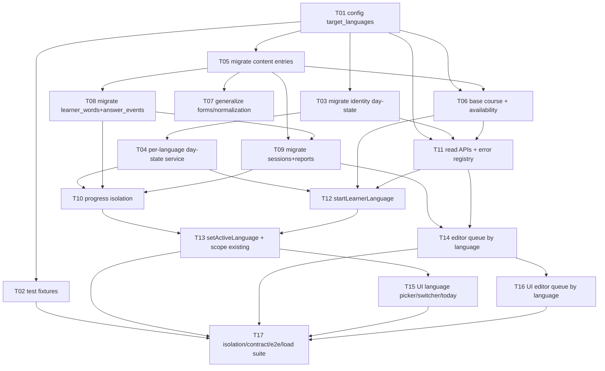

# Epic — multi-target-languages

> **Що це.** Розбиття фічі на атомарні задачі (кожна ≤1 дня, окремий review-able PR ≤500 LOC).
> Кожна задача **лінкує** на першоджерело ([PRD](../PRD.md), [sad.md](../sad.md),
> [data-model.md](../data-model.md), [openapi.yaml](../contracts/openapi.yaml),
> [adr/](../adr)), а не дублює його ("story лінкує, не дублює").

## Мета

Узагальнити тренер із єдиної (польської) мови до кількох **target languages** (pl/en/de/nl)
за перевикористовним каркасом на кожну мову: окремий per-language прогрес, окремий контент,
додавання нової мови = рядок конфігу + контент без перебудови тренера. Вектор — Approach C
([idea-brief §13](../idea-brief.md#13-recommendation)). Source language лишається українською.

## Обсяг

**У обсязі (ця фіча — expand + backfill + dual-write):**

- Конфіг-таблиця `target_languages` + вимір `target_language` на наявних таблицях прогресу/контенту (29 стейджених міграцій, [data-model.md](../data-model.md)).
- Per-language стан доби learner ([ADR-0002](../adr/0002-scope-day-state-per-target-language.md)).
- 5 нових API-операцій ([openapi.yaml](../contracts/openapi.yaml)) + серверне scoping наявних ендпоінтів за активною мовою.
- Узагальнення коду пошуку/нормалізації (зняття хардкоду `"pl"`, [ADR-0004](../adr/0004-model-supported-languages-as-config-table.md)).
- UI: вибір/перемикання активної мови, порожній початковий стан, черга редактора за мовою.
- Тести ізоляції / контракту / e2e / навантаження ([test-plan.md](../test-plan.md)).

**Поза обсягом:**

- **Contract-фаза** 3-кроку: DROP старих колонок `learners.current_day_*` і старих не-мово-свідомих індексів — окремий PR/deploy після переходу застосунку ([data-model.md §Борг](../data-model.md)).
- Нові source languages / переклад UI іншими мовами; міжмовні підказки; перенесення прогресу між мовами ([PRD §3](../PRD.md#3-non-goals)).
- Перейменування `lemma_pl`/`example_pl` → мово-нейтральні імена — борг [SAD §11](../sad.md), окремий 3-крок PR.
- Увімкнення en/de/nl адміном (`is_enabled=true`) — потребує approved-контенту; `available=true` настає з наявністю контенту (OQ-7 spike у T07). `normalization_profile` для en/de/nl уже заведено (OQ-5 закрито 2026-11-04, правила кодуються в T07).

## Карта задач (граф залежностей)

## Фази

1. **Фундамент** — конфіг мов + тестова оснастка (T01, T02).
2. **Identity** — міграції день-стану + per-language day-state service (T03, T04).
3. **Content** — міграції словника + base course / доступність / узагальнення форм (T05, T06, T07).
4. **Learning** — міграції дискримінаторів прогресу + ізоляція обліку (T08, T09, T10).
5. **API** — читальні операції + старт мови + перемикання + черга редактора (T11, T12, T13, T14).
6. **UI** — перемикач мови / порожній стан / черга за мовою (T15, T16).
7. **Верифікація** — наскрізна ізоляція / контракт / e2e / навантаження (T17).

## Задачі

| # | Task | Layer | Blocked by | Estimate | DoD (short) |
|---|---|---|---|---|---|
| [T01](./T01-config-target-languages.md) | Конфіг-таблиця `target_languages` + seed + сутність/репозиторій | migration+infra | — | M | таблиця+seed у EF-міграції; сутність і репозиторій читають каталог; `TargetLanguageFixtures` |
| [T02](./T02-test-fixtures.md) | Per-language фікстури й оснастка ізоляційних тестів | tests | T01 | M | `LearnerFixtures.NewLearnerStudying`, `ContentFixtures.*`; тест-база PostgreSQL 16 testcontainer |
| [T03](./T03-migrate-identity-day-state.md) | Міграції `learner_language_states` + `learners.active_target_language` | migration | T01 | M | таблиці+backfill `'pl'`+FK-індекси у EF; down реверсує; застосовано на testcontainer |
| [T04](./T04-per-language-day-state.md) | Per-language стан доби learner (`ILearnerDayStateService`) | domain | T03 | L | блокування рядка `(learner_id, target_language)`; unit+integration зелені |
| [T05](./T05-migrate-content-entries.md) | Міграції `dictionary_entries.target_language` + своп індексів | migration | T01 | M | ADD+backfill+SET NOT NULL; `CONCURRENTLY` своп unique/course_position; down реверсує |
| [T06](./T06-base-course-availability.md) | Base course на мову + перевірка доступності мови | domain | T01, T05 | M | добір лем лише зі свого base course у його порядку; `available` = enabled ∧ є approved-контент |
| [T07](./T07-generalize-forms-normalization.md) | Узагальнення пошуку форм і нормалізації (зняти хардкод `"pl"`) | domain | T05 | L | `SearchFormsProjection`/морф-імпортер конфігуровані на мову; нормалізація за профілем мови |
| [T08](./T08-migrate-learner-words-answer-events.md) | Міграції дискримінатора `learner_words` + `answer_events` | migration | T05 | M | ADD+backfill через `entry_id`+SET NOT NULL; мово-свідомі індекси `CONCURRENTLY`; down реверсує |
| [T09](./T09-migrate-sessions-reports.md) | Міграції дискримінатора `learning_sessions` + `content_reports` | migration | T05, T08 | M | ADD+backfill `'pl'`+SET NOT NULL; індекси `CONCURRENTLY`; down реверсує |
| [T10](./T10-progress-isolation.md) | Ізоляція обліку прогресу за `(learner, мова)` | domain | T04, T08, T09 | L | word status/повторення/ліміт/«Вже знаю» рахуються окремо на мову; ізоляційні тести зелені |
| [T11](./T11-read-apis-error-registry.md) | `listTargetLanguages` + `listLearnerLanguages` + реєстр помилок | app | T01, T03, T06 | M | 2 GET-операції за контрактом; 4 нові `language.*` коди в реєстрі; тести 200/401/404 |
| [T12](./T12-start-learner-language.md) | `startLearnerLanguage` (ідемпотентний старт + активація) | app | T04, T06, T11 | L | AC-01/02/12; 200 ідемпотентно / 409 `language.not_available`/`concurrent_update`; тести |
| [T13](./T13-set-active-scope-existing.md) | `setActiveLanguage` + scoping наявних ендпоінтів за активною мовою | app | T10, T12 | L | AC-03/AC-04/AC-07; «Сьогодні»/session/словник показують лише активну мову; тести |
| [T14](./T14-editor-queue-by-language.md) | `listEditorQueueByLanguage` + прив'язка report до мови запису | app | T09, T11 | M | AC-09/AC-11; черга відокремлена за мовою; report → мова `entry_id`; тести |
| [T15](./T15-ui-language-switcher.md) | SPA: вибір/перемикання мови + порожній початковий стан | ui | T13 | L | перемикання+додавання мови в налаштуваннях (OQ-2 закрито); AC-07 порожній стан; лічильники лише активної мови; локальні перевірки |
| [T16](./T16-ui-editor-queue-by-language.md) | SPA: черга content reports редактора за мовою | ui | T14 | M | AC-11; фільтр за мовою у черзі редактора; локальні перевірки |
| [T17](./T17-isolation-contract-e2e-load.md) | Наскрізна ізоляція / контракт / e2e / навантаження | tests | T02, T13, T14, T15, T16 | L | [test-plan.md](../test-plan.md): 0 відповідей не своїй мові; 5 контракт-операцій; NFR-сценарії |

## Разом

17 задач. S = 0, M = 10 (≈5 людино-днів), L = 7 (≈7 людино-днів) → **≈12 людино-днів**.
Оцінка: S = 2 год, M = пів дня, L = день.

## Паралелізація

- Після **T01**: гілки Identity (T03→T04) і Content (T05→{T06,T07,T08→T09}) ідуть паралельно.
- **T02** (фікстури) паралельна всім міграціям після T01.
- Серіалізація записів: спільні `files_hint` (міграції/EF-модель) синхронізуються вручну за графом залежностей вище (окремого `tasks.json` scheduling не згенеровано).

## Ризики / Hard rules

- **Ризик №1 (High) — витік фільтра ізоляції** ([SAD §8](../sad.md), [test-plan.md](../test-plan.md)):
  ключ `(learner_id, target_language)` має застосовуватися в кожному запиті прогресу/черги.
  Інваріант: `target_language` рядка = `target_language` його `entry`. Покривається T10 + T17.
- **Міграційні hard rules** ([.claude/rules/migrations.md](../../../../.claude/rules/migrations.md)):
  UUID v7 app-side; лише `created_at`; `VARCHAR(N)`; без `CHECK`/`TRIGGER`/бізнес-`DEFAULT`/stored proc;
  кожен FK → `CREATE INDEX`; наявна таблиця → `CREATE INDEX CONCURRENTLY` (один statement на файл);
  нова NOT NULL → 3 кроки (add nullable → backfill → SET NOT NULL).
- **Контрактні hard rules** ([.claude/rules/openapi.md](../../../../.claude/rules/openapi.md)):
  OpenAPI 3.1; конверт помилки `{code, message, details?}`; `code` = `module.error_name`; URL-версіонування;
  курсорна пагінація черги; `TelegramInitData` (reference ADR-0005), не BearerAuth.
- **Відкриті питання — закрито (2026-11-04):** OQ-4 (конкурентність) → оптимістична `xmin`,
  `409 language.concurrent_update`, клієнт повторює (T12). OQ-5 (нормалізація de/nl) → повні правила
  одразу, `normalization_profile` `'de'`/`'nl'` заведено, правила кодуються в T07. OQ-9 (scoping
  редактора за мовою) → єдина роль content editor для всіх мов, без per-language authz й 403-гілки (T14).
  OQ-2 (UI перемикання/додавання) → усе в налаштуваннях (T15). OQ-1а → незалежний ліміт нових слів на
  мову. OQ-8 → єдина наближена (не-IPA) транскрипція для всіх мов, без per-language колонки. Лишається
  борг SAD §11 (перейменування `lemma_pl`/`example_pl`) та OQ-7 (увімкнення en/de/nl gated на наявність
  контенту — spike у T07). Деталі: [tracker.md](./tracker.md), [PRD §8](../PRD.md#8-open-questions).

## Трасування AC → задачі

Джерело правди — поля `acs:` у файлах задач (матриця генерується їх інверсією).

| AC | Задачі |
|---|---|
| AC-01 (обрати мову) | T01, T06, T11, T12, T15 |
| AC-02 (мова недоступна) | T01, T06, T12 |
| AC-03 (перемкнути) | T13, T15 |
| AC-04 (session не змішуються) | T02, T04, T08, T09, T10, T13, T17 |
| AC-05 (окремий ліміт/облік) | T02, T03, T04, T08, T10, T17 |
| AC-06 (base course на мову) | T05, T06 |
| AC-07 (порожній стан) | T03, T04, T13, T15 |
| AC-08 (вимова/форми/нормалізація) | T05, T07 |
| AC-09 (report активної мови) | T09, T14 |
| AC-10 (крос-learner ізоляція) | T02, T08, T10, T11, T17 |
| AC-11 (черга редактора за мовою) | T09, T14, T16, T17 |
| AC-12 (ідемпотентний старт) | T12, T17 |
