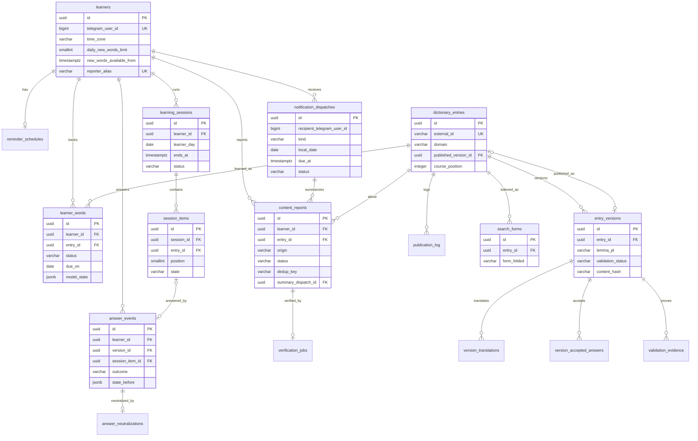

# Data model — personal-trainer-mvp

<!-- Generated by generate-data-model. Migrations are STAGED under
docs/features/personal-trainer-mvp/migrations/ (NOT the live ConstantLearning/Migrations/ tree);
implement-tasks promotes them. -->

> Міграції лежать у [`migrations/`](./migrations/) (23 пари `.up.sql` / `.down.sql`) і ще не застосовані. `implement-tasks` переносить кожну пару в EF Core міграцію (`migrationBuilder.Sql`) з новою позначкою часу. Повний DDL — у файлах міграцій; тут — модель, обмеження й обґрунтування індексів.
>
> **Правила курсу:** UUID v7 генерується в застосунку (`Guid.CreateVersion7()`); лише `created_at`, без `updated_at`; жорстке видалення; `VARCHAR(N)`; без `CHECK`, `TRIGGER` і бізнесових `DEFAULT` — статуси, ліміти й прапорці завжди задає застосунок. Оптимістична конкурентність — системна колонка PostgreSQL `xmin` (DDL не потрібен, SAD §8).

## ER diagram

Таблиці `morph_forms` і `reference_entries` — довідкові знімки без зовнішніх ключів (ADR-0011, ADR-0012); на діаграмі не показані.

## Entities

### Агрегат Identity — `learners`

| Column | Type | Constraints | Notes |
|---|---|---|---|
| `id` | UUID | PK, app-generated (UUID v7) | |
| `telegram_user_id` | BIGINT | NOT NULL, UNIQUE | ідентичність з `initData` (ADR-0005) |
| `first_name` | VARCHAR(64) | NULL | персональні дані, PRD §6.1 |
| `time_zone` | VARCHAR(64) | NOT NULL | IANA id; `Europe/Warsaw`, якщо не визначено (AC-01) |
| `time_zone_confirmed` | BOOLEAN | NOT NULL | false — пояс не вибрано, вимагається для reminder (AC-27) |
| `daily_new_words_limit` | SMALLINT | NOT NULL | 3, 5 або 10 — валідація в застосунку (AC-45) |
| `pending_daily_new_words_limit` | SMALLINT | NULL | новий ліміт до початку наступної доби (AC-44) |
| `pending_limit_effective_from` | TIMESTAMPTZ | NULL | початок наступної доби в новому поясі |
| `new_words_available_from` | TIMESTAMPTZ | NULL | кінець доби видачі останньої порції (AC-07) |
| `reporter_alias` | VARCHAR(16) | NULL, UNIQUE | псевдонімна мітка автора (PRD §6.1) |
| `can_message` | BOOLEAN | NOT NULL | бот може писати learner; false після блокування |
| `onboarded_at` | TIMESTAMPTZ | NULL | null — онбординг не завершено (KPI активації) |
| `created_at` | TIMESTAMPTZ | NOT NULL DEFAULT now() | |

**Aggregate root:** root. **Mutable:** так (налаштування), без `updated_at` — історія змін PRD не потрібна.

### Агрегат Identity — `reminder_schedules`

| Column | Type | Constraints | Notes |
|---|---|---|---|
| `learner_id` | UUID | PK, FK → `learners(id)` ON DELETE CASCADE | 1:1; немає рядка — немає reminder |
| `local_time` | TIME | NOT NULL | час у поясі learner |
| `days_of_week` | SMALLINT | NOT NULL | бітова маска пн–нд; хоча б один день — валідація в застосунку (AC-02) |
| `created_at` | TIMESTAMPTZ | NOT NULL DEFAULT now() | |

**Aggregate root:** `learners`.

### Агрегат Learning — `learner_words`

| Column | Type | Constraints | Notes |
|---|---|---|---|
| `id` | UUID | PK | |
| `learner_id` | UUID | NOT NULL, FK → `learners(id)` CASCADE | |
| `entry_id` | UUID | NOT NULL, FK → `dictionary_entries(id)` | прогрес на запис, а не версію (AC-42) |
| `status` | VARCHAR(16) | NOT NULL | word status: `not_started` / `review` / `recalled` |
| `consecutive_scheduled_correct` | SMALLINT | NOT NULL | лічильник для AC-18, обнуляється mistake (AC-19) |
| `first_shown_day` | DATE | NULL | точка відліку KPI «≥ 7 діб після першого показу» |
| `last_review_day` | DATE | NULL | |
| `interval_days` | INTEGER | NULL | |
| `due_on` | DATE | NULL | доба learner для наступного повторення |
| `control_pending` | BOOLEAN | NOT NULL | очікує control repetition (AC-20) |
| `lapses` | INTEGER | NOT NULL | |
| `model_state` | JSONB | NOT NULL | непрозорий стан планувальника (ADR-0009) — змінюється з алгоритмом |
| `scheduler_version` | VARCHAR(16) | NOT NULL | |
| `created_at` | TIMESTAMPTZ | NOT NULL DEFAULT now() | |

**Aggregate root:** `learners`. Проєкція журналу `answer_events`; перебудовується повторним прогоном (ADR-0009). **Constraints:** UNIQUE (`learner_id`, `entry_id`).

### Агрегат Learning — `learning_sessions`

| Column | Type | Constraints | Notes |
|---|---|---|---|
| `id` | UUID | PK | |
| `learner_id` | UUID | NOT NULL, FK → `learners(id)` CASCADE | |
| `learner_day` | DATE | NOT NULL | доба learner на момент створення |
| `ends_at` | TIMESTAMPTZ | NOT NULL | кінець доби; ліниве закриття (AC-25) |
| `status` | VARCHAR(16) | NOT NULL | `active` / `completed` / `incomplete` |
| `last_activity_at` | TIMESTAMPTZ | NULL | пауза 30 хв для reminder (AC-26) |
| `completed_at` | TIMESTAMPTZ | NULL | лічильник «завершені заняття за 7 днів» (AC-28) |
| `created_at` | TIMESTAMPTZ | NOT NULL DEFAULT now() | |

**Constraints:** часткова UNIQUE (`learner_id`) WHERE `status = 'active'` — одна активна session (SAD §8).

### Агрегат Learning — `session_items`

| Column | Type | Constraints | Notes |
|---|---|---|---|
| `id` | UUID | PK | природний ключ ідемпотентності відповіді (ADR-0008) |
| `session_id` | UUID | NOT NULL, FK → `learning_sessions(id)` CASCADE | |
| `entry_id` | UUID | NOT NULL, FK → `dictionary_entries(id)` | |
| `position` | SMALLINT | NOT NULL | ≤ 20 — склад session (PRD §5) |
| `kind` | VARCHAR(24) | NOT NULL | `review` / `new_word_card` / `new_word_check` / `control_repetition` |
| `state` | VARCHAR(16) | NOT NULL | `pending` / `answered` / `skipped` |
| `answer_payload_hash` | VARCHAR(64) | NULL | порівняння повтору «той самий / інший вміст» |
| `answered_at` | TIMESTAMPTZ | NULL | |
| `created_at` | TIMESTAMPTZ | NOT NULL DEFAULT now() | |

**Aggregate root:** `learning_sessions`. **Constraints:** UNIQUE (`session_id`, `position`).

### Агрегат Learning — `answer_events` (append-only)

| Column | Type | Constraints | Notes |
|---|---|---|---|
| `id` | UUID | PK | |
| `learner_id` | UUID | NOT NULL, FK → `learners(id)` CASCADE | |
| `entry_id` | UUID | NOT NULL, FK → `dictionary_entries(id)` | |
| `version_id` | UUID | NOT NULL, FK → `entry_versions(id)` | показана версія |
| `session_item_id` | UUID | NULL, UNIQUE, FK → `session_items(id)` SET NULL | одна відповідь на картку |
| `exercise_kind` | VARCHAR(24) | NOT NULL | |
| `outcome` | VARCHAR(24) | NOT NULL | `correct` / `mistake_typo` / `mistake_diacritic` / `dont_know` / `already_known` |
| `raw_answer` / `normalized_answer` | VARCHAR(200) | NULL | |
| `answered_at` | TIMESTAMPTZ | NOT NULL | |
| `learner_day` | DATE | NOT NULL | ліміт «Вже знаю» 10 на добу (AC-20, AC-21) |
| `time_zone` | VARCHAR(64) | NOT NULL | |
| `due_on` / `interval_before` | DATE / INTEGER | NULL | |
| `scheduler_version` | VARCHAR(16) | NOT NULL | |
| `state_before` | JSONB | NOT NULL | знімок стану слова для відкату (AC-17) |
| `created_at` | TIMESTAMPTZ | NOT NULL DEFAULT now() | |

**Aggregate root:** `learners`. Незмінний журнал — джерело істини (ADR-0009).

### Агрегат Learning — `answer_neutralizations` (append-only)

| Column | Type | Constraints | Notes |
|---|---|---|---|
| `id` | UUID | PK | |
| `answer_event_id` | UUID | NOT NULL, UNIQUE, FK → `answer_events(id)` CASCADE | ідемпотентність AC-17 |
| `content_report_id` | UUID | NOT NULL, FK → `content_reports(id)` | |
| `created_at` | TIMESTAMPTZ | NOT NULL DEFAULT now() | |

### Агрегат Content — `dictionary_entries`

| Column | Type | Constraints | Notes |
|---|---|---|---|
| `id` | UUID | PK | стабільний id, на нього посилається прогрес |
| `external_id` | VARCHAR(64) | NOT NULL, UNIQUE | `id` з редакторського CSV — ключ ідемпотентного імпорту |
| `domain` | VARCHAR(16) | NOT NULL | `everyday` / `legalization` |
| `published_version_id` | UUID | NULL, FK → `entry_versions(id)` | null — запис не бачать learner (AC-32, AC-33) |
| `course_position` | INTEGER | NULL | матеріалізований порядок base course (AC-09) |
| `created_at` | TIMESTAMPTZ | NOT NULL DEFAULT now() | |

**Aggregate root:** root (ADR-0010).

### Агрегат Content — `entry_versions`

| Column | Type | Constraints | Notes |
|---|---|---|---|
| `id` | UUID | PK | |
| `entry_id` | UUID | NOT NULL, FK → `dictionary_entries(id)` CASCADE | |
| `based_on_version_id` | UUID | NULL, FK → `entry_versions(id)` | ланцюг версій для відкату |
| `lemma_pl` | VARCHAR(200) | NOT NULL | |
| `part_of_speech` | VARCHAR(32) | NOT NULL | |
| `gender`, `gender_pair_id`, `aspect_pair_id` | VARCHAR | NULL | `content-schema.md` |
| `pronunciation_uk` | VARCHAR(200) | NOT NULL | |
| `example_pl` / `example_uk` | VARCHAR(500) | NOT NULL | |
| `show_context_before` | BOOLEAN | NOT NULL | |
| `frequency_rank` / `utility_rank` | INTEGER | NULL | ранг для своєї квоти |
| `legalization_stage`, `topic` | VARCHAR(32) | NULL | |
| `validation_status` | VARCHAR(16) | NOT NULL | `draft` / `needs_review` / `approved` |
| `created_by_kind` | VARCHAR(24) | NOT NULL | `import` / `auto_verification` / `editor` |
| `content_report_id` | UUID | NULL, FK → `content_reports(id)` | звіт, що породив версію |
| `content_hash` | VARCHAR(64) | NOT NULL | нова версія при імпорті лише за зміни хешу |
| `review_note` | VARCHAR(500) | NULL | |
| `created_at` | TIMESTAMPTZ | NOT NULL DEFAULT now() | |

**Mutable:** лише `validation_status` (перехід перевірки); вміст версії незмінний.

### Агрегат Content — `version_translations`, `version_accepted_answers`, `validation_evidence`

| Table | Key columns | Constraints | Notes |
|---|---|---|---|
| `version_translations` | `version_id`, `kind` VARCHAR(16), `text_uk` VARCHAR(200), `position` | UNIQUE (`version_id`, `position`) | `canonical` / `variant` / `local` — пошук і підказка |
| `version_accepted_answers` | `version_id`, `text_pl` VARCHAR(200), `is_canonical` | UNIQUE (`version_id`, `text_pl`) | прийняті польські відповіді (AC-12, AC-16); закриває OQ SAD §11 |
| `validation_evidence` | `version_id`, `field`, `source`, `url` TEXT, `revision_id`, `attribution`, `outcome`, `retrieved_at` | FK CASCADE | доказ звірки й атрибуція CC BY-SA (ADR-0011) |

**Aggregate root:** `entry_versions` → `dictionary_entries`. Усі незмінні.

### Агрегат Content — `publication_log` (append-only)

| Column | Type | Constraints | Notes |
|---|---|---|---|
| `id` | UUID | PK | |
| `entry_id` | UUID | NOT NULL, FK CASCADE | |
| `from_version_id` / `to_version_id` | UUID | NULL, FK → `entry_versions(id)` | |
| `action` | VARCHAR(16) | NOT NULL | `publish` / `unpublish` / `rollback` |
| `actor_kind` | VARCHAR(24) | NOT NULL | `import` / `auto_verification` / `editor` |
| `actor_learner_id` | UUID | NULL, FK → `learners(id)` | content editor |

**Відкат (US-12).** Список застосованих змін — рядки `publish` з `actor_kind` `auto_verification` чи `editor`, нова версія яких має `content_report_id` (AC-48). Відкат дозволено, лише коли `to_version_id` рядка досі дорівнює `dictionary_entries.published_version_id` (AC-49): у транзакції з оптимістичною перевіркою вказівника тренер повертає вказівник на `from_version_id`, пише рядок `rollback` і перебудовує `search_forms`. Версії, `content_reports` і `answer_events` не змінюються.
| `created_at` | TIMESTAMPTZ | NOT NULL DEFAULT now() | |

### Агрегат Content — `content_reports`

| Column | Type | Constraints | Notes |
|---|---|---|---|
| `id` | UUID | PK | |
| `learner_id` | UUID | NOT NULL, FK CASCADE | автор; редактор бачить лише `reporter_alias` |
| `entry_id` / `version_id` | UUID | NULL, FK | null для відсутнього запису (AC-31, AC-40) |
| `answer_event_id` | UUID | NULL, FK | для «Моя відповідь теж правильна» (AC-17) |
| `origin` | VARCHAR(24) | NOT NULL | `card` / `answer_dispute` / `missing_word` |
| `field` | VARCHAR(32) | NULL | `lemma` / `translation` / `pronunciation` / `example` |
| `proposed_value` | VARCHAR(500) | NULL | (AC-34) |
| `comment` | VARCHAR(1000) | NULL | показується лише як текст (PRD §6.1) |
| `search_query` | VARCHAR(200) | NULL | для відсутнього запису |
| `status` | VARCHAR(24) | NOT NULL | `pending_verification` / `in_editor_queue` / `closed` |
| `outcome` | VARCHAR(24) | NULL | `applied` / `added_to_candidates` / `rejected` |
| `rejection_reason` | VARCHAR(32) | NULL | (AC-39) |
| `resulting_version_id` | UUID | NULL, FK | |
| `closed_at` | TIMESTAMPTZ | NULL | підсумок learner (AC-37), KPI часу розгляду |
| `dedup_key` | VARCHAR(64) | NULL | SHA-256 від нормалізованих `origin`, `entry_id`, `field`, `proposed_value`, `comment` або `search_query` (нижній регістр, стиснуті пробіли); обчислює застосунок; null для `answer_dispute` (AC-51) |
| `summary_dispatch_id` | UUID | NULL, FK → `notification_dispatches(id)` | підсумок, у який потрапив результат; ставиться під час захоплення відправлення й скидається, якщо воно стало `failed` чи `missed` (AC-37) |
| `created_at` | TIMESTAMPTZ | NOT NULL DEFAULT now() | ліміт 20 на добу без `answer_dispute` (AC-46, AC-47) |

**Constraints:** частковий UNIQUE (`learner_id`, `dedup_key`) для незакритих reports — повтор того самого повідомлення повертає наявний report (AC-51); UNIQUE (`answer_event_id`) — не більше одного report на оцінену відповідь (AC-47).

**Mutable:** `status`, `outcome`, `rejection_reason`, `resulting_version_id`, `closed_at`, `summary_dispatch_id`. Додано міграцією `20261031120022_alter_content_reports_dedup_and_summary` під час синхронізації з PRD після другого `clarify-prd`.

### Агрегат Content — `verification_jobs`, `reference_entries`, `search_forms`, `morph_forms`

| Table | Key columns | Constraints | Notes |
|---|---|---|---|
| `verification_jobs` | `content_report_id`, `status`, `attempts`, `next_attempt_at`, `last_error`, `claimed_at`, `completed_at` | UNIQUE (`content_report_id`) — ключ ідемпотентності | черга звірки з пропуском заблокованих рядків, 3 спроби (ADR-0011) |
| `reference_entries` | `source`, `lemma`, `lemma_folded`, `field`, `value` VARCHAR(500), `url`, `revision_id`, `retrieved_at` | — | знімок Wikisłownik і кеш точкових запитів |
| `search_forms` | `entry_id`, `version_id`, `lang` VARCHAR(2), `form_display`, `form_folded` VARCHAR(200), `is_lemma` | FK CASCADE | перебудовується при публікації (ADR-0012) |
| `morph_forms` | `lang`, `source`, `lemma`, `form`, `tags` | — | лексикон для генерації форм; ліцензія VESUM — SAD §11 |

### Агрегат Notifications — `notification_dispatches`

| Column | Type | Constraints | Notes |
|---|---|---|---|
| `id` | UUID | PK | |
| `recipient_telegram_user_id` | BIGINT | NOT NULL | content editor може не мати завершеного онбордингу |
| `learner_id` | UUID | NULL, FK → `learners(id)` CASCADE | |
| `kind` | VARCHAR(24) | NOT NULL | `reminder` / `report_outcomes` / `editor_digest` |
| `local_date` | DATE | NOT NULL | дата отримувача |
| `due_at` | TIMESTAMPTZ | NOT NULL | |
| `status` | VARCHAR(16) | NOT NULL | `pending` / `sending` / `sent` / `skipped` / `missed` / `failed` |
| `attempts` | SMALLINT | NOT NULL | ≤ 3 тимчасові збої до доставки |
| `claimed_at` / `sent_at` | TIMESTAMPTZ | NULL | метрика «≤ 2 хв» (PRD §6) |
| `reason` | VARCHAR(200) | NULL | |
| `created_at` | TIMESTAMPTZ | NOT NULL DEFAULT now() | |

**Constraints:** UNIQUE (`recipient_telegram_user_id`, `kind`, `local_date`) — «не більше одного на дату» (ADR-0007).

## Indexes

| Index | Columns | Query it serves |
|---|---|---|
| `ux_learners_telegram_user_id` | `learners(telegram_user_id)` | Пошук learner за ідентичністю з `initData` на кожен запит (ADR-0005) |
| `ux_learners_reporter_alias` | `learners(reporter_alias)` | Унікальність псевдоніма при генерації |
| `ux_dictionary_entries_external_id` | `dictionary_entries(external_id)` | Ідемпотентний імпорт CSV |
| `ix_dictionary_entries_course_position` | `dictionary_entries(course_position) WHERE published_version_id IS NOT NULL` | Добір нових лем у порядку base course («Складання session», AC-09) |
| `ix_dictionary_entries_published_version_id` | `dictionary_entries(published_version_id)` | Індекс FK |
| `ix_entry_versions_entry_id` | `entry_versions(entry_id, created_at)` | Історія версій і відкат (ADR-0010) |
| `ix_entry_versions_based_on_version_id`, `ix_entry_versions_content_report_id` | FK | Індекси FK |
| `ux_version_translations_version_position` | `version_translations(version_id, position)` | Переклади опублікованої версії на картці й в оцінці |
| `ux_version_accepted_answers_version_text` | `version_accepted_answers(version_id, text_pl)` | Прийняті варіанти під час оцінки відповіді (AC-12) |
| `ux_learner_words_learner_entry` | `learner_words(learner_id, entry_id)` | Стан слова в оцінці відповіді; унікальність |
| `ix_learner_words_learner_due` | `learner_words(learner_id, due_on)` | «Слова, які час повторити» («Складання session», «Сьогодні») |
| `ix_learner_words_learner_status` | `learner_words(learner_id, status)` | Лічильник recalled words («Сьогодні», AC-28) |
| `ix_learner_words_entry_id` | FK | Індекс FK |
| `ux_learning_sessions_one_active` | `learning_sessions(learner_id) WHERE status = 'active'` | Активна session («Продовження session») і одна активна на learner |
| `ix_learning_sessions_learner_completed` | `learning_sessions(learner_id, completed_at)` | Завершені заняття за 7 днів (AC-28), KPI завершення |
| `ix_learning_sessions_learner_day` | `learning_sessions(learner_id, learner_day)` | Чи завершено session цієї доби — reminder (AC-26) |
| `ux_session_items_session_position` | `session_items(session_id, position)` | Наступна неопрацьована картка (AC-24) |
| `ix_session_items_entry_id` | FK | Індекс FK |
| `ux_answer_events_session_item` | `answer_events(session_item_id)` | Ідемпотентність відповіді (ADR-0008) |
| `ix_answer_events_learner_entry` | `answer_events(learner_id, entry_id, answered_at)` | Перебудова стану слова з журналу (ADR-0009) |
| `ix_answer_events_learner_day_outcome` | `answer_events(learner_id, learner_day, outcome)` | Ліміт «Вже знаю» 10 на добу (AC-20, AC-21); KPI активних днів |
| `ix_answer_events_entry_id`, `ix_answer_events_version_id` | FK | Індекси FK |
| `ix_content_reports_learner_created` | `content_reports(learner_id, created_at)` | Ліміт 20 content reports на добу (AC-46) |
| `ix_content_reports_learner_unsummarized` | `content_reports(learner_id, closed_at) WHERE closed_at IS NOT NULL AND summary_dispatch_id IS NULL` | Результати, закриті після попереднього підсумку (AC-37) |
| `ux_content_reports_open_dedup` | `content_reports(learner_id, dedup_key) WHERE closed_at IS NULL AND dedup_key IS NOT NULL` | Повтор відкритого report (AC-51) |
| `ux_content_reports_answer_event_id` | `content_reports(answer_event_id)` | Один report на оцінену відповідь (AC-47); заміняє FK-індекс |
| `ix_content_reports_summary_dispatch_id` | FK | Індекс FK |
| `ix_content_reports_status_created` | `content_reports(status, created_at)` | Черга content editor і дайджест (AC-43) |
| `ix_content_reports_entry_id`, `_version_id`, `_resulting_version_id` | FK | Індекси FK |
| `ux_answer_neutralizations_answer_event` | `answer_neutralizations(answer_event_id)` | Ідемпотентність AC-17 |
| `ix_answer_neutralizations_content_report_id` | FK | Індекс FK |
| `ix_validation_evidence_version_id` | FK | Докази звірки версії |
| `ix_publication_log_entry_created` | `publication_log(entry_id, created_at)` | Журнал публікацій запису для відкату |
| `ix_publication_log_actor_created` | `publication_log(actor_kind, created_at)` | Список змін, застосованих звіркою чи content editor, від нових до старих (AC-48) |
| `ix_publication_log_from_version_id`, `_to_version_id`, `_actor_learner_id` | FK | Індекси FK |
| `ix_search_forms_form_folded` | `search_forms(form_folded text_pattern_ops)` | Точний збіг і префіксний пошук (AC-30) |
| `ix_search_forms_entry_id`, `ix_search_forms_version_id` | FK | Перебудова форм при публікації |
| `ix_morph_forms_lang_lemma` | `morph_forms(lang, lemma)` | Генерація форм нового перекладу під час роботи |
| `ix_reference_entries_lookup` | `reference_entries(source, lemma_folded, field)` | Автоматична звірка content report (AC-35) |
| `ux_verification_jobs_content_report` | `verification_jobs(content_report_id)` | Ідемпотентність задачі звірки |
| `ix_verification_jobs_status_next_attempt` | `verification_jobs(status, next_attempt_at)` | Захоплення належних задач звірки |
| `ux_notification_dispatches_recipient_kind_date` | `notification_dispatches(recipient_telegram_user_id, kind, local_date)` | Одне відправлення на дату (AC-26, AC-44) |
| `ix_notification_dispatches_status_due` | `notification_dispatches(status, due_at)` | Захоплення належних відправлень кожні 30 с (ADR-0007) |
| `ix_notification_dispatches_learner_id` | FK | Індекс FK |

## Test fixtures

Фабрики для тестів створює `implement-tasks` у `ConstantLearning.Tests/Fixtures/` за стилем репозиторію (статичні методи-будівники, InMemory і Testcontainers). Жодних фікстур у міграціях. PII guard: імена `Test User`, Telegram id з діапазону `900000000+`, без реальних контактів.

- `LearnerFixtures.NewLearner(timeZone, dailyLimit)` — learner з підтвердженим поясом.
- `ContentFixtures.NewPublishedEntry(lemmaPl, translationUk, acceptedAnswers)` — запис з однією `approved`-версією й опублікованим вказівником.
- `LearningFixtures.NewActiveSession(learner, items)` — активна session на поточну добу learner.
- `ContentFixtures.NewContentReport(learner, entry, origin)` — content report у заданому статусі.

## Seeds

Bootstrap- і lookup-сидів немає: статуси й види — константи застосунку, роль content editor — конфігурація (SAD §8), словник завантажує імпорт редакторського CSV, а не міграція.
