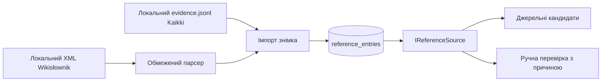

# Довідкові знімки

Реалізація [T25](tasks/T25-reference-snapshots.md) надає джерела для [автоматичної звірки AC-35](PRD.md), але не публікує змін сама. Вона відповідає [ADR-0011](adr/0011-verify-content-reports-asynchronously-against-reference-snapshots.md), враховує [ризики джерел](sad.md#11-risks-and-technical-debt) і зберігає [обмеження без мовних моделей у runtime](PRD.md#3-non-goals). Наступний споживач — [T26](tasks/T26-auto-verification.md).

## Поточна поведінка



`AddReferenceSources()` реєструє `IEnumerable<IReferenceSource>` з іменами `wikislownik`, `wsjp`, `government`. `LookupAsync(new ReferenceQuery(lemma, field), cancellationToken)` підтримує поля `translation` та `transcription`; інші поля повертають `ManualReview`, як вимагає [AC-36](PRD.md). Результат містить статус, стабільну причину й кандидатів із URL, `RevisionId`, `SnapshotAt`, атрибуцією та ліцензією. `Available` означає доступний довідковий матеріал; фінальні перевірки версії й рішення про публікацію лишаються за [T26](tasks/T26-auto-verification.md).

Після міграцій і [імпорту навчального словника](tasks/T20-dictionary-import.md) старт застосунку виконує `ReferenceSnapshotImporter.ImportPackagedAsync()`. Він читає упаковані `evidence.jsonl` та `sources-manifest.json` із `Resources/Dictionary`, а не звертається до мережі. Поточний набір містить 2 000 записів. Значення `RetrievedAt` у [наявній схемі](data-model.md) є датою отримання локального експорту з `retrieved_on` маніфесту; `CreatedAt` — часом імпорту в БД. Це не дата окремого редагування сторінки. Докладне походження випуску й дата базового дампу наведені в [маніфесті](../../dictionary/sources-manifest.json).

Поточний [файл доказів](../../dictionary/evidence.jsonl) містить кандидатні переклади та IPA; він не містить вікітексту або `revid`. Тому джерело зберігається як `wikislownik_kaikki`, `RevisionId` лишається `null`, усі такі результати потребують редактора (`revision_missing`). Наявність кандидата не означає незалежне підтвердження редакторських адаптацій. Атрибуція спільноти Wikisłownik, CC BY-SA 4.0 і позначення адаптацій повертаються в кожному кандидатові; повні умови — у [NOTICE](../../dictionary/NOTICE.md).

## Ревізований локальний дамп

Операційний шлях увімкнено через `References:WikislownikDumpPath` та `References:SnapshotAt`. Після імпорту упакованих доказів startup викликає `ImportConfiguredDumpAsync(IConfiguration, CancellationToken)`. Шлях веде на вже завантажений і розпакований локальний XML; застосунок не отримує дамп із мережі. Час повинен бути явним ISO UTC значенням з відомостей про знімок, не датою запуску. Наприклад, перед рестартом налаштованого середовища PowerShell:

```powershell
$env:References__WikislownikDumpPath = 'C:\snapshots\plwiktionary-pages-articles.xml'
$env:References__SnapshotAt = '2026-11-01T00:00:00Z'
```

Це приклад синтаксису; файл і час оператор замінює фактичними. У контейнері файл слід змонтувати для читання й передати відповідний шлях усередині контейнера. Без обох ключів виконується лише імпорт упакованих доказів. Неповна конфігурація, некоректний або майбутній час, відсутній чи нечитабельний файл дають явні причини `configured_snapshot_metadata_invalid`, `configured_dump_missing` або `configured_dump_unreadable`; startup записує їх у структурований журнал для ручного розгляду. Автоматично вигаданої дати немає.

`ImportWikislownikDumpAsync(Stream, Instant, CancellationToken)` читає розпакований MediaWiki `pages-articles` XML послідовно, лише простір назв `0`, лише одну ревізію на сторінку. Оператор передає достовірний час знімка; ревізія береться з `revision/id`, URL — з назви сторінки. Підтримуються прямі `revision/text`; багатослотові чи історичні дампи потребують попереднього експорту в цей формат. DTD та зовнішні сутності вимкнені. Пошкодження структури XML є помилкою файлу; непідтримуваний вікітекст окремої сторінки дає ручне рішення й не зупиняє наступні сторінки.

Парсер бере лише єдину секцію `{{język polski}}`, блок `{{wymowa}}` з одним `IPA`, `IPA2`, `IPA3` або `IPA4`, та єдиний рядок `ukraiński` в `{{tłumaczenia}}`. Переклади підтримують один маркер значення й прості кириличні вікіпосилання. Кілька значень у блоці визначень, невідомі шаблони, пояснення й варіанти IPA дають ручне рішення відповідного поля. Парсер не розгортає шаблони MediaWiki. Граматика ґрунтується на [правилах Wikisłownik](https://pl.wiktionary.org/wiki/Wikis%C5%82ownik:ZTH_uwagi) і [документації шаблонів](https://pl.wiktionary.org/wiki/Wikis%C5%82ownik:Szablony).

Конвертер IPA формує приблизну українську підказку за явною таблицею символів і зберігає основний наголос над наступним голосним. Африкати з верхньою чи нижньою з'єднувальною рискою підтримуються як цілі токени. Носові голосні, довгота, відсутній наголос у багатоскладовому записі, другорядний або повторний наголос, альтернативи й невідомі діакритики не відкидаються мовчки: значення не повертається, поле потребує редактора. Це локальна навчальна конвенція, а не універсальний фонетичний стандарт. Початковий IPA теж зберігається як поле `ipa` для перевірки походження, але порт не трактує його як готову кириличну транскрипцію.

Оновлення леми атомарне: у транзакції з PostgreSQL advisory lock замінюються її кандидати й маркери `manual_review`. Збій нового парсера прибирає попередні кандидати цієї леми, щоб вони не підтверджували застаріле значення. Повтор однакового знімка не додає дублікатів; старіший знімок не перезаписує новіший. Знімки старші за 35 днів або датовані майбутнім потребують редактора. Згортання прискорює пошук, але результат додатково звіряє точну нормалізовану лему, зберігаючи відмінності польських діакритиків.

## Дозволені зовнішні джерела

WSJP PAN за замовчуванням не має дозволених лем. `ReferenceSourcesOptions.WsjpPages` задає окремі HTTPS-сторінки на `wsjp.pl`; невідомі леми й інші поля не викликають HTTP. Один singleton на процес застосовує інтервал щонайменше 5 секунд за замовчуванням, timeout 5 секунд, обмеження відповіді 256 KiB і кеш результатів та помилок 24 години. Автоматичні перенаправлення, cookies і розпакування вимкнені, повторних спроб немає. Заголовки й тіло входять у спільний бюджет timeout. Обмеження діє на екземпляр; перед горизонтальним масштабуванням потрібен спільний ліміт.

Отриманий HTML WSJP не підтверджує вимову автоматично: результат `wsjp_requires_editor` означає ручну звірку. Повного ліцензованого експорту чи стабільного семантичного парсера WSJP у цьому випуску немає. Масового обходу, пошукових запитів і скрейпінгу невідомих термінів немає.

`ReferenceSourcesOptions.GovernmentReferences` — явно перевірені редактором відповідності леми, українського значення, HTTPS URL у домені `gov.pl`, дати перевірки та атрибуції. Лише ці записи можуть бути доступними для поля перекладу. Порожня, неурядова або прострочена відповідність дає `permitted_government_reference_missing`. Адаптер не виводить юридичний зміст із самого факту існування URL. У поточному випуску таких відповідностей не налаштовано; легалізаційні леми потребують редактора.

## Перевірки та подальша робота

Тести використовують фіксовані мінімальні зразки вікітексту, створені для тестування граматики; їхні числові ревізії синтетичні й не заявляються як ревізії справжніх сторінок. HTTP підмінено локальним handler. PostgreSQL-тести доводять шлях імпорт → зберігання → пошук через порт, повторний імпорт, деградацію парсера та імпорт реальних 2 000 локальних доказів без вигаданих ревізій.

Щомісячне отримання нових дампів, планувальник оновлення, покриття всіх синтаксичних конструкцій Wikisłownik і автоматичний семантичний розбір WSJP не реалізовані. Для нового довідкового підтвердження потрібні ревізований локальний XML або явно перевірена урядова відповідність. Публікація змін, конфлікти джерел і журнал рішення належать [T26](tasks/T26-auto-verification.md); цей шар не викликає LLM.
