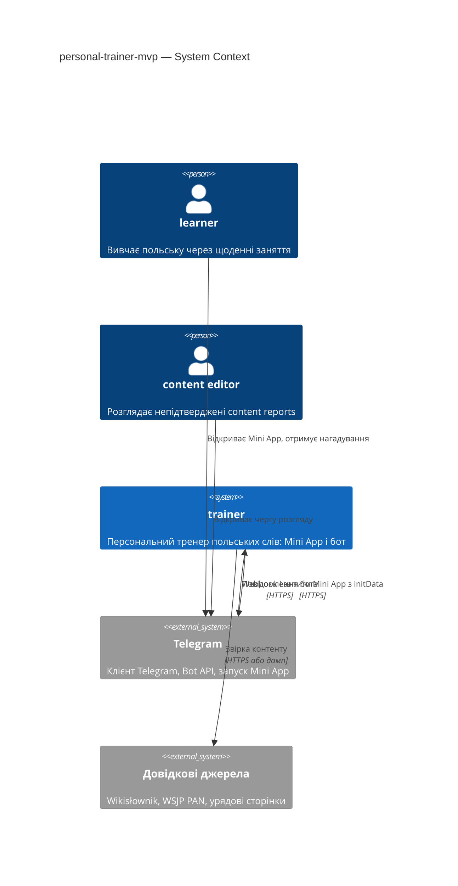
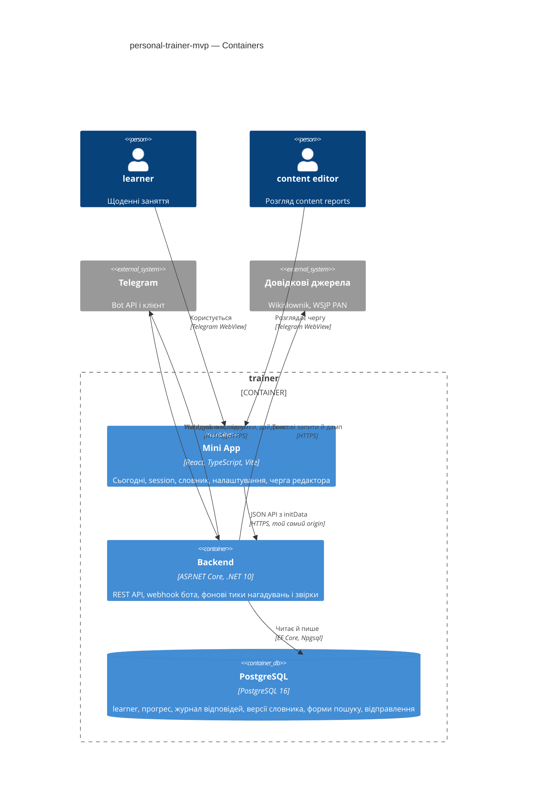
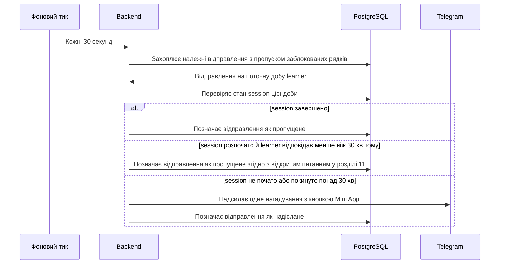

# Software Architecture Document — personal-trainer-mvp

> **Inputs:** [PRD](./PRD.md) · [CONTEXT](../../../CONTEXT.md) · [architecture-map](../../architecture-map.md) (reflects `2026702`).
> Рішення з великим масштабом удару зважували три агенти-експерти (бекенд .NET, фронтенд Telegram Mini App, алгоритм повторень і контент); автор прийняв рекомендовані варіанти (режим «автономно + експерти»).

## 1. Introduction and goals

**Intent.** Перетворити груповий Telegram-бот на персональний trainer: кожен learner проходить коротке щоденне заняття з пригадуванням польських слів у застосунку всередині Telegram (Mini App), тренер оцінює відповіді на сервері й адаптує інтервали повторень, бот нагадує про заняття, а content editor підтримує якість спільного словника через content reports (PRD §1–§2).

**Top-3 quality goals (1-liners; full scenarios in §10):**

1. **Коректність навчального обліку** — жодна відповідь не втрачається й не зараховується двічі; доба, ліміти й статуси слів рахуються в часовому поясі learner.
2. **Чутливість інтерфейсу** — «Сьогодні», оцінка відповіді й пошук укладаються в latency-цілі PRD §6.
3. **Надійність нагадувань** — не більше одного нагадування на добу без дублікатів після рестартів, ≥ 99% вчасно; рідкісна втрата при збої між надсиланням і позначкою входить у бюджет 1% (ADR-0007).

**Stakeholders.**

| Role | Interest | Sign-off owner? |
|---|---|---|
| learner | Щоденні заняття, прогрес, нагадування, пошук слів | No |
| content editor | Черга непідтверджених content reports, якість словника | No |
| Власник проєкту (Viacheslav Melnichenko) | Продуктові рішення, роль content editor у пілоті, затвердження SAD | Yes |
| Tech Lead | Архітектурна цілісність, ADR | Yes |

<!-- Decision overrides (¶4) — populated by the Step-7 critic resolution loop, empty otherwise. -->

## 2. Constraints

**Technical.**
- C# / .NET 10, ASP.NET Core з контролерами, EF Core 10.0.2 + Npgsql 10.0.0, PostgreSQL 16 — `architecture-map.md` §Stack.
- Telegram.Bot 22.8.1 (webhook), Quartz 3.15.1 з in-memory сховищем і `[DisallowConcurrentExecution]`.
- Один екземпляр застосунку (`replicas: 1`) у k8s; CI збирає образ і запускає тести, але не розгортає.
- Фронтенду й JS-тулчейну в репозиторії немає — Mini App є першим UI.

**Organisational.**
- Один розробник, переважно бекенд .NET.
- Пілот на ~50 learner стартує лише після схвалення 2 000 лем (PRD §1, OQ-2).
- Роль content editor — власник проєкту, призначений вручну (PRD OQ-3).

**Conventions.**
- DI-реєстрація в `Program.cs`, primary constructors, interface-per-service, `IOptions<T>` — `architecture-map.md` §Conventions.
- EF Core Migrations з іменами `yyyyMMddHHmmss_Name`, застосування на старті.
- Тести: xUnit + Moq + FluentAssertions; документація й коментарі українською (`AGENTS.md`).
- Свідоме відхилення від конвенції тестів: окрім InMemory-тестів сервісів, додаються інтеграційні тести на справжньому PostgreSQL (Testcontainers), бо InMemory-провайдер не перевіряє транзакції, `xmin` і захоплення рядків з пропуском заблокованих, на яких тримаються QG-1 і QG-3.

**Regulatory / external.**
- Персональні дані learner класифіковано як confidential (PRD §6.1); security review обов'язковий.
- Ліцензії зовнішніх даних: Wikisłownik — CC BY-SA 4.0 (атрибуція), PoliMorf і Morfeusz 2 — 2-clause BSD, VESUM — CC BY-NC-SA 4.0 (див. §11).
- Обмеження частоти запитів до Wikisłownik підтверджено пілотом (`docs/dictionary/wiktionary-validation-pilot.csv`).

## 3. Context and scope

trainer обслуговує україномовних learner, які вивчають польську, і одного content editor. Learner взаємодіє з Mini App, що відкривається в Telegram, і отримує нагадування від бота; content editor розглядає чергу content reports у тому самому Mini App. Довідкові джерела використовуються лише для звірки контенту у фоні.

**External systems (in / out):**

| Actor or system | Type | Interaction |
|---|---|---|
| learner | Person | Заняття, словник, налаштування, content reports через Mini App; нагадування й підсумки від бота |
| content editor | Person | Черга непідтверджених content reports, схвалення й відхилення змін |
| Telegram Bot API | System (external) | Webhook з оновленнями; доставка повідомлень бота; запуск Mini App з підписаними даними ідентичності |
| Wikisłownik / WSJP PAN / офіційні урядові сторінки | System (external) | Довідкові джерела для автоматичної звірки контенту (дамп і точкові запити) |

**C4 Context (L1):**



## 4. Solution strategy

**Target surface(s) (the first decision — what's being built):** `[backend-service, web-frontend]` — ASP.NET Core бекенд з REST JSON API і фоновими завданнями в тому самому процесі + Telegram Mini App як клієнтська SPA. Окремої `worker`-поверхні немає: нагадування, дайджести й звірка виконуються в процесі бекенду (ADR-0001).

**Top strategic choices (the seeds for ADRs):**

1. **Модульний моноліт на одному PostgreSQL** — новий код живе у feature-модулях `Identity`, `Learning`, `Content`, `Notifications`, `Bot` в одному проєкті з одним `AppDbContext`; групова модель виводиться з ужитку без міграції даних (ADR-0003, ADR-0004). Відповідь, розклад слова й стан session змінюються в одній транзакції, тож розподіл на сервіси нічого не дає при одному екземплярі.
2. **Сервер — єдине джерело істини навчального стану** — session, оцінка відповіді, межі доби й планування повторень живуть на сервері; клієнт лише відмальовує стан і результат (ADR-0008, ADR-0009). Це закриває вимоги «0 втрачених відповідей» і «рівно одне зарахування» та не розкриває правильних відповідей клієнту.
3. **Час learner як доменне поняття** — IANA-пояс learner і календарна доба з урахуванням DST моделюються явно; нагадування й дайджести йдуть через таблицю відправлень з унікальним ключем на дату (ADR-0006, ADR-0007).
4. **Словник як версійований контент у БД** — незмінні версії записів, вказівник на опубліковану версію, асинхронна звірка content reports за довідковими знімками й попередньо обчислена таблиця форм для пошуку (ADR-0010, ADR-0011, ADR-0012).
5. **UI-architecture: SPA, яку роздає бекенд** — React + TypeScript + Vite, Telegram UI kit поверх theme params, той самий origin, що й API; автентифікація через підписані `initData` у кожному запиті (ADR-0002, ADR-0005). Дизайн-системи в репозиторії немає (`architecture-map.md` §Frontend: N/A), тож UI-kit Telegram і є базовою дизайн-системою.

## 5. Building block view

Модульний моноліт: технічні папки поточного бота замінюються feature-модулями, кожен з власними контролерами, сервісами, конфігураціями EF-сутностей і методом реєстрації `Add<Module>()`; `Program.cs` лишається composition root. Модуль читає чужі дані лише через його інтерфейс; правило перевіряє архітектурний тест (ADR-0003).

**Internal decomposition:**

```
ConstantLearning/
├── Features/
│   ├── Identity/        learner, автентифікація initData, роль content editor, псевдонімна мітка
│   ├── Learning/        session, оцінка відповіді, планувальник повторень, журнал відповідей, «Сьогодні»
│   ├── Content/         записи й версії словника, імпорт, пошук, content reports, звірка, черга редактора
│   ├── Notifications/   таблиця відправлень, planner, dispatcher (нагадування, підсумки, дайджест)
│   └── Bot/             webhook, /start з кнопкою Mini App, надсилання повідомлень
├── Platform/            годинник і часові пояси, AppDbContext, Telegram-клієнт, фонові тики
├── wwwroot/             зібрана Mini App (копіюється на етапі Docker-збірки)
└── Program.cs           composition root
ConstantLearning.MiniApp/  React + TypeScript + Vite
ConstantLearning.Tests/    модульні й інтеграційні тести
```

**C4 Container (L2):**



## 6. Runtime view

**Critical flow 1: відповідь на вправу пригадування (AC-12, AC-15–AC-18)**

```mermaid
sequenceDiagram
    actor L as learner
    participant M as Mini App
    participant A as Backend
    participant D as PostgreSQL
    L->>M: Вводить польське слово
    M->>A: Відповідь на картку session з initData
    A->>A: Перевіряє initData і визначає learner
    A->>D: Відкриває транзакцію й читає стан картки
    alt картку вже оцінено з тим самим вмістом
        D-->>A: Збережений результат
        A-->>M: Той самий результат без повторного зарахування
    else картку вже оцінено з іншим вмістом
        A-->>M: Відмова без зміни результату
    else картка очікує відповіді
        A->>A: Оцінює відповідь і планує наступне повторення
        A->>D: В одній транзакції переводить картку в оцінену й пише подію відповіді та стан слова
        D-->>A: Зафіксовано
        A-->>M: Результат, різниця написання й наступна картка
    end
    M-->>L: Показує результат і приклад
```



**Critical flow 2: щоденне нагадування (AC-26)**



Решту критичних потоків (онбординг, «Вже знаю», межа доби, content report і звірка, черга редактора, пошук) додає `complete-sequence-diagrams`.

## 7. Deployment view

Один образ Docker: multi-stage збірка спершу будує Mini App (Node 22), копіює її в `wwwroot`, потім публікує бекенд; build context розширюється до кореня репозиторію. У k8s — один Deployment з `replicas: 1` і PostgreSQL; Mini App і API обслуговуються з одного HTTPS-домену, який також є адресою webhook. Фонові тики (нагадування, дайджести, звірка) працюють у тому самому процесі.

**Monitoring:**
- Журнал відправлень (`notification_dispatch`) — частка відправлень, надісланих у межах 2 хв від `due_at_utc`.
- Серверні метрики latency для оцінки відповіді й пошуку; клієнтська телеметрія відкриття «Сьогодні» через окремий endpoint (`navigator.sendBeacon`).
- Щоденна звірка журналу відповідей із картками session.

**Scaling thresholds:**
- Пілот: ~50 learner, ціль ≥ 100 одночасних на одному екземплярі.
- Друга репліка вимагає: міграцій поза стартом застосунку (bundle або init-контейнер); Quartz-тики безпечні завдяки захопленню рядків з пропуском заблокованих.
- Обсяг: 2 000 лем × десятки форм — сотні тисяч рядків таблиці форм; журнал відповідей пілоту — десятки тисяч подій.

**Обов'язкові виправлення до пілоту** (з `architecture-map.md` §Constraints): probes на `api/telegram/health`; рядок підключення через `ConnectionStrings__DefaultConnection`; webhook не видаляється на зупинці.

## 8. Crosscutting concepts

| Concept | Convention | Where defined |
|---|---|---|
| Logging | Структуровані шаблони `ILogger` з `{LearnerId}` замість `{ChatId}`; заголовок `Authorization` і `initData` ніколи не логуються | тут; `architecture-map.md` §Conventions |
| Authentication | `AuthenticationHandler` перевіряє `initData` (HMAC-SHA256, свіжість `auth_date` ≤ 24 год) у кожному запиті | ADR-0005 |
| Authorization | Policy `ContentEditor` з claim, який додає `IClaimsTransformation` за списком Telegram id у конфігурації (secret); `learner_id` лише з claims, чужі ресурси — «не знайдено» | тут (рішення OQ-3) |
| Псевдонімна мітка автора | Випадковий alias на кшталт `R-7F3A9C`, унікальний, зберігається в learner при першому content report | тут (PRD §6.1) |
| Error handling | ProblemDetails через `[ApiController]`; доменні відмови — бізнесові повідомлення українською; webhook завжди відповідає успіхом, помилки лише логуються | тут |
| API style | REST JSON на контролерах `[ApiController]` усередині модулів, `AddOpenApi()`; TS-типи клієнта генеруються з OpenAPI | тут; `api-forge` |
| Idempotency | Картка session — природний ключ відповіді: захоплення `pending → answered` у тій самій транзакції, що й запис відповіді; повтор з тим самим вмістом повертає збережений результат, з іншим — відмову без зміни результату | ADR-0008 |
| Concurrency | Оптимістична конкурентність через `xmin` на стані слова й session; унікальні `learner_word(learner_id, entry_id)` і одна активна session на learner у межах доби | тут |
| Time | NodaTime: `IClock`, IANA tzdb, `LocalDate` доби learner; тести з `FakeClock` | ADR-0006 |
| Answer evaluation | Чистий доменний сервіс: NFC, обрізання й стискання пробілів, нижній регістр; явна мапа згортання діакритики (`ą ć ę ł ń ó ś ź ż`); структурований diff з сервера | тут (AC-12–AC-17) |
| ID strategy | `int` identity для нових сутностей за конвенцією репозиторію; Telegram user id — `long` з унікальним індексом | `architecture-map.md` §Conventions |
| UI / design system | `@telegram-apps/telegram-ui` поверх `--tg-theme-*`; власні кольори лише похідні від theme params; lazy-чанки для словника, налаштувань і черги редактора | тут |
| Data fetching | TanStack Query: кеш `/today`, відміна застарілих запитів пошуку, повтор мутацій з тим самим ключем картки | тут |
| Search UX | Запит на кожен символ без debounce, відміна застарілого запиту, `CancellationToken` до EF-запиту | ADR-0012, AC-30 |
| Bot webhook | `SetWebhook` з `secret_token` і перевіркою заголовка; явні `allowed_updates`; без видалення на зупинці; заблокований бот вимикає нагадування | тут |
| Internationalisation | Інтерфейс українською; польські тексти — контент словника | — |
| Observability | Журнал відправлень, серверні latency-метрики, клієнтська телеметрія «Сьогодні» | §7 |

## 9. Architecture decisions

| # | Title | Status | Section |
|---|---|---|---|
| 0001 | Deliver the trainer as a backend service plus a Telegram Mini App | Accepted | §4 |
| 0002 | Build the Mini App as a React SPA served by ASP.NET Core | Accepted | §4 |
| 0003 | Organise code into feature modules inside the monolith | Accepted | §5 |
| 0004 | Retire the group model without data migration | Accepted | §4 |
| 0005 | Authenticate every API request with Telegram initData | Accepted | §8 |
| 0006 | Model learner time with NodaTime and IANA zones | Accepted | §8 |
| 0007 | Dispatch notifications through a Postgres dispatch table | Accepted | §6 |
| 0008 | Keep the learning session server-side with per-card idempotency | Accepted | §6 |
| 0009 | Schedule reviews with MEMORIZE behind a port over an answer log | Accepted | §4 |
| 0010 | Version dictionary entries in Postgres with a published pointer | Accepted | §4 |
| 0011 | Verify content reports asynchronously against reference snapshots | Accepted | §4 |
| 0012 | Search via a precomputed table of folded word forms | Accepted | §8 |

ADR files live under `docs/features/personal-trainer-mvp/adr/NNNN-<title>.md`.

## 10. Quality requirements

**QG-1. Коректність навчального обліку**
- **When:** learner надсилає ту саму відповідь двічі (подвійне натискання, повтор після мережевої помилки) або двома пристроями.
- **Then:** 0 втрачених відповідей; повторне надсилання тієї самої відповіді зараховується один раз (PRD §6).
- **How verify:** інтеграційний тест подвійного надсилання на справжньому PostgreSQL (Testcontainers) + щоденна звірка журналу відповідей із картками session.

**QG-2. Чутливість інтерфейсу**
- **When:** learner відкриває trainer, відповідає на вправу або вводить символ у пошуку при ≥ 100 одночасних learner на одному екземплярі.
- **Then:** Latency p95 відкриття екрана «Сьогодні» ≤ 1 500 ms; оцінки відповіді ≤ 500 ms; пошуку в словнику ≤ 300 ms на запит (PRD §6).
- **How verify:** навантажувальний тест перед пілотом; клієнтська телеметрія «Сьогодні»; серверні метрики оцінки відповіді й пошуку.

**QG-3. Надійність нагадувань**
- **When:** настає час нагадування learner, зокрема після рестарту застосунку чи зміни часового поясу.
- **Then:** ≥ 99% нагадувань надіслано в межах 2 хв від запланованого часу; не більше одного нагадування на календарну дату learner (PRD §6, AC-26, AC-44).
- **How verify:** журнал доставки з тижневим вікном; тести planner на перехід DST і зміну поясу з `FakeClock`.

**QG-4. Доступність**
- **When:** будь-який місяць пілоту.
- **Then:** Availability 99.5% (PRD §6).
- **How verify:** місячне SLO-вікно за health-probe.

## 11. Risks and technical debt

| Risk / debt | Severity | Mitigation | Owner |
|---|---|---|---|
| Ліцензія VESUM (CC BY-NC-SA 4.0) забороняє комерційне використання українських словоформ і може поширити ShareAlike на таблицю форм | High | До генерації форм вибрати: VESUM для некомерційного пілоту з атрибуцією, hunspell `uk_UA` після перевірки ліцензій файлів або пошук лише за базовими формами | Viacheslav Melnichenko |
| Немає машинного польсько-українського словника з відкритою ліцензією, крім Wikisłownik, — «другий словник» з AC-35 фактично недоступний | Medium | Автопідтвердження перекладу лише за Wikisłownik; решта йде content editor; частку автопідтверджень вимірювати на пілоті | Viacheslav Melnichenko |
| Умови використання WSJP PAN невідомі | Medium | Лише точкові запити з обмеженням частоти до перевірки умов; без масового скрейпінгу | Viacheslav Melnichenko |
| Парсер вікітексту Wikisłownik і конвертер IPA → кирилиця крихкі | Medium | Окремі адаптери за портом `IReferenceSource` з тестами на зразках; збій парсера переводить звірку в ручний режим | Backend |
| `@telegram-apps/telegram-ui` фіксує проєкт на React 18 і розвивається повільно | Low | Тема прив'язана до `--tg-theme-*`, kit можна замінити власним CSS поступово | Frontend |
| Наявність `tzdata` та ICU в образі `aspnet:10.0` не перевірена | Medium | Перевірити під час скафолдингу; NodaTime несе власну tzdb | Backend |
| Інтерфейс недоступний під час рестарту, бо UI й API в одному процесі | Low | Один короткий рестарт на реліз; webhook більше не видаляється на зупинці | Backend |
| Немає процесу перевірки в реальному клієнті Telegram | Medium | Тестовий бот і HTTPS-тунель для ручної перевірки; `mockTelegramEnv` для локальної розробки | Frontend |
| Open architectural decision: поле прийнятих польських варіантів відповіді відсутнє в `content-schema.md`, хоча AC-16 і AC-38 його потребують | Open question | Resolve before /sdlc:generate-data-model; додати поле до редакторської схеми й імпорту | Viacheslav Melnichenko |
| Open architectural decision: чи зараховувати іншу `approved`-лему з тим самим українським перекладом, кириличну літеру замість латинської й кінцеву пунктуацію | Open question | Resolve before /sdlc:api-forge; до рішення — mistake з дією «Моя відповідь теж правильна» | Viacheslav Melnichenko |
| Open architectural decision: до якого моменту доступна дія «Моя відповідь теж правильна» | Open question | Resolve before /sdlc:api-forge; default — до переходу на наступну картку | Viacheslav Melnichenko |
| Open architectural decision: якщо о часі reminder learner був активний менше 30 хв тому, нагадування пропускається без відкладеного повтору | Open question | Resolve before /sdlc:break-tasks; default — пропуск | Viacheslav Melnichenko |

**Accepted debt (acceptable in v1, plan to fix later):**
- Межі модулів тримаються на домовленості й архітектурному тесті, а не на окремих збірках.
- Нагадування мають семантику «не більше одного»: збій між надсиланням і позначкою втрачає нагадування, і це йде в бюджет 1% NFR.
- Параметри MEMORIZE апріорні до перенастроювання за даними пілоту (PRD OQ-4).
- Один екземпляр і автоміграції на старті; друга репліка потребує змін з §7.

## 12. Glossary

Канонічні терміни — у [CONTEXT.md](../../../CONTEXT.md). Тут лише архітектурні терміни цього SAD.

| Term | Meaning |
|---|---|
| initData | Підписані Telegram дані запуску Mini App з ідентичністю користувача й `auth_date` |
| Dispatch table | Таблиця запланованих відправлень бота з унікальним ключем `(recipient, kind, local_date)` |
| Answer log | Append-only журнал подій відповідей — джерело істини, з якого перебудовується стан слів |
| Published pointer | Посилання запису словника на поточну `approved`-версію, яку бачать learner |
| Folded form | Словоформа після нормалізації й згортання діакритики для префіксного пошуку |
| Reference snapshot | Локальна копія довідкових даних (дамп Wikisłownik, кеш точкових запитів) для звірки |
