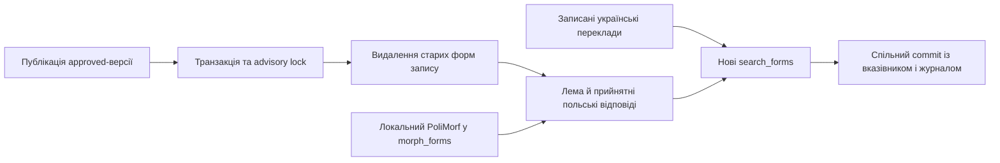

# Пошукові форми словника

Поточна реалізація [T21](tasks/T21-search-forms.md) виконує [ADR-0012](adr/0012-search-via-a-precomputed-table-of-folded-word-forms.md), вимоги [PRD AC-30](PRD.md), [PRD AC-32](PRD.md) і [PRD AC-33](PRD.md). Місце пошуку в архітектурі описує [SAD](sad.md). Публікація та повторний імпорт спираються на [T20](tasks/T20-dictionary-import.md) і [ADR-0010](adr/0010-version-dictionary-entries-in-postgres-with-a-published-pointer.md).



## Поточна поведінка

`SearchFormsProjection` реалізує `IPublicationProjection` в тому самому scoped `AppDbContext` і транзакції, що й `ContentPublicationService`. Для змінених записів старі форми видаляються, а нові створюються лише для поточної опублікованої `approved`-версії. Зняття публікації видаляє всі форми запису. Збій після видалення або вставки відкочує форми, вказівник, порядок курсу й журнал публікації разом.

Індекс містить нормативну польську лему, усі прийнятні польські відповіді, форми з локального лексикону для цих написань та всі збережені українські переклади незалежно від їхнього `kind`. Тотожні display-форми однієї мови й версії не дублюються; ознака леми зберігається. `form_display` має діакритику; `form_folded` використовує спільний `SearchTextNormalizer.Fold(string)` із простору імен `ConstantLearning.Features.Content.Search.Forms`. [T22](tasks/T22-dictionary-search-api.md) має викликати той самий метод для запиту.

Згортання обрізає зовнішні пробіли, нормалізує Unicode, переводить текст у нижній регістр invariant, прибирає комбіновані діакритичні знаки та замінює `ł → l`, `ґ → г`. Зокрема, `ą ć ę ń ó ś ź ż → a c e n o s z z`, `ї → і`, `й → и`; `є` залишається `є`. Це правило пошуку, а не оцінювання навчальних відповідей; апострофи й внутрішні пробіли не змінюються.

Відповідно до відкритого [PRD OQ-6](PRD.md#8-open-questions) українська морфологія не завантажується, VESUM не використовується. Український пошук має лише записані переклади та їхні префікси; відмінені форми перекладів автоматично не утворюються. Правила довжини запиту, префіксів, сортування й learner API належать до [T22](tasks/T22-dictionary-search-api.md).

## Дані та покриття

До пакета входить `Resources/Morphology/polimorf-course.tab.gz`: **58 971 унікальний рядок PoliMorf 0.6.7, 337 110 байтів gzip**, відібраний за 2 000 лемами й прийнятними відповідями поточного курсу. Покрито **1 998 із 2 000** написань. Дві леми `siebie` та `związany` не мають власних записів леми в цьому джерелі: їхні базові написання залишаються доступними для пошуку. Відповідність цих форм іншим словниковим лемам не використовується як автоматична заміна редакторської леми.

Контрольні суми, точне джерело, кількість і список пропусків містить [manifest.json](../../../ConstantLearning/Resources/Morphology/manifest.json). Ліцензію BSD-2-Clause, правовласників та атрибуцію містить [повідомлення морфології](../../../ConstantLearning/Resources/Morphology/NOTICE.md). Умови навчальних перекладів окремо описує [повідомлення словника](../../dictionary/NOTICE.md).

`SearchFormsMaintenance.GetMissingPolishMorphologyAsync()` повертає редакторський індикатор пропусків: `EntryId`, `VersionId`, `ExternalId`, `LemmaPl` для опублікованих лем без польської морфології. Startup журналює їхню кількість. Цей індикатор не змінює редакторську версію чи `review_note`; редакторський UI ще не реалізовано. Нові леми поза packaged-вибіркою також мають fallback із леми, прийнятних відповідей та записаних перекладів до оновлення вибірки або імпорту повного локального джерела.

## Ініціалізація та локальне оновлення

Після міграцій і [імпорту словника](tasks/T20-dictionary-import.md) `DatabaseInitializationService` викликає `SearchFormsMaintenance.InitializeAsync()`. Він перевіряє контрольну суму packaged-вибірки з [manifest.json](../../../ConstantLearning/Resources/Morphology/manifest.json), імпортує її за потреби й відновлює відсутні проєкції вже опублікованих записів. Повторний незмінний імпорт словника не є умовою запуску backfill. Повторний запуск не додає версій, журналу публікацій чи дублікатів форм.

`PolishMorphologyImporter.ImportAsync(path, expectedSha256, cancellationToken)` читає локальний UTF-8 TSV або `.gz` у форматі PoliMorf: форма, лема, граматичні теги, необов'язкові інші колонки. Суфікс омоніма леми після `:` вилучається. Імпорт потоковий через PostgreSQL binary COPY; великого списку в пам'яті немає. Неправильні рядки, порожній файл і невідповідна очікувана SHA-256 завершують імпорт відмовою. Ідентифікатор `source` має вигляд `polimorf:<20 символів SHA-256 файлу>`; незмінне джерело повторно не вставляється. Заміна джерела видаляє лише попередні польські рядки з префіксом `polimorf:` та атомарно перебудовує форми всіх поточних публікацій під тим самим advisory lock.

Жодних HTTP-запитів під час startup немає. За потреби передати повний локальний PoliMorf через конфігурацію `Morphology:PolishLexiconPath` та, бажано, `Morphology:PolishLexiconSha256`, наприклад змінними середовища:

```powershell
$env:Morphology__PolishLexiconPath='C:\data\PoliMorf-0.6.7.tab.gz'
$env:Morphology__PolishLexiconSha256='e9b2633bf384b7a778bdb4d17dd4c8055b1d040da9f5113dae513718854216b2'
dotnet run --project ConstantLearning
```

Повний локальний файл імпортується цілком і потребує відповідного місця в PostgreSQL. Якщо шлях явно задано, але файла немає, startup завершується помилкою. Якщо packaged-файла немає й власний шлях не задано, startup журналює обмежений fallback та будує леми, відповіді й переклади. `SearchFormsMaintenance.RebuildAsync()` дозволяє явно відновити всі пошукові форми; `onlyMissing: true` відновлює лише відсутні та прибирає застарілі.

Відтворення компактної вибірки після зміни курсу виконується окремо, до поширення застосунку:

```powershell
Invoke-WebRequest -Uri 'https://zil.ipipan.waw.pl/PoliMorf?action=AttachFile&do=get&target=PoliMorf-0.6.7.tab.gz' -OutFile .dictionary-cache/PoliMorf-0.6.7.tab.gz
python -X utf8 tools/dictionary/prepare_morphology.py --source .dictionary-cache/PoliMorf-0.6.7.tab.gz
```

Інструмент перевіряє зафіксовану суму офіційного джерела, вибирає потрібні леми й відповіді з поточного курсу, усуває повтори та записує детермінований gzip і оновлений [manifest.json](../../../ConstantLearning/Resources/Morphology/manifest.json). Повний знімок залишається в ігнорованому локальному кеші. Після зміни даних слід перевірити покриття та зберегти [повідомлення морфології](../../../ConstantLearning/Resources/Morphology/NOTICE.md).
