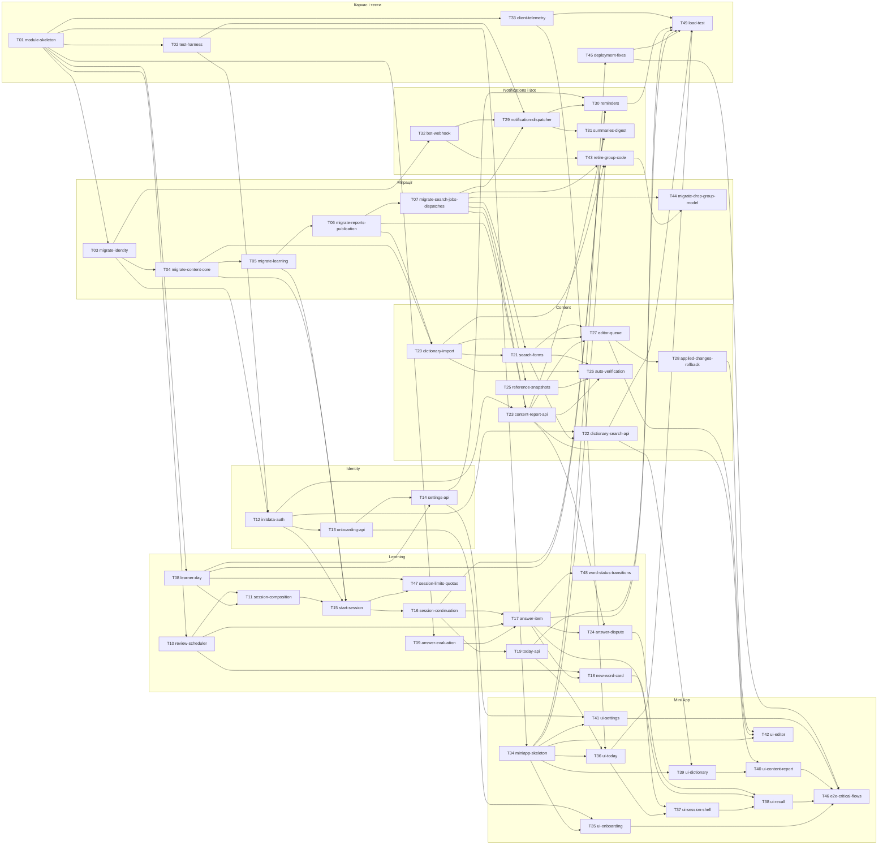

# Epic — personal-trainer-mvp

> **PRD:** [PRD.md](../PRD.md) · **Design:** [sad.md](../sad.md) · **Data model:** [data-model.md](../data-model.md) · **API:** [openapi.yaml](../contracts/openapi.yaml), [events.md](../contracts/events.md) · **ADRs:** [adr/](../adr/)

## Goal

Замінити груповий бот персональним тренером у Telegram Mini App: кожен learner отримує щоденні session з адаптивними повтореннями, пошук у версійованому словнику й канал повідомлень про неточності з автоматичною звіркою (PRD §2). Епік закінчується, коли всі 57 AC мають зелені тести, а таблиці групової моделі видалено окремим релізом.

## Scope

- **In:** модулі `Identity`, `Learning`, `Content`, `Notifications`, `Bot`, `Platform` у `ConstantLearning/`, Mini App `ConstantLearning.MiniApp/`, 23 staged-міграції, виведення групової моделі, збірка й маніфести.
- **Out:** усе з PRD §3 — зокрема відкат імпортованих змін і відкат на довільну стару версію, VESUM до рішення OQ-6, друга репліка застосунку.

## Task map

Той самий DAG, що й у [tasks.json](./tasks.json). Стрілка веде від залежності до задачі, яку вона розблоковує.

**Фази (рівні DAG — задачі однієї фази можуть іти паралельно, якщо не ділять lane):**

- **Фаза 1:** T01
- **Фаза 2:** T02, T03, T08, T09, T10, T33, T34
- **Фаза 3:** T04, T11, T12, T32, T45
- **Фаза 4:** T05, T13
- **Фаза 5:** T06, T14, T15, T35
- **Фаза 6:** T07, T47, T16, T20, T41
- **Фаза 7:** T17, T19, T21, T23, T25, T29, T43
- **Фаза 8:** T48, T18, T22, T24, T26, T27, T30, T31, T36, T44
- **Фаза 9:** T28, T37, T39, T49
- **Фаза 10:** T38, T40, T42
- **Фаза 11:** T46

Lanes, що серіалізуються: усі `migration` (T03 → T04 → T05 → T06 → T07 → T44); задачі зі спільними `files_hint` (наприклад, T13 і T14 у `Features/Identity/`); ланцюг T15 → T16 → T17 → T18 у `Features/Learning/Sessions/` серіалізовано залежностями; T43 іде після всіх міграцій T03–T07, імпорту T20 і каркаса Mini App T34, бо змінює `AppDbContext` і `Program.cs`.

## Tasks

Статус — у [tracker.md](./tracker.md). Машинний контракт — [tasks.json](./tasks.json).

| # | Task | Layer | Blocked by | DoD (short) |
|---|---|---|---|---|
| [T01](./T01-module-skeleton.md) | Створити каркас feature-модулів, Platform і NodaTime | wiring | — | `dotnet build` і наявні тести зелені |
| [T02](./T02-test-harness.md) | Додати інтеграційні тести на PostgreSQL з FakeClock і фікстурами | tests | T01 | приклад інтеграційного тесту піднімає контейнер, застосовує міграції й проходить |
| [T03](./T03-migrate-identity.md) | Перенести міграції learner і нагадувань | migration | T01 | міграції застосовуються на чистій БД і відкочуються `.down.sql` без залишків |
| [T04](./T04-migrate-content-core.md) | Перенести міграції записів, версій, перекладів і прийнятих відповідей | migration | T03 | міграції застосовуються на чистій БД і відкочуються `.down.sql` без залишків |
| [T05](./T05-migrate-learning.md) | Перенести міграції слів learner, session, карток і журналу відповідей | migration | T04 | міграції застосовуються на чистій БД і відкочуються `.down.sql` без залишків |
| [T06](./T06-migrate-reports-publication.md) | Перенести міграції content reports, нейтралізацій, доказів і журналу публікацій | migration | T05 | міграції застосовуються на чистій БД і відкочуються `.down.sql` без залишків |
| [T07](./T07-migrate-search-jobs-dispatches.md) | Перенести міграції форм пошуку, довідок, задач звірки й відправлень | migration | T06 | міграції застосовуються на чистій БД і відкочуються `.down.sql` без залишків |
| [T08](./T08-learner-day.md) | Реалізувати обчислення доби learner зі зміною поясу | domain | T01 | unit-тести з `FakeClock` на AC-07 (Варшава → Токіо) і AC-54 (Варшава → Нью-Йорк) зелені |
| [T09](./T09-answer-evaluation.md) | Реалізувати оцінку відповіді з нормалізацією й різницею написання | domain | T01 | unit-тести на кожен результат AC-12…AC-16 зелені |
| [T10](./T10-review-scheduler.md) | Реалізувати планувальник повторень за портом над журналом відповідей | domain | T01 | property-тест: інтервал після правильної відповіді завжди в межах [max(2, prev+1); min(3·prev, 180)] |
| [T11](./T11-session-composition.md) | Реалізувати складання session з лімітами й квотами | domain | T08, T10 | unit-тести AC-03…AC-06, AC-09, AC-10 зелені |
| [T12](./T12-initdata-auth.md) | Автентифікувати запити за initData і додати роль content editor | ports | T03, T02 | тести: валідний підпис — 200, підроблений чи прострочений — `auth.invalid_init_data` |
| [T13](./T13-onboarding-api.md) | Реалізувати онбординг і профіль learner | app | T12 | інтеграційні тести AC-01, AC-02, AC-53 зелені |
| [T14](./T14-settings-api.md) | Реалізувати зміну ліміту, поясу й нагадувань | app | T13, T08 | інтеграційні тести AC-27, AC-45 зелені |
| [T15](./T15-start-session.md) | Реалізувати старт session з персистенцією карток | app | T11, T05, T04, T12 | інтеграційні тести на PostgreSQL для AC-03, AC-04, AC-05, AC-08 зелені |
| [T47](./T47-session-limits-quotas.md) | Застосувати денний ліміт, зміну поясу й квоти під час старту session | app | T15, T08 | інтеграційні тести AC-06, AC-07, AC-09, AC-10, AC-54 з `FakeClock` зелені |
| [T16](./T16-session-continuation.md) | Реалізувати продовження session і закриття на межі доби | app | T15 | інтеграційні тести AC-24, AC-25 з `FakeClock` зелені |
| [T17](./T17-answer-item.md) | Реалізувати відповідь на картку з ідемпотентністю | app | T09, T10, T16 | інтеграційний тест подвійного надсилання дає рівно одну подію відповіді (QG-1) |
| [T48](./T48-word-status-transitions.md) | Застосувати переходи word status і control repetition у відповіді | app | T17 | інтеграційні тести AC-18, AC-19, AC-22, AC-23 зелені |
| [T18](./T18-new-word-card.md) | Реалізувати картку нового слова, «Далі» і «Вже знаю» | app | T17, T10 | інтеграційні тести AC-11, AC-20, AC-21 зелені |
| [T19](./T19-today-api.md) | Реалізувати екран «Сьогодні» на сервері | app | T16 | інтеграційні тести AC-28, AC-29 зелені |
| [T20](./T20-dictionary-import.md) | Імпортувати редакторський CSV у версійований словник | infra | T04, T06 | інтеграційний тест: повторний імпорт без змін не створює версій |
| [T21](./T21-search-forms.md) | Генерувати форми пошуку для опублікованих версій | infra | T20, T07 | тест: публікація нової версії замінює її форми, знята з публікації — прибирає |
| [T22](./T22-dictionary-search-api.md) | Реалізувати пошук у словнику й картку запису | ports | T21, T12 | інтеграційні тести AC-30…AC-33 зелені |
| [T23](./T23-content-report-api.md) | Реалізувати надсилання content report з лімітом і дедуплікацією | app | T06, T07, T12 | інтеграційні тести AC-34, AC-36, AC-46, AC-51 зелені |
| [T24](./T24-answer-dispute.md) | Реалізувати «Моя відповідь теж правильна» | app | T17, T23 | інтеграційні тести AC-17, AC-47, AC-55 зелені |
| [T25](./T25-reference-snapshots.md) | Завантажити довідкові знімки для звірки | infra | T07 | тести адаптера на зафіксованих зразках вікітексту зелені |
| [T26](./T26-auto-verification.md) | Реалізувати фонову звірку content reports | app | T23, T25, T20, T21 | інтеграційні тести: підтверджено → нова опублікована версія (AC-35, AC-42); недоступне джерело тричі → черга редактора |
| [T27](./T27-editor-queue.md) | Реалізувати чергу й рішення content editor | app | T23, T20, T21 | інтеграційні тести AC-38…AC-42 зелені |
| [T28](./T28-applied-changes-rollback.md) | Реалізувати список застосованих змін і відкат | app | T27 | інтеграційні тести AC-48, AC-49, AC-50 зелені |
| [T29](./T29-notification-dispatcher.md) | Реалізувати dispatcher таблиці відправлень | infra | T07, T02, T32 | інтеграційний тест: два паралельні тики не надсилають один рядок двічі |
| [T30](./T30-reminders.md) | Реалізувати планування й умови нагадувань | app | T29, T08, T14, T16 | тести з `FakeClock` на всі гілки AC-26 зелені |
| [T31](./T31-summaries-digest.md) | Реалізувати щоденний підсумок learner і дайджест редактора | app | T29, T23 | інтеграційні тести AC-37, AC-43 зелені |
| [T32](./T32-bot-webhook.md) | Переробити webhook бота під Mini App | ports | T03 | тест: запит без правильного секрету — `webhook.invalid_secret` |
| [T33](./T33-client-telemetry.md) | Приймати клієнтську телеметрію й публікувати серверні метрики | ports | T01 | невідома метрика повертає `telemetry.invalid_metric` |
| [T34](./T34-miniapp-skeleton.md) | Створити каркас Mini App, що його роздає бекенд | ui | T01 | `npm run build` і `npm test` зелені |
| [T35](./T35-ui-onboarding.md) | Зробити екран онбордингу | ui | T34, T13 | компонентні тести: збереження без днів показує пояснення (AC-02) |
| [T36](./T36-ui-today.md) | Зробити екран «Сьогодні» | ui | T34, T19, T33 | компонентні тести AC-28 і пропозиції поясу зелені |
| [T37](./T37-ui-session-shell.md) | Зробити каркас заняття, картку нового слова й підсумок | ui | T36, T18 | компонентні тести AC-11, AC-20, AC-24, AC-52 зелені |
| [T38](./T38-ui-recall.md) | Зробити вправу пригадування, результат і оскарження | ui | T37, T17, T24 | компонентні тести AC-12…AC-17, AC-55 зелені |
| [T39](./T39-ui-dictionary.md) | Зробити пошук у словнику й картку запису | ui | T34, T22 | компонентні тести AC-30, AC-31 зелені |
| [T40](./T40-ui-content-report.md) | Зробити форму content report | ui | T39, T23 | компонентні тести AC-34, AC-46, AC-51 зелені |
| [T41](./T41-ui-settings.md) | Зробити екран налаштувань | ui | T34, T14 | компонентні тести AC-44, AC-45 зелені |
| [T42](./T42-ui-editor.md) | Зробити чергу content editor і список застосованих змін | ui | T34, T27, T28 | компонентні тести рішень і відкату зелені |
| [T43](./T43-retire-group-code.md) | Видалити код групової моделі | wiring | T32, T07, T20, T34 | `dotnet build` і тести зелені без групового коду |
| [T44](./T44-migrate-drop-group-model.md) | Перенести міграцію видалення таблиць групової моделі | migration | T43, T07 | міграція застосовується після видалення групового коду й відкочується до структури без даних |
| [T45](./T45-deployment-fixes.md) | Оновити збірку й маніфести розгортання | wiring | T34 | образ збирається локально й відповідає на probe |
| [T46](./T46-e2e-critical-flows.md) | Покрити наскрізними тестами критичні потоки через UI | tests | T35, T38, T40, T41, T45 | сценарій AC-01: онбординг веде на «Сьогодні» |
| [T49](./T49-load-test.md) | Перевірити бюджети латентності під навантаженням | tests | T45, T17, T19, T22, T30, T33, T36 | на 100 одночасних learner p95 оцінки ≤ 500 ms і пошуку ≤ 300 ms |

**Разом:** 49 задач, ~26.75 людино-днів (S = 2 год, M = пів дня, L = день).

## Risks / Hard rules

- Модуль звертається до чужих даних лише через інтерфейс модуля; архітектурний тест з T01 це перевіряє ([ADR-0003](../adr/0003-organise-code-into-feature-modules-inside-the-monolith.md)).
- Відповідь, стан слова й картка session змінюються в одній транзакції; повтор відповіді зараховується один раз (PRD §6, QG-1).
- Жодного `DateTime.Now` у нових модулях — лише `IClock` і доба learner (ADR-0006).
- Міграції з `docs/features/personal-trainer-mvp/migrations/` переносяться без зміни SQL і з новими позначками часу; `0021_drop_group_model` — окремим релізом після `pg_dump` (T44).
- `initData` і заголовок `Authorization` не логуються; редактор бачить лише псевдонімну мітку автора (PRD §6.1).
- VESUM не використовується до рішення OQ-6; WSJP — лише точкові запити з обмеженням частоти (sad §11).
- Бюджети латентності: «Сьогодні» ≤ 1 500 ms, оцінка ≤ 500 ms, пошук ≤ 300 ms p95 (PRD §6).
