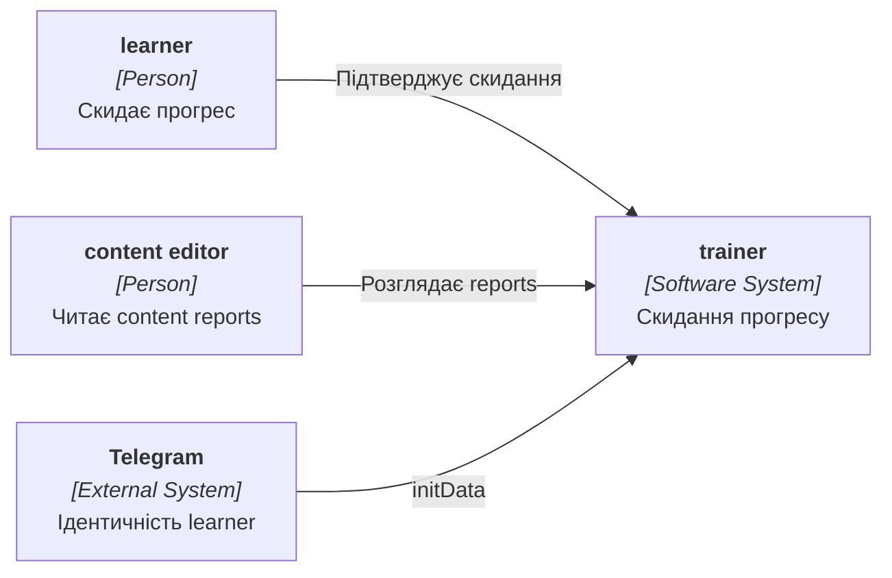
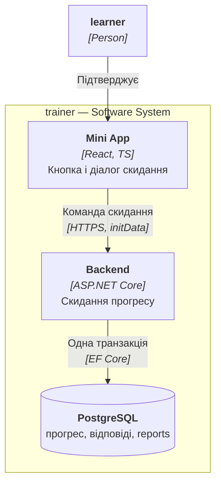
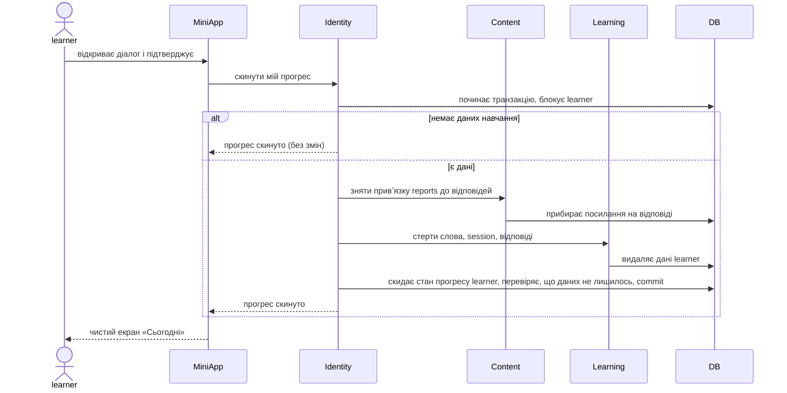

# Software Architecture Document — reset-progress

> **Inputs:** [PRD](./PRD.md) · [CONTEXT](../../../CONTEXT.md) · [architecture-map](../../architecture-map.md) · батьківський [SAD personal-trainer-mvp](../personal-trainer-mvp/sad.md).
> Це дельта до батьківського SAD: контейнери, технології й наскрізні концепції успадковані, тут описано лише те, що змінює ця фіча.

## 1. Introduction and goals

**Intent.** Дати learner кнопку в налаштуваннях, яка незворотно стирає весь його особистий прогрес навчання й лишає налаштування та content reports ([PRD §1](./PRD.md#1-context), [PRD §2](./PRD.md#2-goals)).

**Top-3 quality goals (повні сценарії в §10):**
1. Атомарність: скидання або виконане повністю, або не змінює нічого.
2. Коректність під одночасністю: скидання й відповідь з іншого пристрою не лишають «осиротілих» даних.
3. Швидкість скидання для повного курсу: p95 ≤ 2 000 ms.

**Stakeholders.**

| Role | Interest | Sign-off owner? |
|---|---|---|
| learner | Чистий старт без втрати налаштувань | No |
| content editor | Content reports лишаються доступними | No |
| Tech Lead | Затвердження SAD | Yes |

## 2. Constraints

**Technical.**
- Успадковано від [SAD personal-trainer-mvp §2](../personal-trainer-mvp/sad.md#2-constraints): ASP.NET Core на .NET 10, EF Core, PostgreSQL, Mini App на React і TypeScript.
- Нових таблиць і міграцій немає; дані стираються явними впорядкованими видаленнями в обробниках, бо каскади працюють лише від рядка learner, який лишається ([data-model](../personal-trainer-mvp/data-model.md)). Зовнішній ключ content reports на відповіді не має каскаду й не відкладається, тож привʼязку треба зняти до видалення відповідей.

**Organisational.**
- Оцінка 1.5 людино-тижня ([idea-brief §11](./idea-brief.md#11-rice--claude-proposed)); роботу веде одна людина.

**Conventions.**
- Правила міграцій і контракту API: `.claude/rules/migrations.md`, `.claude/rules/openapi.md`.
- Модульний моноліт із feature-модулями ([ADR-0003](../personal-trainer-mvp/adr/0003-organise-code-into-feature-modules-inside-the-monolith.md)).

**Regulatory / external.**
- Стерті дані лишаються в зашифрованих резервних копіях до 14 діб ([PRD §6.1](./PRD.md#61-security--privacy)).

## 3. Context and scope

learner керує власним прогресом через Mini App; Telegram лише підтверджує ідентичність. Нових зовнішніх систем немає.

**External systems (in / out):**

| Actor or system | Type | Interaction |
|---|---|---|
| learner | Person | Скидає прогрес із налаштувань |
| content editor | Person | Бачить content reports, що пережили скидання |
| Telegram | System (external) | Передає перевірену ідентичність через initData ([ADR-0005](../personal-trainer-mvp/adr/0005-authenticate-every-api-request-with-telegram-init-data.md)) |

**Context (L1):**



## 4. Solution strategy

**Target surface(s):** `[backend-service, web-frontend]` — успадковано; нова дія додається в наявний backend і екран налаштувань Mini App, без нового контейнера й без нового UI-архітектурного рішення.

**Top strategic choices:**
1. **Одна транзакція під блокуванням learner** — Identity керує потоком, обробники Learning і Content стирають свої дані в тій самій транзакції; це задовольняє атомарність і безпеку відносно одночасних відповідей. Виняток із незмінного журналу відповідей зафіксовано в [ADR-0001](adr/0001-erase-learner-progress-in-one-transaction-under-learner-lock.md).
2. **Жорстке видалення замість архівації** — відповідає правилам проєкту й вимозі «стерти все»; архів відкладено ([idea-brief §14](./idea-brief.md#14-parked--rejected-approaches)).
3. **Діалог підтвердження на клієнті, перевірки на сервері** — клієнт показує наслідки й питає підтвердження, а сервер лишається єдиним джерелом правил (власність, ідемпотентність).

## 5. Building block view

Зміни вкладаються в наявні модулі ([SAD personal-trainer-mvp §5](../personal-trainer-mvp/sad.md#5-building-block-view)):

```
ConstantLearning/Features/
├── Identity/ProgressReset/   керує потоком: блокування learner, виклик обробників, скидання полів learner
├── Content/Reports/          обробник скидання (виконується першим): розрив привʼязки report → відповідь
└── Learning/                 обробник скидання: стан слів, session і картки, відповіді, нейтралізації
ConstantLearning.MiniApp/src/features/settings/   кнопка, діалог підтвердження, стан результату
```

Notifications окремого обробника не потребує: нагадування й підсумки читають стан learner на льоту (ризик перевіряє тест AC-11 у [T06](tasks/T06-reset-integration-tests.md)). Порядок обробників фіксований: Content, потім Learning.

Точка розширення — порт обробника скидання в Identity за зразком `ILearnerSettingsChangedHandler`: модулі реєструють реалізації, Identity викликає їх до commit у спільному `AppDbContext`.

**Containers (L2):**



## 6. Runtime view

Нова послідовність; ендпоінт-рівень уточнить `api-forge`, решту потоків (помилки, одночасність) покриє `complete-sequence-diagrams`.

**Critical flow 1: скидання прогресу**



Перевірка цілісності в кінці транзакції відкочує скидання, якщо дані learner лишилися, і збільшує агрегований лічильник невдалих перевірок. Збій на будь-якому кроці відкочує всю транзакцію ([AC-04](./PRD.md#5-acceptance-criteria)).

## 7. Deployment view

<!-- N/A: розгортання не змінюється — ті самі контейнери та конфігурація, що в SAD personal-trainer-mvp; нових міграцій, джерел даних чи фонових задач немає. -->

## 8. Crosscutting concepts

Успадковано від [SAD personal-trainer-mvp §8](../personal-trainer-mvp/sad.md#8-crosscutting-concepts). Специфічне для фічі:

| Concept | Convention | Where defined |
|---|---|---|
| Authorization | `learner_id` лише з claims; скидання торкається тільки власного прогресу, чужі дані не розкриваються | [ADR-0005](../personal-trainer-mvp/adr/0005-authenticate-every-api-request-with-telegram-init-data.md) |
| Idempotency | Повторне скидання порожнього прогресу — успіх без змін; ознака — стан, а не ключ запиту. Свідоме відхилення від правила `Idempotency-Key` в `.claude/rules/openapi.md`, зафіксоване в [ADR-0001](adr/0001-erase-learner-progress-in-one-transaction-under-learner-lock.md) і [api-sync-report](contracts/api-sync-report.md) | [ADR-0001](adr/0001-erase-learner-progress-in-one-transaction-under-learner-lock.md) |
| Concurrency | Блокування рядка learner серіалізує скидання з відповідями й зміною налаштувань | [ADR-0001](adr/0001-erase-learner-progress-in-one-transaction-under-learner-lock.md) |
| Logging | Лише агрегований лічильник (успішні, порожні, невдалі, невдалі перевірки цілісності) без персональних даних; окремої події на кожне скидання немає | [PRD §6.1](./PRD.md#61-security--privacy) |
| Completeness | Тест повноти скидання: кожна таблиця з посиланням на learner або його слова має обробник скидання **або** стоїть у явному whitelist збережених. Стирається: `learner_words` (word status), `learning_sessions` (усіх видів `kind`), `session_items`, `answer_events`, нейтралізації оскаржень; на `learners` скидаються `course_completed_at` і `new_words_available_from`. Явно зберігаються (whitelist): `reminder_schedules` (налаштування нагадувань), `notification_dispatches` (черга повідомлень learner), `publication_log.actor_learner_id` (журнал дій content editor), `content_reports` (автор-псевдонім лишається; `answer_event_id` лише відвʼязується). Новий learner-FK, якого немає в жодному списку, провалює тест | тут |

## 9. Architecture decisions

| # | Title | Status | Section |
|---|---|---|---|
| 0001 | Стерти прогрес learner однією транзакцією під блокуванням learner | Accepted | §4 |

ADR-файли лежать у `docs/features/reset-progress/adr/`. Рішення батьківської фічі діють без змін: [ADR-0003](../personal-trainer-mvp/adr/0003-organise-code-into-feature-modules-inside-the-monolith.md), [ADR-0005](../personal-trainer-mvp/adr/0005-authenticate-every-api-request-with-telegram-init-data.md), [ADR-0008](../personal-trainer-mvp/adr/0008-keep-the-learning-session-server-side-with-per-card-idempotency.md), [ADR-0009](../personal-trainer-mvp/adr/0009-schedule-reviews-with-memorize-behind-a-port-over-an-answer-log.md) (з винятком із ADR-0001).

## 10. Quality requirements

| ID | Scenario | Target | How verified |
|---|---|---|---|
| QG-1 | Learner із повним курсом (2 000 слів) і до 20 000 відповідей підтверджує скидання | p95 ≤ 2 000 ms | серверна метрика запитів скидання на навантажувальному наборі перед пілотом ([PRD §6](./PRD.md#6-non-functional-requirements)) |
| QG-2 | Збій посеред скидання | 0 випадків часткового стирання | автоматизований інтеграційний тест збою посеред скидання; у пілоті — агрегований лічильник невдалих перевірок цілісності ([PRD §6](./PRD.md#6-non-functional-requirements)) |
| QG-3 | Повторне підтвердження того самого скидання | не змінює даних і не повертає помилку | інтеграційний тест подвійного надсилання |
| QG-4 | Відповідь з іншого пристрою одночасно зі скиданням | жодної відповіді не лишається в чистому стані | інтеграційний тест одночасних запитів ([AC-12](./PRD.md#5-acceptance-criteria)) |

## 11. Risks and technical debt

| Risk | Severity | Mitigation | Owner |
|---|---|---|---|
| Новий модуль додасть дані learner без обробника скидання | Medium | Тест повноти скидання, що перевіряє всі таблиці з посиланням на learner | Backend |
| Блокування learner на час великого стирання сповільнює його відповіді | Low | Скидання рідкісне й дозволяється лише власнику; ціль ≤ 2 000 ms | Backend |
| Нагадування чи підсумки посилаються на стерті дані (Notifications без обробника) | Low | Тест AC-11 у T06; за потреби додати обробник | Backend |
| Привʼязка content reports до відповідей знімається незворотно | Low | Свідомий компроміс, зафіксований у [ADR-0001](adr/0001-erase-learner-progress-in-one-transaction-under-learner-lock.md) | Owner |
| Скидання як спосіб обходу денного ліміту | Low | Свідомо прийнятий ризик без ліміту скидань ([PRD §6.1](./PRD.md#61-security--privacy)) | Owner |

**Accepted debt:**
- Немає архіву й відновлення прогресу — можливий наступний крок після сигналів із пілоту ([idea-brief §14](./idea-brief.md#14-parked--rejected-approaches)).

## 12. Glossary

Терміни — у [CONTEXT](../../../CONTEXT.md); нове для цієї фічі:

| Term | Meaning |
|---|---|
| progress reset | Дія learner, що безповоротно стирає особисте навчання; налаштування й content reports лишаються ([CONTEXT](../../../CONTEXT.md)) |
