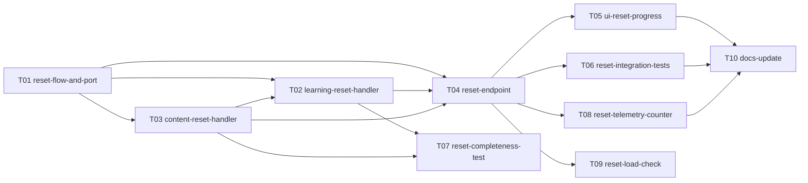

# Epic — reset-progress

> **PRD:** [PRD.md](../PRD.md) · **Design:** [sad.md](../sad.md) · **API:** [openapi.yaml](../contracts/openapi.yaml) · **ADRs:** [adr/](../adr/)

## Goal

Дати learner кнопку в налаштуваннях, що незворотно стирає весь його прогрес навчання й лишає налаштування та content reports ([idea-brief](../idea-brief.md)).

## Scope

- **In:** модулі `Identity`, `Learning`, `Content` у `ConstantLearning/`, екран налаштувань і діалог у Mini App, тести, документація.
- **Out:** усе з [PRD §3](../PRD.md#3-non-goals) — часткове скидання, архів і відновлення, експорт історії. Нових міграцій немає.

## Task map

Той самий DAG, що й у [tasks.json](./tasks.json). Стрілка веде від залежності до задачі, яку вона розблоковує.

Після T01 іде T03, потім T02 (порядок обробників: спершу Content); після T04 — T05, T06, T08, T09.

## Coverage

Усі 12 AC з [PRD §5](../PRD.md#5-acceptance-criteria) покриті щонайменше однією задачею; тест-план — у розділі [Test plan](../PRD.md#test-plan).
