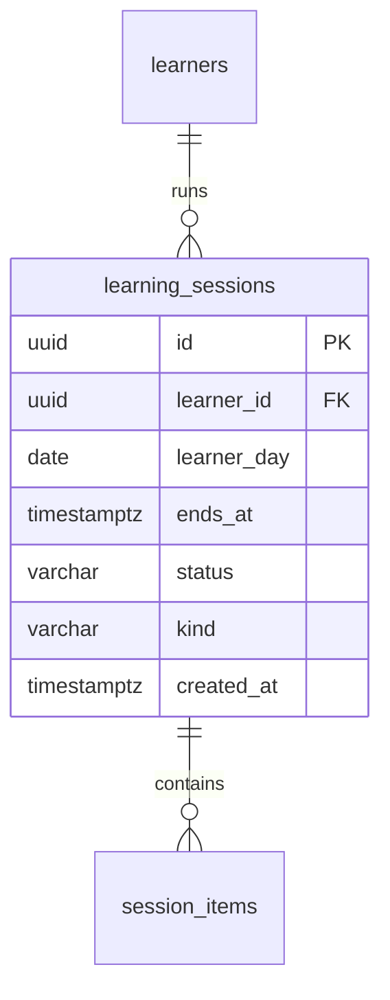

# Data model — unlimited-learning

> **Inputs:** [PRD](./PRD.md) · [SAD](./sad.md) · [ADR-0001](adr/0001-run-extras-as-typed-sessions-over-the-existing-session-pipeline.md) · [ADR-0002](adr/0002-model-extra-practice-as-a-third-exercise-kind-in-the-scheduler.md) · батьківська [data-model personal-trainer-mvp](../personal-trainer-mvp/data-model.md).
> Це дельта до батьківської моделі: нових таблиць немає, змінюється одна таблиця і три значення в наявних текстових полях.

## ER diagram

Показано лише змінену сутність; зв'язки лишаються як у [батьківській моделі](../personal-trainer-mvp/data-model.md#er-diagram).

## Entities

### Агрегат Learning — `learning_sessions` (зміна)

| Column | Type | Constraints | Notes |
|---|---|---|---|
| `kind` | VARCHAR(24) | NOT NULL (після кроку 3) | тип заняття: `plan` / `extra_word` / `extra_practice` ([ADR-0001](adr/0001-run-extras-as-typed-sessions-over-the-existing-session-pipeline.md)); значення задає застосунок, DB не має default і CHECK |

Усі інші колонки без змін. **Aggregate root:** `learners`. Наявне часткове UNIQUE `ux_learning_sessions_one_active` (одна активна session на learner) лишається і діє для всіх видів: саме воно повертає ту саму extra-картку при повторному натисканні ([PRD AC-05](./PRD.md#ac-05---domain-invariant)).

Новий NOT NULL на наявній таблиці розкладено на три кроки (див. «Migrations»). Запити, що рахують звичайні заняття (completed за 7 днів, нагадування, межа доби плану), фільтрують `kind = 'plan'`.

### Нові значення в наявних полях (без зміни схеми)

| Table.column | Нове значення | Призначення |
|---|---|---|
| `session_items.kind` | `extra_new_word_check`, `extra_practice` | Картка перевірки extra-слова й картка практики; картка нового слова в extra використовує наявне `new_word_card` |
| `answer_events.exercise_kind` | `extra_new_word_check`, `extra_practice` | Походження відповіді ([PRD AC-15](./PRD.md#ac-15---domain-invariant)); обидва значення вміщаються у VARCHAR(24) |

`answer_events.outcome`, `state_before` і `learner_words` не змінюються: правила практики живуть у планувальнику ([ADR-0002](adr/0002-model-extra-practice-as-a-third-exercise-kind-in-the-scheduler.md)), а стан слова лишається проєкцією журналу. Позиції карток extra: extra_word — картка 1, перевірка 31 (як у плановому занятті); extra_practice — позиції 1–20.

## Indexes

Нових індексів немає.

| Index | On | Query it serves | Рішення |
|---|---|---|---|
| `ux_learning_sessions_one_active` | `learning_sessions(learner_id) WHERE status = 'active'` | Активна session і захист від подвійного старту extra | наявний, достатній |
| `ix_learning_sessions_learner_completed` | `learning_sessions(learner_id, completed_at)` | Completed за 7 днів із додатковим фільтром `kind = 'plan'` | наявний; фільтр по kind застосовується до малої вибірки одного learner, окремий індекс не виправданий |
| `ix_learning_sessions_learner_day` | `learning_sessions(learner_id, learner_day)` | Чи завершено plan-session цієї доби (нагадування) | наявний |

Окремий індекс на `kind` свідомо не створюється: немає запиту, що вибирає за самим `kind` без `learner_id` (правило «індекс лише під конкретний запит»).

## Migrations

Міграції **staged** у [`migrations/`](./migrations) (не в живому дереві); `implement-tasks` просуває їх у реальні EF-міграції репозиторію. Порядок розгортання (zero-downtime, кожен крок — окремий деплой):

| # | Файл | Крок | Умова виконання |
|---|---|---|---|
| 1 | `20261103120000_add_kind_to_learning_sessions` | expand: ADD COLUMN nullable | разом із версією застосунку, що пише `kind` у кожній новій session |
| 2 | `20261103120001_backfill_kind_in_learning_sessions` | backfill: `plan` для наявних session | після кроку 1; таблиця мала (пілот ≤ 100 learner), пакетування не потрібне |
| 3 | `20261103120002_set_kind_not_null_on_learning_sessions` | contract: SET NOT NULL | після кроку 2 і коли жодна session не має NULL |

Rollback кожного кроку — відповідний `.down.sql` у зворотному порядку.

## Seeds

Seed-даних немає. Значення `kind` для наявних рядків заповнює крок 2 (backfill), це не seed.

## Test fixtures

Нові фікстури не вводяться окремою таблицею; тестові фабрики session (`internal/testfixtures` або наявні тестові побудовники в `ConstantLearning.Tests`) отримують параметр kind зі значенням `plan` за замовчуванням у коді. Тестові learner — лише `user-<uuid>@example.test`, `Test User`.
