# Software Architecture Document — unlimited-learning

> **Inputs:** [PRD](./PRD.md) · [CONTEXT](../../../CONTEXT.md) · [architecture-map](../../architecture-map.md) · батьківський [SAD personal-trainer-mvp](../personal-trainer-mvp/sad.md) · [data-model personal-trainer-mvp](../personal-trainer-mvp/data-model.md).
> Це дельта до батьківського SAD: контейнери, технології й наскрізні концепції успадковані, тут описано лише те, що змінює ця фіча. [architecture-map](../../architecture-map.md) описує стару групову модель; фактичну структуру взято з коду `ConstantLearning/Features/Learning` і батьківського SAD.

## 1. Introduction and goals

**Intent.** Коли learner виконав план дня, дати йому «Ще одне слово» і «Потренувати вивчені» без обходу наявного заняття, планувальника повторень і правил доби learner ([PRD §1](./PRD.md#1-context), [PRD §2](./PRD.md#2-goals)).

**Top-3 quality goals (повні сценарії в §10):**
1. Чесний статус: «Вже пригадую» не можна отримати відповідями однієї доби, а графік повторень не спотворюється додатковою практикою.
2. Без дублів і втрат: повторні натискання й два пристрої не дають зайвих слів ні пропусків ([PRD §6](./PRD.md#6-non-functional-requirements)).
3. Не ламати план дня: додаткові дії не рахуються як completed session і не змінюють ліміт нових слів.

**Stakeholders.**

| Role | Interest | Sign-off owner? |
|---|---|---|
| learner | Продовжувати навчання після плану дня без глухого кута | No |
| content editor | Видалені з `approved` леми не потрапляють у додаткові дії | No |
| Tech Lead | Затвердження SAD | Yes |

## 2. Constraints

**Technical.**
- Успадковано від [SAD personal-trainer-mvp §2](../personal-trainer-mvp/sad.md#2-constraints): ASP.NET Core на .NET 10, EF Core, PostgreSQL, Mini App на React і TypeScript.
- Журнал відповідей — джерело істини, стан слова відтворюється його повторним прогоном ([ADR-0009](../personal-trainer-mvp/adr/0009-schedule-reviews-with-memorize-behind-a-port-over-an-answer-log.md)); сесії й картки захищені ідемпотентністю на рівні картки й однією активною session на learner ([ADR-0008](../personal-trainer-mvp/adr/0008-keep-the-learning-session-server-side-with-per-card-idempotency.md)).
- Зараз денне використання нових слів виводиться з показаних сьогодні слів і «Вже знаю» за добу; воно не зберігається окремим лічильником.

**Organisational.**
- Оцінка 2 людино-тижні ([idea-brief §11](./idea-brief.md#11-rice--claude-proposed)); роботу веде одна людина.

**Conventions.**
- Правила міграцій і контракту API: `.claude/rules/migrations.md`, `.claude/rules/openapi.md`.
- Модульний моноліт із feature-модулями ([ADR-0003](../personal-trainer-mvp/adr/0003-organise-code-into-feature-modules-inside-the-monolith.md)).

**Regulatory / external.** Нових зовнішніх обмежень немає; персональні дані ті самі, що в базовому PRD ([PRD §6.1](./PRD.md#61-security--privacy)).

## 3. Context and scope

learner керує навчанням через Mini App; Telegram лише підтверджує ідентичність. Нових зовнішніх систем немає.

**External systems (in / out):**

| Actor or system | Type | Interaction |
|---|---|---|
| learner | Person | Бере «Ще одне слово», проходить практику |
| content editor | Person | Керує схваленим словником, від якого залежать додаткові дії |
| Telegram | System (external) | Передає перевірену ідентичність через initData ([ADR-0005](../personal-trainer-mvp/adr/0005-authenticate-every-api-request-with-telegram-init-data.md)) |

**Context (L1):**

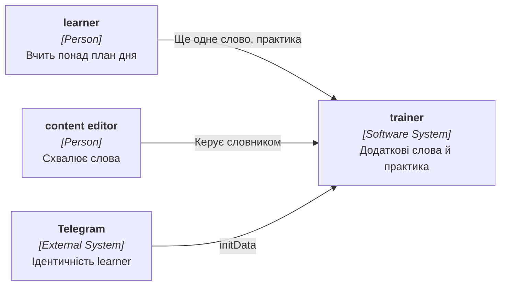

## 4. Solution strategy

**Target surface(s):** `[backend-service, web-frontend]` — успадковано; нові дії додаються в наявний backend і екран «Сьогодні» Mini App. Нового контейнера й нового UI-архітектурного рішення немає: екран заняття повторно використовується для карток, перевірки й результату.

**Top strategic choices:**
1. **Додаткові слова й практика — типізовані заняття (session з полем kind: plan / extra_word / extra_practice).** Повторно використовується перевірена машинерія карток: одна активна session на learner дає захист від подвійного натискання, закриття на опівночі й ідемпотентна відповідь працюють без дубля. Запити, що рахують звичайні заняття, фільтрують kind = plan ([ADR-0001](adr/0001-run-extras-as-typed-sessions-over-the-existing-session-pipeline.md)).
2. **Практика — третій вид вправи в планувальнику повторень.** Правило «правильна відповідь зараховується до статусу лише з іншої доби, але не відсуває наступну дату; помилка діє як у плановому повторенні» живе в порту планувальника й однаково працює при відтворенні журналу ([ADR-0002](adr/0002-model-extra-practice-as-a-third-exercise-kind-in-the-scheduler.md)).
3. **Придатність слів і стан «план виконано» обчислює сервер.** Клієнт показує дії за полями екрана «Сьогодні», а правила (одна практика на слово за добу, виключення control repetition і слів, отриманих сьогодні) діють лише на сервері.
4. **Походження відповіді — у наявному полі exercise_kind журналу** (`extra_new_word_check`, `extra_practice`), без нових колонок у журналі ([PRD AC-15](./PRD.md#ac-15---domain-invariant)).

Дрібні рішення, ухвалені в режимі easy (assumptions ledger, підтверджено власником 2026-11-03):
- «Ще одне слово» створює session kind = extra_word з однією карткою нового слова та перевіркою; наявна обробка картки нового слова застосовується без додаткового нового слова на заміну і не збільшує плановий облік ліміту.
- Практика створює session kind = extra_practice до 20 карток; відбір — найближча дата наступного повторення, слова зі статусом «На повторення» чи «Вже пригадую» без control repetition, без відповіді сьогодні й не отримані сьогодні.
- Початок звичайного заняття, коли є активна додаткова session, закриває її як незавершену (звичайне заняття має пріоритет); отримане слово extra лишається отриманим.
- Технічний захист від зловживань: не більше 30 дій «Ще одне слово» на хвилину на learner ([PRD §6.1](./PRD.md#61-security--privacy)).
- Нових міграцій для журналу немає; для `learning_sessions` потрібна одна колонка kind у три кроки (nullable → заповнення plan → NOT NULL) за правилами міграцій; деталі — у `generate-data-model`.

## 5. Building block view

Зміни вкладаються в наявні модулі ([SAD personal-trainer-mvp §5](../personal-trainer-mvp/sad.md#5-building-block-view)):

```
ConstantLearning/Features/Learning/
├── Sessions/Extra/            нове: старт extra_word і extra_practice, відбір слів, ліміт запитів
├── Sessions/NewWords/         картка нового слова: поведінка залежить від kind (без плану ліміту й без заміни для extra)
├── Sessions/Answer/           відповідь: нові види карток extra_new_word_check і extra_practice
├── Domain/Scheduling/         третій вид вправи ExtraPractice у порту планувальника й проєкторі
├── Today/                     екран «Сьогодні»: стан «план виконано» й доступність дій; completed рахує лише kind = plan
├── Notifications/             читач нагадувань рахує лише kind = plan
└── Data/                      LearningSession.Kind
ConstantLearning.MiniApp/src/features/today/   замість вимкненої кнопки — дії «Ще одне слово» і «Потренувати вивчені»
ConstantLearning.MiniApp/src/features/session/ екран заняття приймає extra-заняття (картка, перевірка, результат, повернення на «Сьогодні»)
```

Модулі Identity (доба learner і блокування), Content (опубліковані слова й approved) використовуються без змін через наявні порти.

**Containers (L2):**

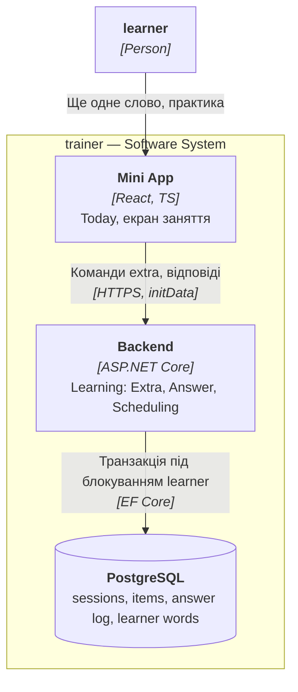

## 6. Runtime view

Нижче — потоки, що разом із таблицею покриття в кінці розділу охоплюють усі історії й AC з [PRD](./PRD.md). Перші два потоки описано мовою модулів, решту — узагальненими учасниками (user, ui, service, data-store).

### Ще одне слово

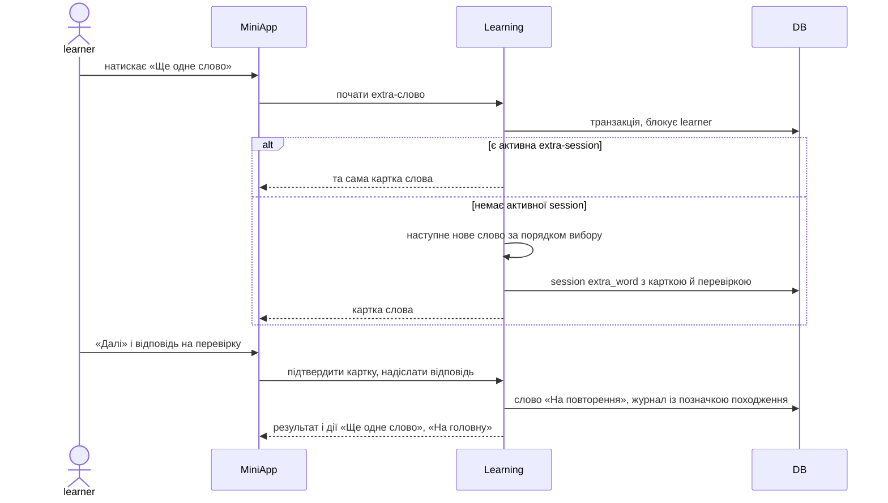

### Практика вивчених слів

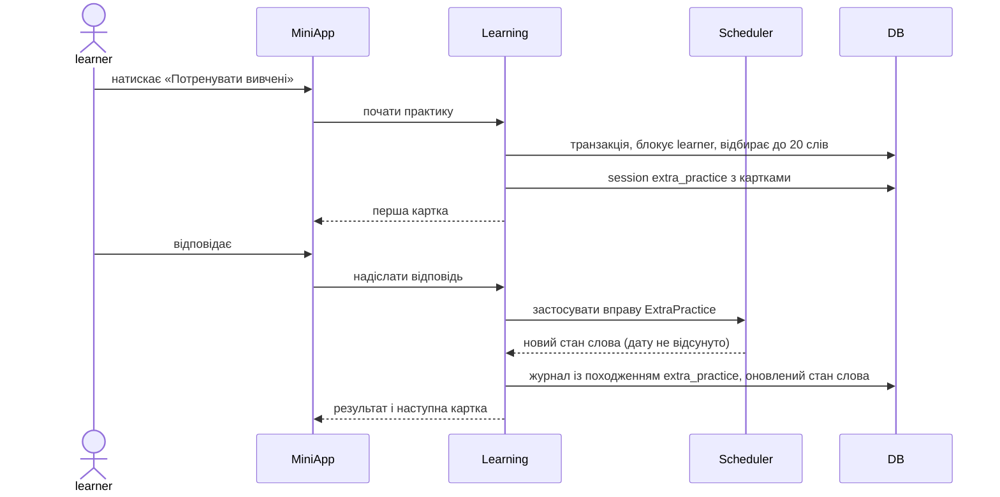

### Екран «Сьогодні» після виконання плану

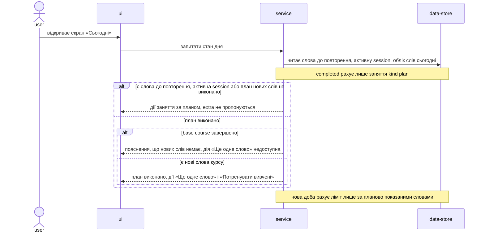

### Вже знаю на extra-слові

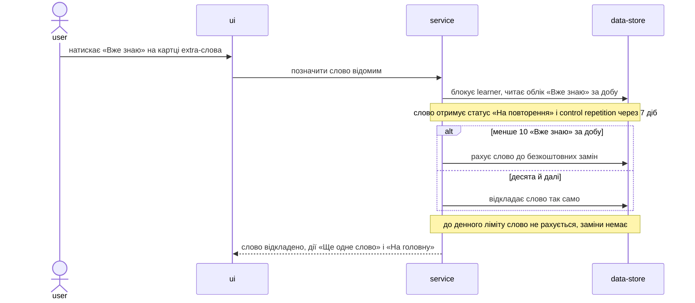

### Відбір слів для практики

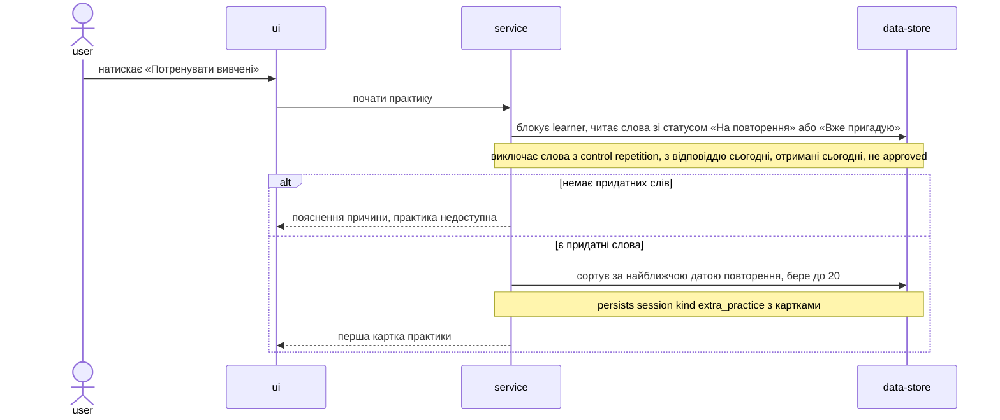

### Відповідь на картку практики

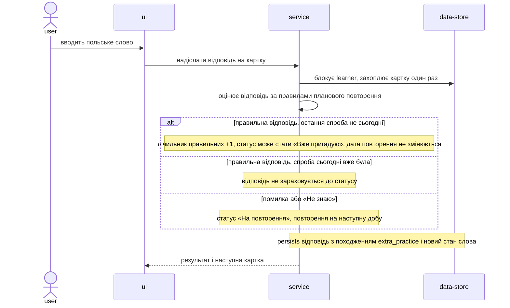

### Лема втратила approved під час extra

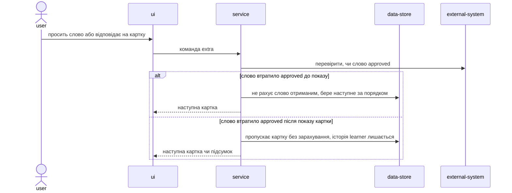

### Кінець доби закриває extra

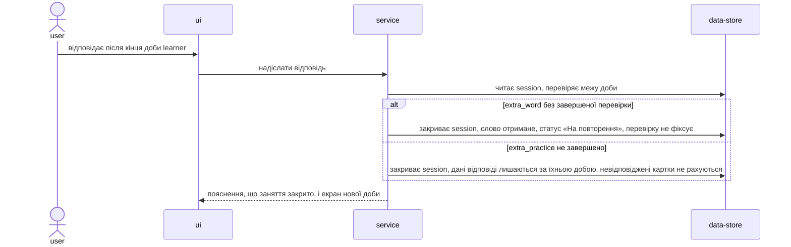

### Заняття за планом закриває активну extra

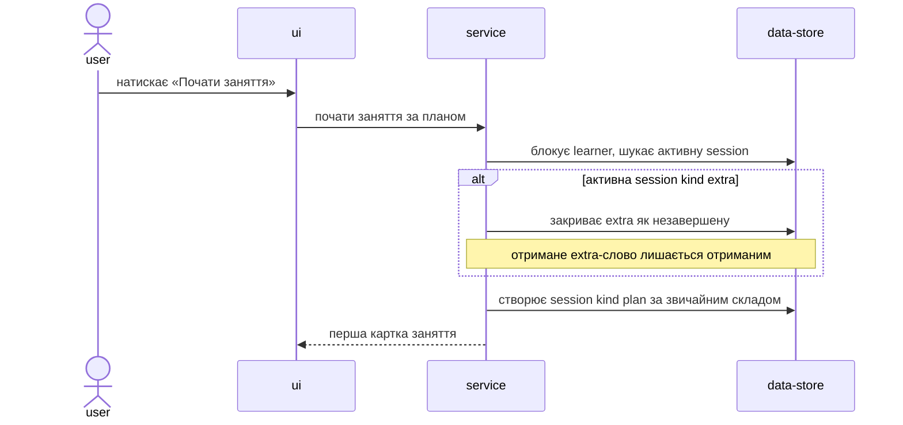

### Coverage: US/AC → flows

| ID | Realized by (§6 heading) | How | Note |
|---|---|---|---|
| US-01 | Ще одне слово; Вже знаю на extra-слові; Лема втратила approved під час extra; Кінець доби закриває extra | flow | |
| US-02 | Практика вивчених слів; Відбір слів для практики; Відповідь на картку практики | flow | |
| US-03 | Екран «Сьогодні» після виконання плану | flow | |
| US-04 | Відповідь на картку практики | flow | |
| US-05 | Екран «Сьогодні» після виконання плану; Заняття за планом закриває активну extra | flow | |
| AC-01 | Ще одне слово | flow | |
| AC-02 | Екран «Сьогодні» після виконання плану | branch | нова доба рахує ліміт лише за планово показаними словами |
| AC-03 | Вже знаю на extra-слові | flow | |
| AC-04 | Екран «Сьогодні» після виконання плану | branch | base course завершено |
| AC-05 | Ще одне слово | branch | є активна extra-session |
| AC-06 | Лема втратила approved під час extra | flow | |
| AC-07 | Кінець доби закриває extra | branch | extra_word без завершеної перевірки |
| AC-08 | Практика вивчених слів; Відбір слів для практики | flow | |
| AC-09 | Відбір слів для практики | branch | виключення слів із відповіддю сьогодні |
| AC-10 | Відбір слів для практики | branch | немає придатних слів |
| AC-11 | Лема втратила approved під час extra | branch | слово втратило approved після показу картки |
| AC-12 | Відповідь на картку практики | branch | правильна відповідь, остання спроба не сьогодні |
| AC-13 | Відповідь на картку практики | branch | помилка або «Не знаю» |
| AC-14 | Відповідь на картку практики | branch | дата повторення не змінюється |
| AC-15 | Відповідь на картку практики | branch | persists відповідь з походженням extra_practice |
| AC-16 | Екран «Сьогодні» після виконання плану | branch | план виконано |
| AC-17 | Екран «Сьогодні» після виконання плану; Заняття за планом закриває активну extra | branch | є слова до повторення, активна session або план не виконано |
| AC-18 | Екран «Сьогодні» після виконання плану | branch | completed рахує лише kind plan |
| AC-19 | — | N/A | авторизація за claims діє наскрізно на кожен запит, окремого потоку немає ([ADR-0005](../personal-trainer-mvp/adr/0005-authenticate-every-api-request-with-telegram-init-data.md)) |
| AC-20 | Кінець доби закриває extra | branch | extra_practice не завершено |

Coverage: 5/5 user stories · 20/20 ACs — 1 non-runtime N/A.

**Flags:**
- Потоки «Ще одне слово» і «Практика вивчених слів» написано мовою модулів (як у батьківському SAD); решту — узагальненими учасниками. Змішування свідоме: наявні блоки не переписувалися.
- Учасник `external-system` у потоці про втрату approved — наявний порт читання опублікованого курсу з Content, у §5 окремим контейнером не винесений.

## 7. Deployment view

<!-- N/A: розгортання не змінюється — ті самі контейнери та конфігурація, що в SAD personal-trainer-mvp; нових джерел даних і фонових задач немає, лише одна міграція колонки. -->

## 8. Crosscutting concepts

Успадковано від [SAD personal-trainer-mvp §8](../personal-trainer-mvp/sad.md#8-crosscutting-concepts). Специфічне для фічі:

| Concept | Convention | Where defined |
|---|---|---|
| Authorization | `learner_id` лише з claims; слова, відповіді й practice стосуються лише власника, чужі дані не розкриваються ([PRD AC-19](./PRD.md#ac-19---authorization)) | [ADR-0005](../personal-trainer-mvp/adr/0005-authenticate-every-api-request-with-telegram-init-data.md) |
| Idempotency | Старт extra: наявна активна extra-session повертається замість нової; відповідь на картку — один раз на картку, як у плані ([PRD AC-05](./PRD.md#ac-05---domain-invariant)) | [ADR-0001](adr/0001-run-extras-as-typed-sessions-over-the-existing-session-pipeline.md) |
| Concurrency | Блокування рядка learner серіалізує старт extra, відповіді й початок звичайного заняття | [ADR-0008](../personal-trainer-mvp/adr/0008-keep-the-learning-session-server-side-with-per-card-idempotency.md) |
| Day boundary | Extra-session закривається в кінці доби learner так само, як звичайна; уже дані відповіді належать добі, у яку дано ([PRD AC-07](./PRD.md#ac-07---domain-invariant), [PRD AC-20](./PRD.md#ac-20---domain-invariant)) | [ADR-0001](adr/0001-run-extras-as-typed-sessions-over-the-existing-session-pipeline.md) |
| Scheduling | Практика й перевірка extra-слова відтворюються проєктором однаково; правило практики — частина планувальника | [ADR-0002](adr/0002-model-extra-practice-as-a-third-exercise-kind-in-the-scheduler.md) |
| Rate protection | ≤ 30 стартів «Ще одне слово» за хвилину на learner; це захист від зловживань, а не навчальний ліміт | [PRD §6.1](./PRD.md#61-security--privacy) |
| Telemetry | Лічильники й метрики KPI беруться з журналу за exercise_kind; клієнтська телеметрія без Telegram-ідентифікатора | [PRD §7](./PRD.md#7-metrics--kpis) |

## 9. Architecture decisions

| # | Title | Status | Section |
|---|---|---|---|
| 0001 | Вести додаткові слова й практику як типізовані заняття поверх наявного конвеєра session | Accepted | §4 |
| 0002 | Змоделювати додаткову практику третім видом вправи в планувальнику | Accepted | §4 |

ADR-файли лежать у `docs/features/unlimited-learning/adr/`. Рішення батьківської фічі діють без змін: [ADR-0003](../personal-trainer-mvp/adr/0003-organise-code-into-feature-modules-inside-the-monolith.md), [ADR-0005](../personal-trainer-mvp/adr/0005-authenticate-every-api-request-with-telegram-init-data.md), [ADR-0006](../personal-trainer-mvp/adr/0006-model-learner-time-with-nodatime-and-iana-zones.md), [ADR-0008](../personal-trainer-mvp/adr/0008-keep-the-learning-session-server-side-with-per-card-idempotency.md), [ADR-0009](../personal-trainer-mvp/adr/0009-schedule-reviews-with-memorize-behind-a-port-over-an-answer-log.md).

## 10. Quality requirements

| ID | Scenario | Target | How verified |
|---|---|---|---|
| QG-1 | Learner двічі поспіль натискає «Ще одне слово» (або з двох пристроїв) до завершення картки | 0 дублів і 0 пропусків слів | інтеграційний тест подвійного й паралельного натискання ([PRD §6](./PRD.md#6-non-functional-requirements), [AC-05](./PRD.md#ac-05---domain-invariant)) |
| QG-2 | Learner запитує наступне слово | p95 ≤ 500 ms | серверна метрика запиту наступного нового слова ([PRD §6](./PRD.md#6-non-functional-requirements)) |
| QG-3 | Learner запускає практику, збір до 20 слів | p95 ≤ 800 ms | серверна метрика запуску практики ([PRD §6](./PRD.md#6-non-functional-requirements)) |
| QG-4 | Слово отримує «Вже пригадую» за відповідями однієї доби | 0 випадків | відтворення журналу в тесті проєктора й KPI «Чесність статусу» ([PRD §7](./PRD.md#7-metrics--kpis), [AC-09](./PRD.md#ac-09---domain-invariant), [AC-12](./PRD.md#ac-12---domain-invariant)) |
| QG-5 | Правильна відповідь у практиці на слово із запланованою датою | наступна дата не змінюється | юніт-тест планувальника ([AC-14](./PRD.md#ac-14---domain-invariant)) |
| QG-6 | Додаткові дії протягом доби | кількість completed session за 7 днів не змінюється | інтеграційний тест екрана «Сьогодні» ([AC-18](./PRD.md#ac-18---domain-invariant)) |
| QG-7 | Повторне надсилання тієї самої відповіді | зараховується один раз; 0 втрачених відповідей | інтеграційний тест подвійного надсилання ([PRD §6](./PRD.md#6-non-functional-requirements)) |

## 11. Risks and technical debt

| Risk | Severity | Mitigation | Owner |
|---|---|---|---|
| Лавина повторень наступної доби після великої кількості extra-слів, бо ліміту й попередження немає | Medium | Свідомо прийнято (рішення власника); KPI «Навантаження наступної доби» ([PRD §7](./PRD.md#7-metrics--kpis)); перегляд за [PRD OQ-1](./PRD.md#8-open-questions) | Owner |
| Запит, що рахує session, пропустить фільтр kind = plan (completed, нагадування, межа доби) | Medium | Єдиний фільтр у спільній вибірці session; тест регресії лічильників і нагадувань ([AC-18](./PRD.md#ac-18---domain-invariant)) | Backend |
| Відтворення старого журналу з новим видом вправи дає інший стан | Medium | Версія планувальника не змінюється, оскільки старі вправи не чіпаємо; тест відтворення журналу зі змішаними видами ([ADR-0002](adr/0002-model-extra-practice-as-a-third-exercise-kind-in-the-scheduler.md)) | Backend |
| Облік денного ліміту виводиться зі слів, показаних сьогодні, тож extra-слова збільшують «показані сьогодні» | Low | Це безпечно: extra доступні лише коли ліміт уже вичерпано; наступної доби облік нульовий ([PRD AC-02](./PRD.md#ac-02---domain-invariant)); тест | Backend |
| Активна extra-session заважає старту звичайного заняття | Low | Старт звичайного заняття закриває extra як незавершену; тест | Backend |
| Миттєва практика після помилок знову відкриває слова завтра | Low | Правило «одна практика на слово за добу» і помилка ставить повторення на наступну добу ([AC-09](./PRD.md#ac-09---domain-invariant)) | Owner |

**Accepted debt:**
- Додаткові слова не обмежуються й не супроводжуються попередженням до даних пілоту ([idea-brief §10](./idea-brief.md#10-risks)).
- Колонка `kind` додається окремою міграцією з трьома кроками; тимчасово наявні запити неявно вважають усі session плановими до завершення кроків.

## 12. Glossary

Терміни — у [CONTEXT](../../../CONTEXT.md); нове для цієї фічі:

| Term | Meaning |
|---|---|
| extra new word | Нове слово понад daily new words limit після виконання плану дня ([CONTEXT](../../../CONTEXT.md)) |
| extra practice | Додаткове тренування вже вивчених слів поза планом дня ([CONTEXT](../../../CONTEXT.md)) |
