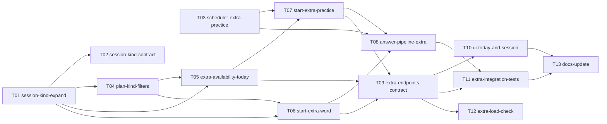

# Epic — unlimited-learning

> **PRD:** [PRD.md](../PRD.md) · **Design:** [sad.md](../sad.md) · **API:** [openapi.yaml](../contracts/openapi.yaml) · **Data:** [data-model.md](../data-model.md) · **ADRs:** [adr/](../adr/)

## Goal

Дати learner після виконання плану дня «Ще одне слово» і «Потренувати вивчені», зберігши ліміт як план на день, чесний статус слів і незмінні лічильники занять ([idea-brief §13](../idea-brief.md#13-recommendation), [PRD §2](../PRD.md#2-goals)).

## Scope

- **In:** модуль `Learning` у `ConstantLearning/` (сесії, планувальник, екран «Сьогодні»), міграція колонки `kind`, екрани «Сьогодні» й заняття в Mini App, тести, документація.
- **Out:** усе з [PRD §3](../PRD.md#3-non-goals) — список вивчених слів (окрема фіча), вибір слів, «слабкі слова», нагадування й досягнення, зміна ліміту.

## Task map

Той самий DAG, що й у [tasks.json](./tasks.json). Стрілка веде від залежності до задачі, яку вона розблоковує. T01 і T03 стартують паралельно; міграційні задачі T01 і T02 розгортаються окремими деплоями.

## Coverage

Усі 20 AC з [PRD §5](../PRD.md#5-acceptance-criteria) покриті щонайменше однією задачею; тест-план — у розділі [Test plan](../PRD.md#test-plan).
