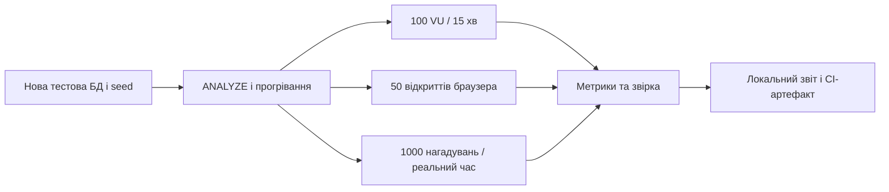

# Локальне навантажувальне тестування

Сценарій відповідає [T49](../../docs/features/personal-trainer-mvp/tasks/T49-load-test.md). Це локальний стенд: CI лише завантажує збережені результати, а запуск навантаження і браузера в CI не налаштований.



Окремий контейнер застосунку має обмеження `--cpus 2 --memory 2g`; PostgreSQL працює окремо. Seed створює 2 000 опублікованих approved записів, 100 learner із 1 000 словами кожен (3 показані сьогодні і 997 належать до повторення) та окрему когорту 1 000 отримувачів нагадувань. Слова імітаційні, леми складаються з літер. Після seed виконується `ANALYZE` таблиць словника, learner, сесій, відповідей і нагадувань до старту вимірювання. Час — `SystemClock`; Telegram замінено заглушкою, що записує час виклику. Production Quartz планує та доставляє нагадування; сторонні jobs і webhook вимкнено.

Профіль до вимірювання: 100 постійних VU протягом 15 хвилин, кожна ітерація відкриває Today, виконує 10 пошуків із префіксами довжиною 1–5 (150 мс між символами, 1 с між пошуками) і проходить заняття із 20 повторень (5 с на відповідь). Три чверті відповідей правильні, чверть містить одну помилку; кожну оцінку підтверджує `continue`. 50 окремих браузерних контекстів відкривають справжній Mini App кожні 15 с одночасно з навантаженням; мережеву відповідь імітовано лише для Telegram SDK. Час `today_ready_ms` береться з фактичного запиту telemetry.

Серверні гістограми `trainer_answer_duration_ms` і `trainer_dictionary_search_duration_ms` зберігають накопичені bucket-лічильники, а не окремі тривалості. Тому межу p95 визначають першим bucket із принаймні 95% спостережень; значення HTTP-клієнта не є серверним p95. Перевірка подій зіставляє `answer_events` із різними оціненими `session_items`, включно з відсутніми та повторними зв’язками. Raw-файли і фактичний результат публікуються разом зі звітом лише після завершеного прогону.

Для відтворення з кореня репозиторію зберіть `docker build -f tests/load/Dockerfile -t constant-learning-load-local .`, створіть окрему Docker-мережу та PostgreSQL 16 із новою порожньою базою. Передайте застосунку `ConnectionStrings__DefaultConnection`, підключіть каталог результатів у `/results`, опублікуйте порт 8888 лише на localhost і встановіть обмеження ресурсів, наведені вище. Дочекайтеся `LOAD_READY` та перевірте кількість записів у базі. Починайте вимірювання до планової хвилини нагадувань із достатнім запасом для 15 хвилин навантаження.

Запустіть `grafana/k6:0.57.0 run --out json=/results/k6-raw.json --summary-export=/results/k6-summary.json /scripts/learners.js` з `BASE_URL` контейнера застосунку; окремо, під навантаженням, виконайте `node tests/load/browser.mjs`, задавши `RESULTS_DIR` до каталогу результатів. До і після навантаження збережіть `metrics-latest.prom`, а після запланованої хвилини й двох хвилин очікування — `reminder-sends.csv`, журнал помилок та результат [SQL-звірки](reconcile.sql). Для аналізу локального каталогу `results/final` призначено `python tests/load/summarize.py`. Вимірюйте в ізоляції від збірок та інших тестів; не оновлюйте seed під час профілю.

Нижче — PowerShell-приклад із кореня репозиторію. Результати першого й наступних прогонів мають окремі каталоги. Пароль і токен у стенді призначені лише для локальних одноразових контейнерів.

```powershell
New-Item -ItemType Directory -Force tests/load/results/run | Out-Null
docker network create constant-learning-load-local
docker build -f tests/load/Dockerfile -t constant-learning-load-local .
docker run -d --name constant-learning-load-db --network constant-learning-load-local `
  -e POSTGRES_DB=load -e POSTGRES_USER=load -e POSTGRES_PASSWORD=load-local-only postgres:16-alpine
docker run -d --name constant-learning-load-app --network constant-learning-load-local `
  --cpus 2 --memory 2g -p 127.0.0.1:18889:8888 `
  -e 'ConnectionStrings__DefaultConnection=Host=constant-learning-load-db;Database=load;Username=load;Password=load-local-only' `
  -v "${PWD}/tests/load/results/run:/results" constant-learning-load-local
# Дочекайтеся LOAD_READY після seed, ANALYZE та прогрівання.
docker logs --tail 20 constant-learning-load-app
Get-Content tests/load/results/run/reminder-due.txt
docker inspect constant-learning-load-app --format '{{.Image}} {{.HostConfig.NanoCpus}} {{.HostConfig.Memory}}' |
  Set-Content tests/load/results/run/container-config.txt
Copy-Item tests/load/results/run/metrics-latest.prom tests/load/results/run/metrics-before.prom
```

Одночасно запустіть дві наступні команди в окремих PowerShell-терміналах; другу — після початку першої. Зберігайте повний час 15 хвилин і graceful stop:

```powershell
docker run --rm --name constant-learning-load-k6 --network constant-learning-load-local `
  -e BASE_URL=http://constant-learning-load-app:8888 -v "${PWD}/tests/load:/scripts" `
  -v "${PWD}/tests/load/results/run:/results" grafana/k6:0.57.0 run `
  --log-output=file=/results/k6-errors.log --out json=/results/k6-raw.json `
  --summary-export=/results/k6-summary.json /scripts/learners.js
```

```powershell
$env:RESULTS_DIR='tests/load/results/run'
node tests/load/browser.mjs
```

Після завершення k6 скопіюйте актуальні server metrics. Після запланованої хвилини і повних 120 секунд виконайте звірку, збережіть JSON-результат для аналізатора, потім зупиніть лише створені для цього прогону ресурси. Не запускайте це до завершення хвилі нагадувань:

```powershell
Copy-Item tests/load/results/run/metrics-latest.prom tests/load/results/run/metrics-after.prom
Get-Content -Raw tests/load/reconcile.sql | docker exec -i constant-learning-load-db psql -U load -d load |
  Set-Content tests/load/results/run/reconcile.txt
# reconciliation.json формують запитом, наведеним у reconcile-json.sql.
Get-Content -Raw tests/load/reconcile-json.sql | docker exec -i constant-learning-load-db psql -U load -d load -At |
  Set-Content -Encoding utf8 tests/load/results/run/reconciliation.json
$env:LOAD_RESULTS_DIR='tests/load/results/run'
python tests/load/summarize.py
docker rm -f --volumes constant-learning-load-app constant-learning-load-db
docker network rm constant-learning-load-local
```

## Скидання прогресу (T09)

Окремий сценарій [`reset.js`](reset.js) відповідає [T09](../../docs/features/reset-progress/tasks/T09-reset-load-check.md). Seed LoadHost додає когорту з 50 learner (`930000001..930000050`), кожен із повним графом найгіршого випадку — 2 000 слів і 20 000 відповідей, заняття з items і content reports, привʼязані до відповідей. Сценарій одним VU послідовно скидає прогрес кожного learner рівно раз (50 ітерацій), тож кожен вимір — це скидання повного набору. Межа [PRD §6](../../docs/features/reset-progress/PRD.md#6-non-functional-requirements): p95 ≤ 2 000 ms.

Запускайте окремо від профілю T49 (щоб скидання не конкурувало за CPU), на свіжому seed. Поріг `reset_duration: p(95)<2000` у самому сценарії — це gate: k6 завершується ненульовим кодом, якщо p95 перевищено. Авторитетне серверне значення — гістограма `trainer_progress_reset_duration_ms{outcome="erased"}` (T08) у `metrics-after.prom`.

```powershell
Copy-Item tests/load/results/run/metrics-latest.prom tests/load/results/run/reset-metrics-before.prom
docker run --rm --name constant-learning-load-reset --network constant-learning-load-local `
  -e BASE_URL=http://constant-learning-load-app:8888 -v "${PWD}/tests/load:/scripts" `
  -v "${PWD}/tests/load/results/run:/results" grafana/k6:0.57.0 run `
  --summary-export=/results/reset-summary.json /scripts/reset.js
Copy-Item tests/load/results/run/metrics-latest.prom tests/load/results/run/reset-metrics-after.prom
```

Звіт: p95 з `reset-summary.json` (`metrics.reset_duration["p(95)"]`) і серверна гістограма з `reset-metrics-after.prom` зберігаються в каталог прогону разом з рештою артефактів. CI, як і для T49, лише завантажує збережені результати — повний прогін із Docker і k6 виконується на локальному стенді.

## Старт extra і практики (T12)

Окремий сценарій [`extra-start.js`](extra-start.js) відповідає [T12](../../docs/features/unlimited-learning/tasks/T12-extra-load-check.md). Seed LoadHost додає когорту з 100 learner (`940000001..940000100`) з виконаним планом дня: нові слова відкладено на завтра, повторень на сьогодні немає, але лишаються непоказані слова курсу й придатні до практики слова. `940000001..940000050` обслуговують старт extra-слова, `940000051..940000100` — старт додаткової практики. Перший дотик кожного learner створює extra-session (201), наступні повертають активну (200) — обидва шляхи вимірюють тривалість старту. Межі [PRD §6](../../docs/features/unlimited-learning/PRD.md#6-non-functional-requirements): p95 старту extra-слова ≤ 500 ms, старту практики ≤ 800 ms.

Сценарій тримає два `constant-vus` блоки по 50 VU протягом 2 хвилин (1 запит на секунду на VU, `sleep(1)`), по одному на кожну дію. Пороги `extra_word_duration: p(95)<500` і `extra_practice_duration: p(95)<800` у самому сценарії — це gate: k6 завершується ненульовим кодом, якщо p95 перевищено. Авторитетні серверні значення — гістограми `trainer_extra_word_start_ms` і `trainer_extra_practice_start_ms` у `metrics-after.prom` (визначають p95 першим bucket із принаймні 95% спостережень). Запускайте окремо від профілю T49 і сценарію скидання на свіжому seed.

```powershell
Copy-Item tests/load/results/run/metrics-latest.prom tests/load/results/run/extra-metrics-before.prom
docker run --rm --name constant-learning-load-extra --network constant-learning-load-local `
  -e BASE_URL=http://constant-learning-load-app:8888 -v "${PWD}/tests/load:/scripts" `
  -v "${PWD}/tests/load/results/run:/results" grafana/k6:0.57.0 run `
  --summary-export=/results/extra-summary.json /scripts/extra-start.js
Copy-Item tests/load/results/run/metrics-latest.prom tests/load/results/run/extra-metrics-after.prom
```

Звіт: p95 зі `extra-summary.json` (`metrics.extra_word_duration["p(95)"]` і `metrics.extra_practice_duration["p(95)"]`) та серверні гістограми зі `extra-metrics-after.prom` зберігаються в каталог прогону. CI, як і для T49, лише завантажує збережені результати — повний прогін із Docker і k6 виконується на локальному стенді.

## Перемикання мови (T17)

Окремий сценарій [`language-switch.js`](language-switch.js) відповідає [T17](../../docs/features/multi-target-languages/tasks/T17-isolation-contract-e2e-load.md). Seed LoadHost вмикає `en` як тестову мову (у проді `en` лишається вимкненою до готовності контенту, OQ-7), засіває 200 опублікованих approved записів `en` та когорту з 50 learner (`950000001..950000050`), кожен веде дві мови — `pl` (активна) і `en` — з непорожнім обліком у кожній (200 слів на мову, по 3 нові й решта придатні до повторення). Кожна ітерація перемикає активну мову `pl→en`, відкриває «Сьогодні» нової мови, перемикає `en→pl` і знову відкриває «Сьогодні» — обидва перемикання й обидва відкриття вимірюються. Межі [PRD §6](../../docs/features/multi-target-languages/PRD.md#6-non-functional-requirements): p95 перемикання активної мови ≤ 1 500 ms, p95 відкриття «Сьогодні» ≤ 1 500 ms.

Сценарій тримає 50 постійних VU протягом 2 хвилин (`sleep(1)` на ітерацію). Пороги `lang_switch_duration: p(95)<1500`, `lang_today_duration: p(95)<1500` і `lang_switch_failures: count==0` у самому сценарії — це gate: k6 завершується ненульовим кодом, якщо p95 перевищено або хоча б одна відповідь не 200. Ізоляцію (0 відповідей, зарахованих не своїй мові) перевіряють integration-тести (`TodayLanguageIsolationTests`, `ProgressIsolationTests`), а не цей сценарій латентності. Запускайте окремо від профілю T49 та інших сценаріїв на свіжому seed.

```powershell
Copy-Item tests/load/results/run/metrics-latest.prom tests/load/results/run/language-metrics-before.prom
docker run --rm --name constant-learning-load-language --network constant-learning-load-local `
  -e BASE_URL=http://constant-learning-load-app:8888 -v "${PWD}/tests/load:/scripts" `
  -v "${PWD}/tests/load/results/run:/results" grafana/k6:0.57.0 run `
  --summary-export=/results/language-summary.json /scripts/language-switch.js
Copy-Item tests/load/results/run/metrics-latest.prom tests/load/results/run/language-metrics-after.prom
```

Звіт: p95 зі `language-summary.json` (`metrics.lang_switch_duration["p(95)"]` і `metrics.lang_today_duration["p(95)"]`) зберігається в каталог прогону. CI, як і для T49, лише завантажує збережені результати — повний прогін із Docker і k6 виконується на локальному стенді pre-pilot.
